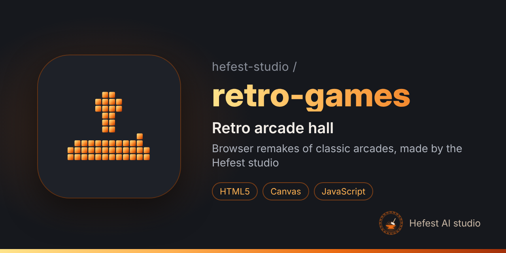

**English** | [Русский](README.ru.md)

<p align="center"></p>

[](https://arcade.hefest.ru)


[](https://hefest.ru)

# Retro Games

A catalog of **77 original browser games** — arcades and platformers by the Hefest studio in
the spirit of the 8- and 16-bit era, with one start page. The catalog switches between an
**8-bit retro style** and a **modern neon** one — just like the games themselves. Everything works
offline: plain HTML/CSS/JS, no build step, no CDN, no npm dependencies and no external assets. The
games share the **Hefest Arcade v2** engine (`_shared/engine.js`, copied into every game).

- **Live (Vercel):** <https://arcade.hefest.ru> · English catalog: <https://arcade.hefest.ru/en/>
- **GitHub:** <https://github.com/hefest-studio/retro-games> (public)
- **Roadmap:** [ROADMAP.md](ROADMAP.md)

## Games

Order as in the catalog (`assets/catalog/games.json`); names as in the English catalog.

| # | Game | Genre | Styles |
|---|---|---|---|
| 01 | [SEEDGLIDE — Hamster in a ball](hrum/) | Arcade | retro / modern |
| 02 | [RUSLO — Over the River](ruslo/) | Shoot'em-up | retro / modern |
| 03 | [GALLERYTRAIL — Colony in the tunnels](krot/) | Arcade | retro / modern |
| 04 | [GOLDFLUME — Gates and shafts](staratel/) | Puzzle | retro / modern |
| 05 | [PITPROP — Props and chain collapse](obval/) | Puzzle | retro / modern |
| 06 | [CASCADE — Puzzle](kaskad/) | Puzzle | retro / modern |
| 07 | [RUBEZH — Neon Dawn](rubezh/) | Run-and-gun | retro / modern |
| 08 | [PRORYV — Stormtrooper](proryv/) | Run-and-gun | retro / modern |
| 09 | [DEEPRISE — Robot TARAN-7](rubikon/) | Arcade | retro / modern |
| 10 | [VIHR — Above the Battlefield](vihr/) | Shoot'em-up | retro / modern |
| 11 | [NORTHERN SAGA — A Tale of Three](saga/) | Platformer | retro / modern |
| 12 | [NEON × YAROST — Neon Yarost](neon-yarost/) | Beat'em-up | retro / modern |
| 13 | [NORTHERN SAGA 2 — Northern Lights](saga-2/) | Platformer | retro / modern |
| 14 | [SLAGBREAK — Escape from Slag-9](bolt/) | Run-and-gun | retro / modern |
| 15 | [KOLOBOK — Adventure](kolobok/) | Puzzle | retro / modern |
| 16 | [PLASHCH — Night Avenger](plashch/) | Action platformer | retro / modern |
| 17 | [SPARKFENCE — A Light-beam Fence Against the Gloom](redut/) | Arcade | retro / modern |
| 18 | [TWINLEASH — Two on one rope](zvero-otryad/) | Puzzle | retro / modern |
| 19 | [ZVERO-OTRYAD 2 — New Levels](zvero-otryad-2/) | Platformer | retro / modern |
| 20 | [KINDLEBROOD — Fire Chain](roy/) | Shoot'em-up | retro / modern |
| 21 | [SLICEWARD — Field Capture](razrez/) | Arcade | retro / modern |
| 22 | [DRIFTSTAIR — Loose sand](podkop/) | Puzzle | retro / modern |
| 23 | [MASONRY — Break the Wall](kladka/) | Arcade | retro / modern |
| 24 | [SCRAPRAMPART — Scrolling Shooter](zaslon/) | Shoot'em-up | retro / modern |
| 25 | [FUSEWICK — Sapper's Maze](fitil/) | Arcade | retro / modern |
| 26 | [EMBERHOOP — Throw the Ember Hoop, Light the Dark](katakomby/) | Arcade | retro / modern |
| 27 | [BENCHSKID — Micro-car Racing](yuz/) | Racing | retro / modern |
| 28 | [GLASSGUST — Inflate, Pop, Gust Them into the Melt](puzyr/) | Platformer | retro / modern |
| 29 | [BEETLEFORD — Road and River Crossing](pereprava/) | Arcade | retro / modern |
| 30 | [ANVILWATCH — Rust Invasion](zastava/) | Shoot'em-up | retro / modern |
| 31 | [EMBERSKIM — Skim the Glowing Rock, Vent the Heat as Steam](sputnik/) | Shoot'em-up | retro / modern |
| 32 | [HAZEWING — Break the Enemy's Aim with a Smoke Screen](eskadrilya/) | Shoot'em-up | retro / modern |
| 33 | [BOILERRAID — Two-player Run-and-gun](nalyot/) | Run-and-gun | retro / modern |
| 34 | [LAMPDIVER — The Ancient Forge Mine](glub/) | Platformer | retro / modern |
| 35 | [ROPEWARD — Rope Maze](taynik/) | Platformer | retro / modern |
| 36 | [GEODELVE — Prospector in the Caves](zheoda/) | Platformer | retro / modern |
| 37 | [BELLOWKIN — An Apprentice with Bellows Rekindles the Forges](udalets/) | Platformer | retro / modern |
| 38 | [STOKELING — Stoker Robot in a Coal Mine](ugolyok/) | Platformer | retro / modern |
| 39 | [CLAPBOLT — Lightning first, thunder after](grom/) | Run-and-gun | retro / modern |
| 40 | [FORGEBAND — The Hefest War Band vs the Iron Horde](druzhina/) | Beat'em-up | retro / modern |
| 41 | [CHERTOG — Save the Master Before Dawn](chertog/) | Platformer | retro / modern |
| 42 | [BROADHAUL — A Tractor Towing Gun Wagons vs the Rust Artel](dozor/) | Shoot'em-up | retro / modern |
| 43 | [RIKOSHET — Anvil vs Walls of Ore](rikoshet/) | Arcade | retro / modern |
| 44 | [RIVETFALL — Bullet Hell Through a Rain of Rivets](liven/) | Shoot'em-up | retro / modern |
| 45 | [CLANGBACK — The Hammer That Sends It All Back](oruzheynik/) | Action platformer | retro / modern |
| 46 | [STEAMSCURRY — Courier Ferret vs the Rust Fox](shustrik/) | Platformer | retro / modern |
| 47 | [SKYHIRE — Scrolling Shooter with a Hangar](podryad/) | Shoot'em-up | retro / modern |
| 48 | [CINDER FLAIL — A chain ball vs the Rust Koschei](dospeh/) | Action platformer | retro / modern |
| 49 | [RIMETRAIL — Iskra and Burash the Arctic Fox vs the Great Cold](lednik/) | Platformer | retro / modern |
| 50 | [SMELTPAIR — Two-player Arena Shooter](gornilo/) | Shoot'em-up | retro / modern |
| 51 | [TICKFLIP — Flip the Phase of the Clockwork Plant](tsep/) | Action platformer | retro / modern |
| 52 | [DUSKHOOK — Acrobatics on Walls and Hooks](ten/) | Action platformer | retro / modern |
| 53 | [KEYWINDER — A Wind-Up Key, Winches and the Great Clockwork](skok/) | Platformer | retro / modern |
| 54 | [POLEMARK — Cartographer Yaroslava and her striped poles](posokh/) | Platformer | retro / modern |
| 55 | [SPOUTWOUND — Wind-up Kettle vs the Tea Set](chaynik/) | Platformer | retro / modern |
| 56 | [INKPUNCH — Printer vs Ink Blots in an Unfinished Book](list/) | Beat'em-up | retro / modern |
| 57 | [YARDRAMMER — Steam-car Combat Racing](taran/) | Racing | retro / modern |
| 58 | [HIVEWRENCH — Repair Squad vs the Rust Hive](vzvod/) | Arcade | retro / modern |
| 59 | [VALVEWRIGHTS — Two-player Steampunk Action with an AI Partner](paroviki/) | Shoot'em-up | retro / modern |
| 60 | [DECKSCOUR — Two-player Corridor Shooter](otsek/) | Shoot'em-up | retro / modern |
| 61 | [SPOOLSWING — Thread and pins](sosedi/) | Arcade | retro / modern |
| 62 | [SHARDSWAP — Throw the Shard, Take Its Place](oskolok/) | Action platformer | retro / modern |
| 63 | [OPERATSIYA — Turn-based Tactics for a Repair Crew](operatsiya/) | Tactics | retro / modern |
| 64 | [OWLSTEP — Night Raid on the Rust Arsenal](lazutchik/) | Action | retro / modern |
| 65 | [SBORKA — Build a Robot — Win Back the Factory Valley](sborka/) | Strategy | retro / modern |
| 66 | [HEARTHDEEP — Kindle the Five Sleeping Forges](podgorye/) | Action platformer | retro / modern |
| 67 | [MAYACHNITSA — Demo: Chapter 1 “The Dark Lighthouse”](kvest/) | Adventure | retro / modern |
| 68 | [CINDERFRONT — Fire wall and top-down action](desant/) | Run-and-gun | retro / modern |
| 69 | [BUMPERWRIGHT — Workshop Pinball Defense](otboynik/) | Pinball | retro / modern |
| 70 | [PRIISK — Real-time Strategy · Demo](priisk/) | RTS | retro / modern |
| 71 | [PORUBEZHYE — Strategy with Asymmetric Factions · Demo](porubezhye/) | RTS | retro / modern |
| 72 | [KETTLEWAKE — A Workshop Hut on Wheels — and on Water](volok/) | Adventure | retro / modern |
| 73 | [WINDSHANKS — A Herd of Stilt-Legged Woollies Across the Northern Passes](otgon/) | Adventure | retro / modern |
| 74 | [GALLWICK — A Scribe’s Apprentice Within the Manuscript](poluustav/) | Puzzle Platformer | retro / modern |
| 75 | [BRASSHUSH — An Apprentice Wakes the Wind-up Dolls of the Clockmakers’ Town](kamerton/) | Puzzle | retro / modern |
| 76 | [POISEWRIGHT — Balance the Pans](koromyslo/) | Puzzle | retro / modern |
| 77 | [CINDER COURT — Dodgeball in the workshop yards](kaleny/) | Sports | retro / modern |

Descriptions, controls and features of each game are in its own `README.md` (in Russian).

## Quick start

```bash
# from the repository root
python3 -m http.server 8080
# catalog:  http://127.0.0.1:8080/
# a game:   http://127.0.0.1:8080/hrum/
```

You can also just double-click `index.html`: in that mode the catalog links to
`<slug>/index.html`, and the games open from `file://` without a server.
The catalog and the games are built to work offline.

## Catalog

- Cards come from `assets/catalog/games.json`: preview, title, subtitle, year, genre,
  developer, short description; Russian and English fields.
- Two full styles: **RETRO** (default: CRT scanlines, pixel frames, amber-and-neon palette,
  stepped animations) and **MODERN** (gradients, glow, rounded corners, smooth transitions).
- Switch with the header button or the `G` key; the choice is saved in `localStorage`
  (`retro-games-catalog-theme`) and applied before the first paint.
- Switching the theme swaps card previews to the matching game style (the other theme
  is preloaded, so there is no flicker).
- Genre filters, search by title and tags, a counter, "Random game", paging,
  keyboard navigation, `prefers-reduced-motion`.
- No external requests: system fonts, inline SVG / data-URI icons, local `webp` previews.

## Layout

```
.
├── index.html                    # start page and catalog (retro / modern style)
├── en/                           # English catalog
├── assets/catalog/               # catalog CSS/JS, games.json and previews (webp)
├── _shared/                      # Hefest Arcade v2 engine (engine.js), shared tests
├── hrum/ ruslo/ krot/ …          # every game is a self-contained folder:
│                                 #   index.html (engine v2) + js/ css/ tests/, sometimes legacy.html
├── build.sh                      # copies _shared/engine.js into the games
├── tools/                        # development only (not deployed): smoke, thumbs, qa
├── docs/DEPLOY.md                # deployment guide (in Russian)
├── vercel.json                   # static deployment config
└── .vercelignore                 # what Vercel does not need
```

## How it works

- **No build.** The catalog and the games are static files. Vercel serves them as is
  (`framework: null`, `trailingSlash: true`).
- **Styles.** The catalog keeps the choice in `localStorage`; every game has its own two
  styles and its own switch button and key.
- **Offline.** Game graphics are drawn in code on Canvas, sound is synthesized with WebAudio,
  catalog previews are local `webp` files.
- **Languages.** Games read `?lang=en` / `?lang=ru`: opened from the English catalog they start in English.
- **Links.** The catalog links to games with relative paths and a trailing slash (`hrum/`),
  so it works the same locally and on Vercel; on `file://` it links to `<slug>/index.html`
  so the browser does not show a folder listing.
- **Way back.** Every game page has a "← Catalog" badge that returns to the start page and
  does not get in the way of the controls. It is adaptive: it checks interactive elements and
  picks a free spot (usually middle left; on narrow screens a free corner), so it never covers
  menus or the HUD. In `index.html` the v2 engine provides it, in old `legacy.html` pages a block
  from `tools/add-catalog-back.mjs` (idempotent); on `file://` it leads to `../index.html`.

## Deploy

Details — [docs/DEPLOY.md](docs/DEPLOY.md). In short:

```bash
npx vercel link      # link the folder to the retro-games project
npx vercel --prod    # deploy the static files from the root
```

The Vercel project is linked to the GitHub repository (`Production Branch = main`):
a push to `main` deploys to <https://arcade.hefest.ru>. Manual CLI deploys work alongside.

## Rights

All games are **original works of the Hefest studio**: their own names, heroes, levels, graphics,
music and sound (all generated in code). Genre mechanics (maze, scrolling shooter, run-and-gun,
falling blocks and so on) are common; there are no third-party titles, characters, logos or
assets in the repository.

## QA (visual audits)

The audits in `tools/qa/*.mjs` run a headless browser, so they need Chrome:
```bash
export CHROME_BIN=/path/to/chrome   # or an installed Google Chrome / Chromium
node tools/qa/audit-catalog.mjs     # catalog
node tools/qa/audit-games.mjs       # games (list from games.json)
node tools/qa/check-file-proto.mjs  # file:// mode (double-click)
```
Quick checks without Chrome: `node tools/smoke.mjs` (JS syntax of all games) and the game tests
`node <slug>/tests/engine.test.mjs` (Playwright).

## QA run

A regular check of the whole catalog in one command (needs Playwright, like the game tests):
```bash
node tools/qa-run.mjs                       # everything: static + tests + catalog + browser + touch
node tools/qa-run.mjs --only kaskad,bolt    # selected games
node tools/qa-run.mjs --skip tests          # without game tests
```
The banned-words check (Yandex 1.15 / 8.2.2) treats "demo" and "full version" as yellow in games with `js/edition.js`: their public edition is a demo by design, and the platform edition is built by `arcade-full`, which swaps those strings and runs the same check.
It writes `qa-report/<date>.md` (summary, red, yellow, slowest tests, per-game table) and `.json`
(all measurements); the folder is in `.gitignore`. Exit code 1 means there are red items.
The full list of checks and options is in the [Russian README](README.ru.md#qa-прогон).

---
*A work of the Hefest studio · [works.hefest.ru](https://works.hefest.ru)*
