# CONTRA: НЕОНОВЫЙ РАССВЕТ

Фанатский браузерный ремейк **Contra** — классического run-and-gun Konami. Один
самодостаточный HTML-файл: открывается двойным щелчком, работает офлайн, без CDN,
сборщиков и внешних ассетов. Вся графика, музыка и звуки сгенерированы кодом.

**Два этапа · два босса · четыре оружия · два визуальных стиля · русский и английский.**

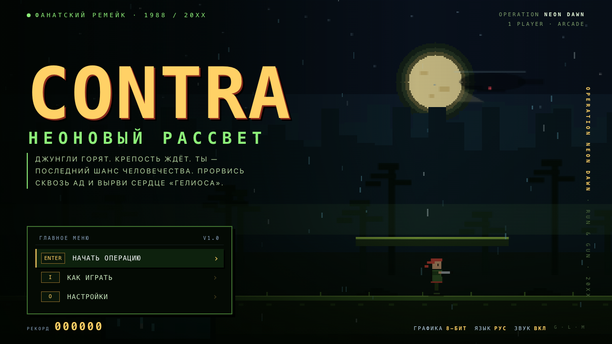

## Запуск

```bash
open contra/index.html        # macOS
# или просто откройте contra/index.html в Chrome / Safari / Firefox
```

Сборка не нужна: готовый файл — `contra/index.html` (≈282 КБ). Для игры нужны
клавиатура, геймпад или тач-экран. Рекомендуется горизонтальная ориентация; на
телефоне в портрете появится подсказка «поверни устройство».

По умолчанию включены **8-битная графика**, **русский язык** и **звук**. Выбор
графики/языка/звука сохраняется в `localStorage`.

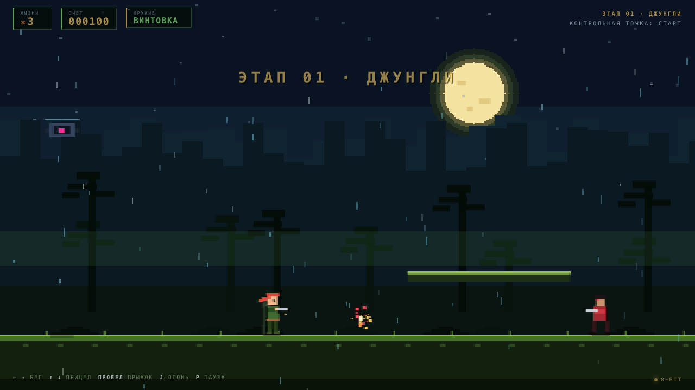

## Что внутри

* **2 этапа** — «Джунгли» и «Крепость «Гелиос»» — с разными фонами, hazards и боссами.
* **Классическая механика Contra**: бег, прыжок с переменной высотой, спрыгивание
  с платформ, стрельба в восьми направлениях, лежачая стойка, смерть от одного
  попадания, 3 жизни, чекпоинты и продолжение со сцены.
* **Оружие**: винтовка (R), пулемёт (M), дробовик на 5 пуль (S), пробивающий лазер (L)
  и щит на 3 заряда (B). Оружие выпадает из летающих капсул и лежит на уровнях.
* **Враги**: стрелки, бегуны, турели и дроны. У боссов свои фазы и рисунок атаки.
* **Два полноценных рендерера** (по умолчанию — 8-BIT):
  * **NEON / 20XX** — векторные спрайты, градиенты, bloom, параллакс, дождь,
    свет боссов, стеклянный HUD;
  * **8-BIT / 1988** — честные 480×270, ограниченная палитра, пиксельные спрайты,
    лунный свет, CRT-строки.
  Переключение — `G` в любой момент, в том числе на титуле и в паузе.
* **Оригинальный чиптюн-саундтрек** на WebAudio: 6 тем (титул, два этапа, босс,
  победа, game over), 4 канала, живой секвенсор, 16 SFX. Никаких сэмплов и файлов.
  Музыка стартует после первого нажатия клавиши — этого требуют браузеры.
* **Локализация**: русский (по умолчанию) и английский, `L` — переключение.
* **Секрет**: код Конами `↑ ↑ ↓ ↓ ← → ← → B A` даёт +30 жизней (один раз за забег;
  подсказка спрятана в «Как играть»).
* **Геймпад** (Gamepad API) и **тач-кнопки** на мобильных.
* **Чекпоинты и рекорд**; +1 жизнь за каждые 20 000 очков.

## Управление

| Клавиши | Действие |
|---|---|
| `←` `→` / `A` `D` | бег |
| `↑` `↓` / `W` `S` | прицел вверх/вниз и по диагонали; `↓` на земле — лечь |
| `Пробел` / `Z` / `K` | прыжок (держите дольше — выше; `↓` + прыжок — спрыгнуть) |
| `J` / `X` / `Ctrl` | огонь (удерживайте для автоматической стрельбы) |
| `P` / `Esc` | пауза |
| `Enter` | подтвердить / начать |
| `G` | графика: NEON ↔ 8-BIT |
| `L` | язык: русский ↔ английский |
| `M` | звук вкл/выкл |

На тач-экране: крестовина слева, `A` — прыжок, `B` — огонь. В меню работают
стрелки, `Enter` и клики/касания. Геймпад: стик/крестовина, `A` — прыжок,
`X`/`B` — огонь, `Select` — подтвердить, `Start` — пауза.

## Два визуальных стиля

### NEON — современный режим

Логическое поле 480×270 рендерится в буфер 1440×810 (3×) с мягкими формами,
аддитивными свечениями, параллаксом из пяти слоёв и погодой. Спрайты героя и
врагов — векторные, с анимацией конечностей и неоновой подсветкой. Боссы —
отдельные многослойные конструкции со светом, роторами и фазовыми атаками.

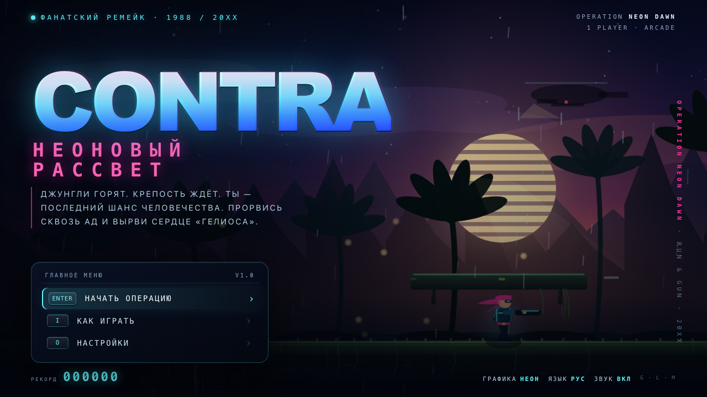
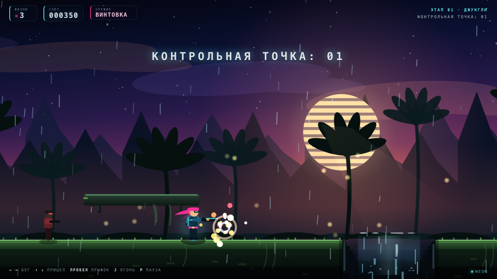

### 8-BIT — по умолчанию (версия 1988 года)

Рендер в нативные 480×270 с ближайшим масштабированием, ограниченная палитра,
пиксельные спрайты героя и врагов, лестничные горы, луна с гало, дизеринг,
CRT-скан-линии и зелёно-янтарный интерфейс. Другой шрифт, другие панели, другая
подача — но тот же геймплей.

## Музыка

Полностью оригинальная 8-битная музыка, синтезируемая в браузере: два импульсных
канала, треугольный бас, шумовые барабаны и лёгкое эхо. Темы:

| Трек | Настроение |
|---|---|
| `title` | тёмный synthwave-чиптюн, 104 BPM, A minor |
| `stage1` | героический run-and-gun, 150 BPM, A minor |
| `stage2` | индустриальная крепость, 136 BPM, D Phrygian |
| `boss` | тревожный босс-темп, 168 BPM, E minor |
| `victory` / `gameover` | короткие джинглы |

Планировщик работает по lookahead, плавно кроссфейдит треки, глушится по `M` и
переживает скрытие вкладки. Подробности — в [docs/AUDIO.md](docs/AUDIO.md).

## Скриншоты

| | |
|---|---|
| 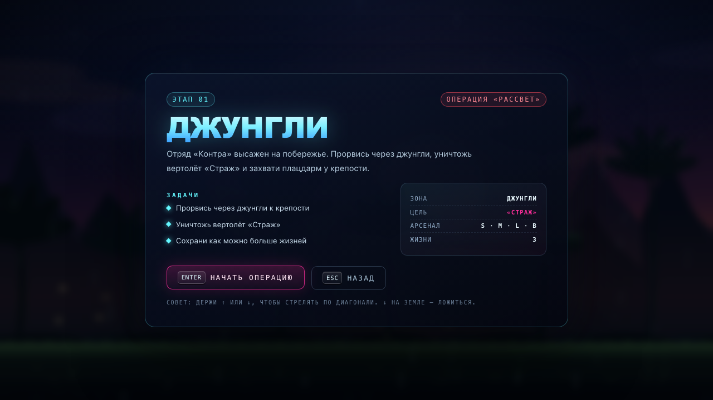 | 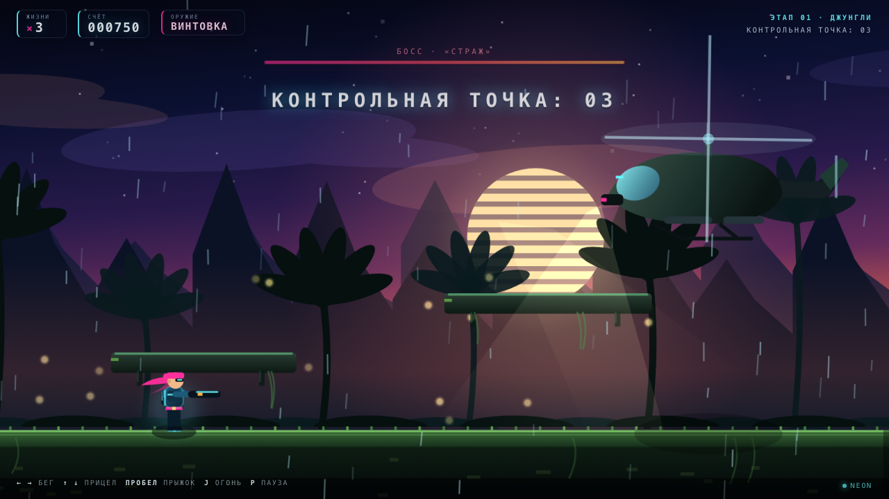 |
| 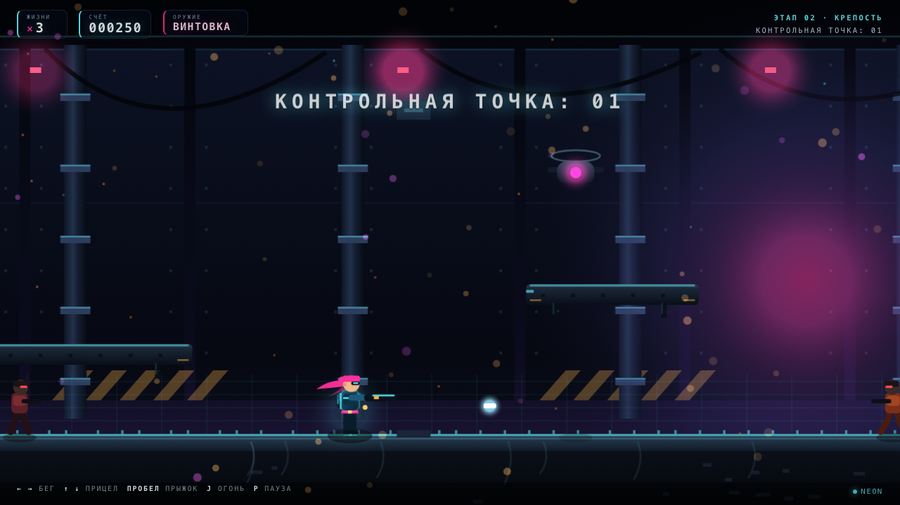 | 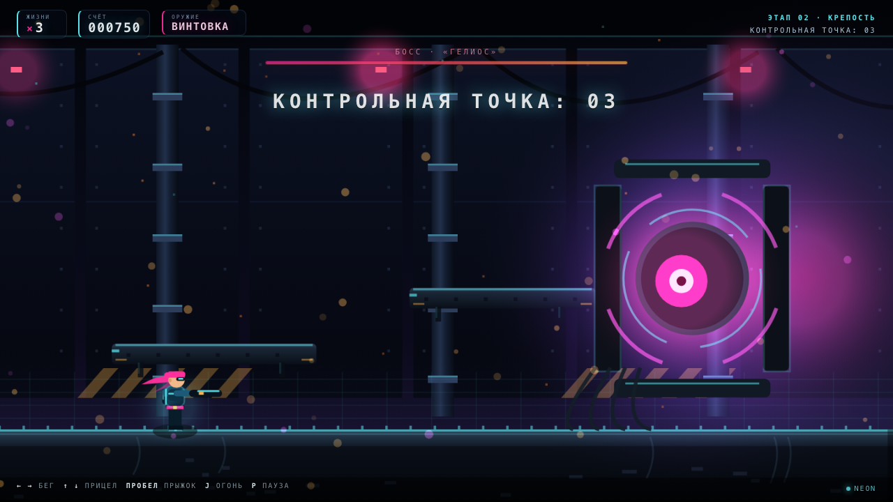 |
| 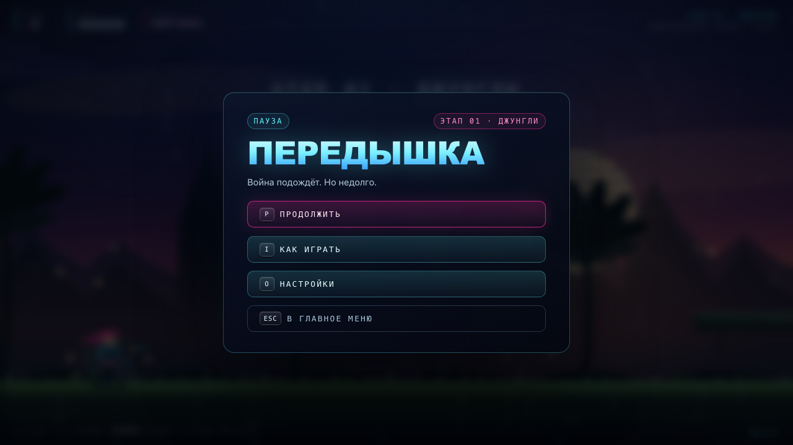 | 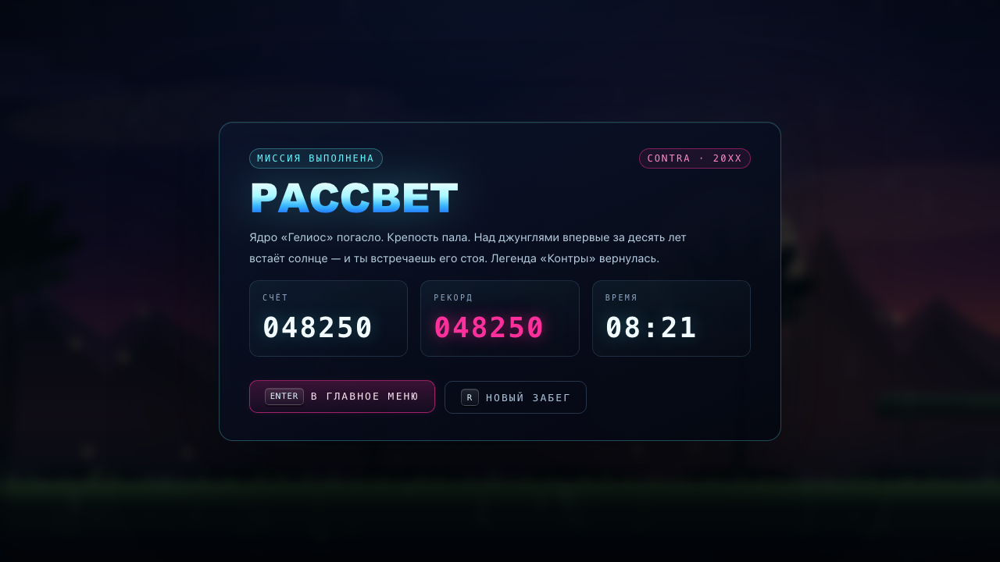 |
| 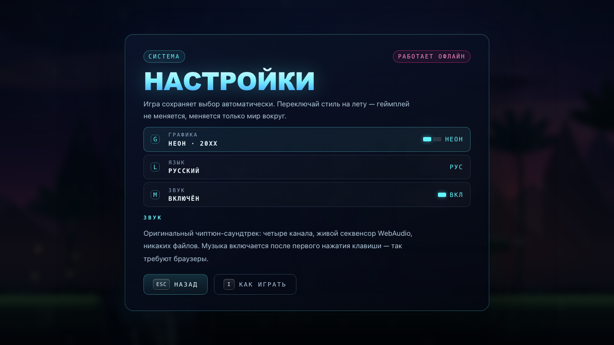 | 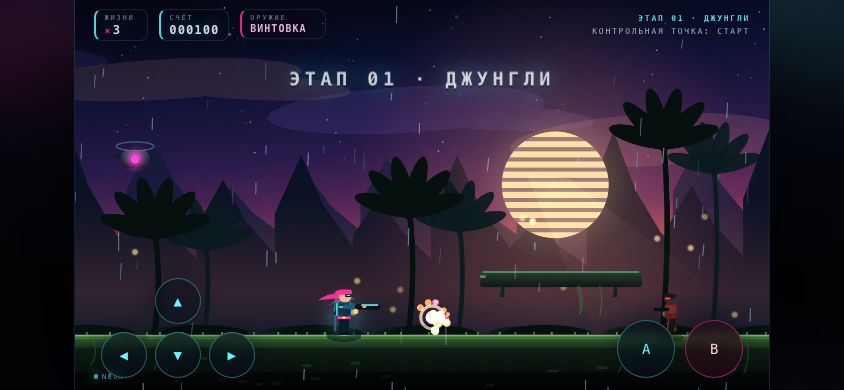 |

## Как играть

* Один контакт с пулей, телом врага, лазером или падение в пропасть — потеря жизни.
  Щит поглощает три попадания.
* Оружие меняется мгновенно; `S` — лучший выбор против толпы, `L` пробивает врагов
  насквозь, `M` — максимальный DPS, `B` — страховка.
* Летающие капсулы сбиваются выстрелом: из них падает оружие. Не пропускайте их.
* Чекпоинты отмечены флагом; после смерти вы возвращаетесь к последнему.
* У боссов есть окно уязвимости и телеграфы атак: учите ритм.
* Рекорд и настройки сохраняются автоматически.

## Технические заметки

* Один HTML-файл, ноль зависимостей, ноль сетевых запросов, работает с `file://`.
* Логическое разрешение 480×270; NEON — 3× буфер, 8-BIT — 1× + nearest-neighbor.
* Спрайты, фоны, частицы и UI нарисованы кодом; шрифты — системные.
* Музыка и SFX — WebAudio без сэмплов.
* Сборка: `python3 tools/build.py` склеивает `src/shell.html` + `src/audio.js` +
  `src/game.js` в `index.html` и проверяет `node --check`, маркеры и отсутствие
  внешних ссылок.
* Автотесты: `contra/index.html#test` — **40/40 PASS** (данные уровней, i18n,
  физика, оружие, щит, смерть/респавн, чекпоинт, боссы, переходы этапов, лазер,
  Konami, оба рендерера, HUD). Полный отчёт — [reports/qa.md](reports/qa.md).
* Отладочные URL (см. `__CONTRA`): `#shot=title|brief|play|boss|over|clear|win|pause|howto|settings`
  + `stage=1|2`, `gfx=modern|retro`, `lang=ru|en`, `x=...`, `fire=1`, `freeze=1`,
  `touch=1`, `lasers=on`, `dump=1`.
* Публичный отладочный API: `window.__CONTRA.state()`, `.start(stage)`, `.warp(x)`,
  `.spawnBoss()`, `.damageBoss(n)`, `.tick(sec)`, `.setGfx()`, `.setLang()`,
  `.selfTest()`.
* `node tools/shots.mjs` — пересобрать скриншоты в `screenshots/`;
  `node tools/audio-smoke.mjs` — smoke-тест аудио; `node tools/cdp.mjs` — CDP-харнесс.

## Об оригинале

**Contra** — аркадный run-and-gun Konami (1987, аркада; 1988, NES). Оригинальная
игра, название и вселенная принадлежат Konami. Это неофициальный фанатский
проект: здесь нет оригинальных спрайтов, карт, музыки или других ассетов — вся
графика, музыка и код созданы с нуля. Проект не связан с Konami и не предназначен
для коммерческого использования.

Порт делался как дань уважения эпохе NES: быстрый бег, восемь направлений огня,
one-hit death, кричащие боссы и чиптюн, который застревает в голове.
