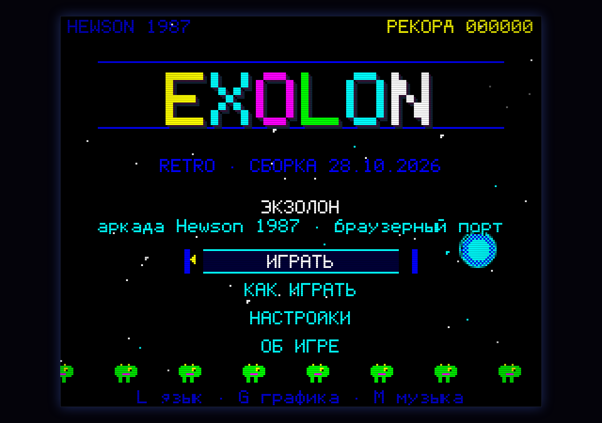
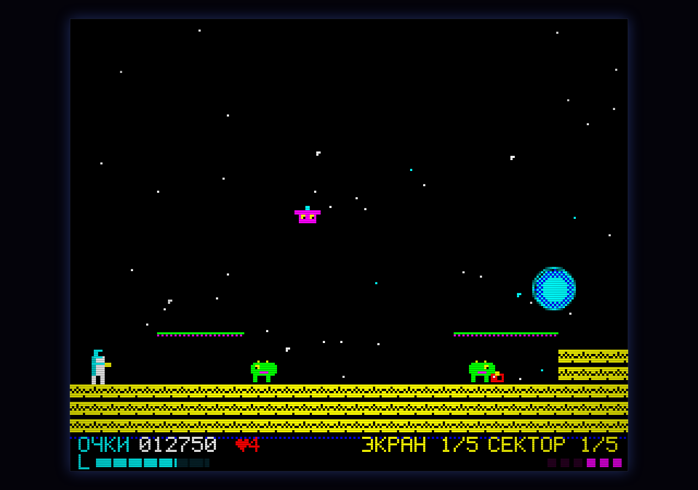
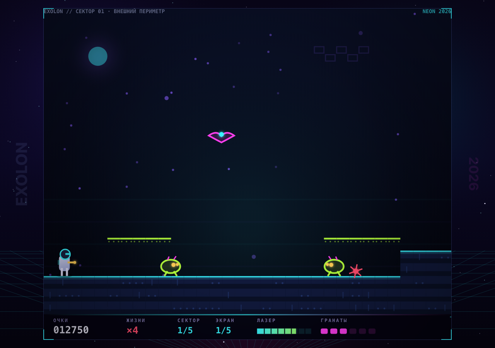
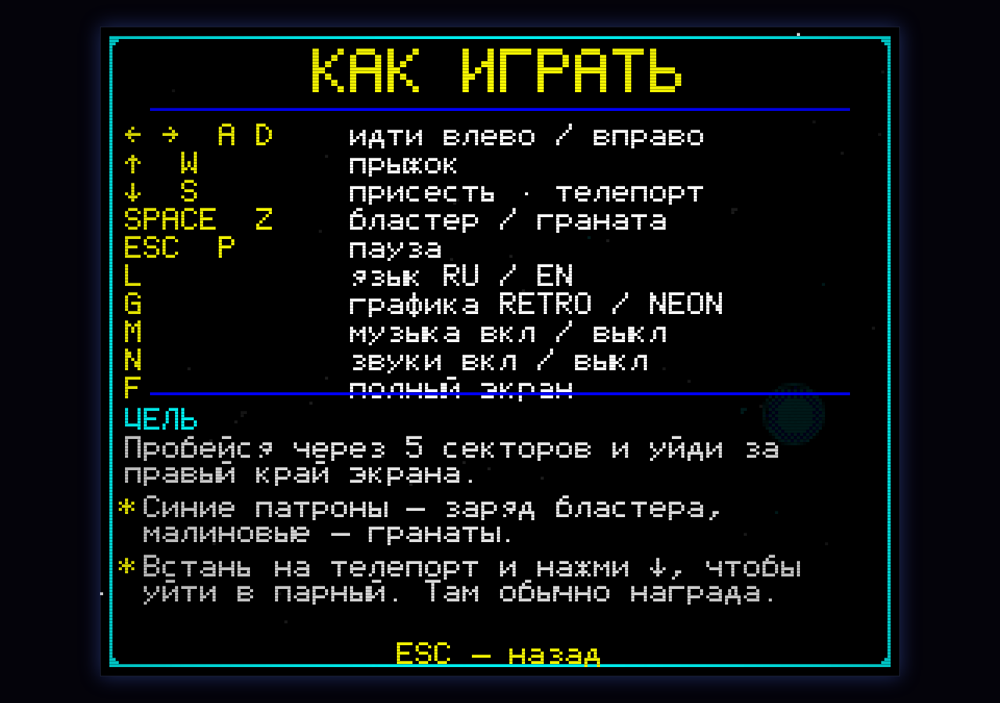
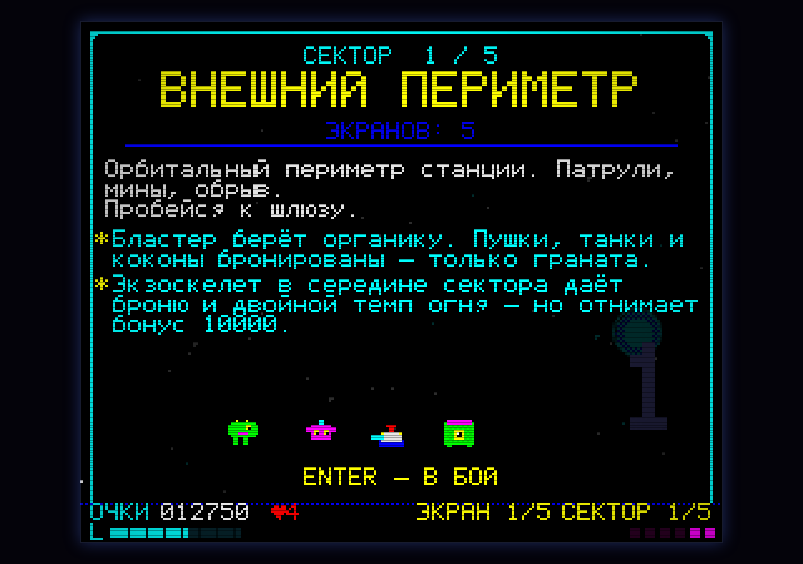
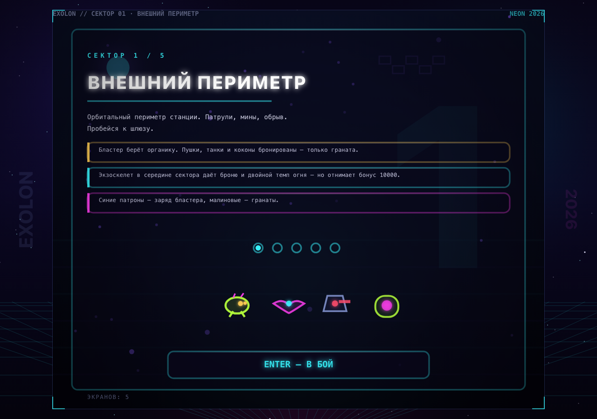
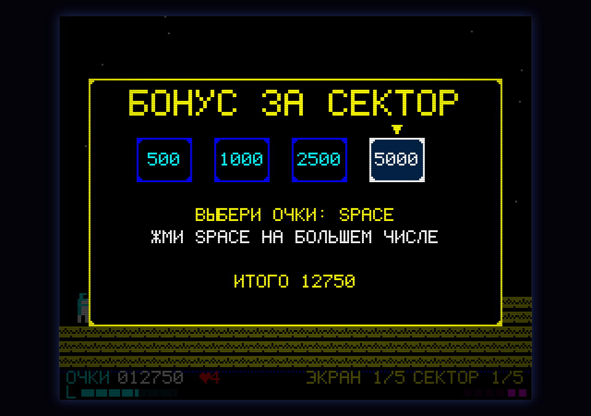
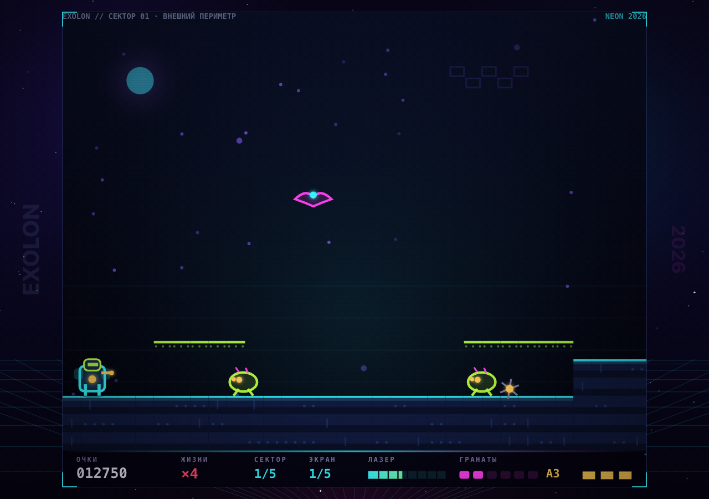
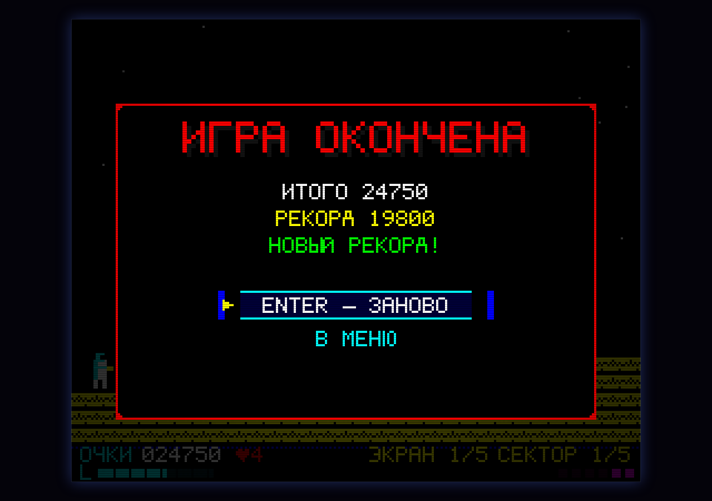
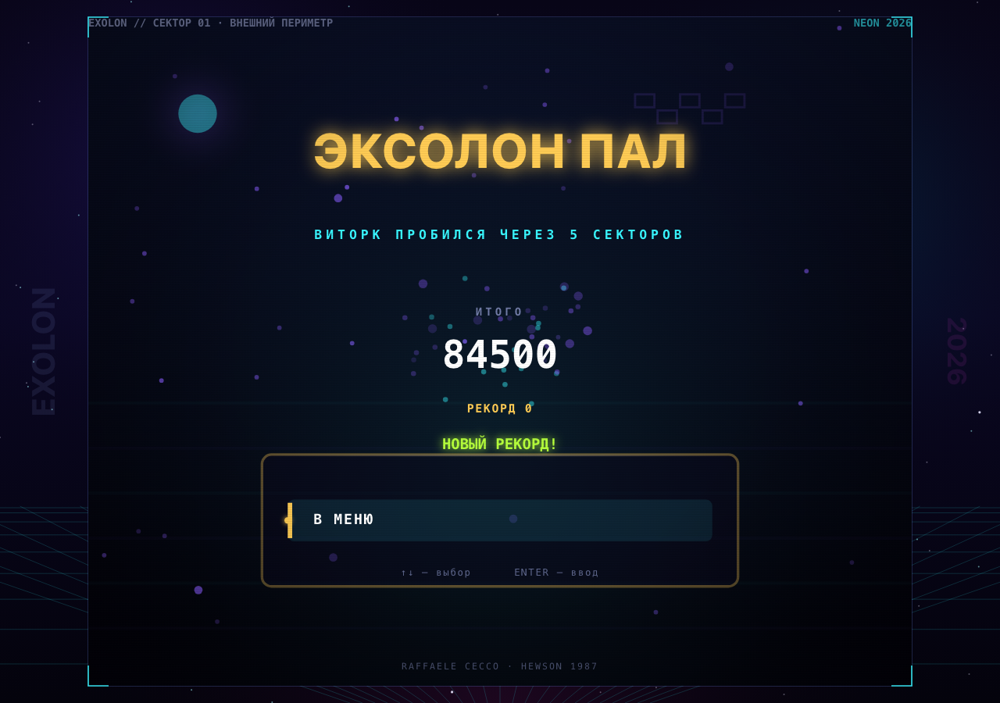

# EXOLON · HTML5

Браузерный ремейк аркады **Exolon** (Hewson, 1987, Raffaele Cecco) — **один HTML-файл**,
без зависимостей, сборки и интернета. Две графики: аутентичный **RETRO ZX** и неоновый
**NEON 2026**. Оригинальная 8-битная музыка на WebAudio. Русский интерфейс по умолчанию,
английский — по клавише.



## Запуск

Откройте `exolon/index.html` двойным щелчком (Chrome, Safari, Firefox, Edge — любой
современный браузер). Сервер и интернет не нужны. Нужна клавиатура; меню можно
тыкать мышью.

```bash
open exolon/index.html      # macOS
```

## Управление

| Клавиши | Действие |
|---|---|
| `←` `→` / `A` `D` | идти влево / вправо |
| `↑` / `W` | прыжок |
| `↓` / `S` | присесть · войти в телепорт |
| `Space` / `Z` | огонь: **клик** — бластер, **удержание** — граната |
| `Esc` / `P` | пауза и меню |
| `Enter` | подтвердить, старт, брифинг |
| `L` | язык интерфейса RU / EN |
| `G` | графика RETRO / NEON |
| `M` | музыка вкл/выкл |
| `N` | звуковые эффекты вкл/выкл |
| `F` | полный экран |
| `R` | заново с экрана |

Язык, музыка, звуки, CRT-эффект и рекорд запоминаются в `localStorage`. Версия сборки
видна на титульном экране (`RETRO · СБОРКА 28.10.2026`) — по ней легко проверить, что
открыт свежий файл.
Графика по умолчанию — RETRO (выбор живёт до перезагрузки страницы).

## Две графики

Переключаются на лету клавишей `G` (или в «Настройках»).
**По умолчанию всегда включается RETRO** — как в 1987-м; NEON доступен в любой момент,
но выбор не запоминается: после перезапуска игра снова откроется в ZX-стиле.

### RETRO · ZX 1987

256×192 пикселей, поле 32×24 тайла, полоса HUD 16 px, палитра ZX Spectrum, собственный
битмап-шрифт 6×8 с кириллицей, скан-линии, фосфорное послесвечение и «атрибутная»
фактура тайлов — как на настоящем Spectrum. Пиксели масштабируются целым числом.



### NEON · 2026

Тот же мир и та же логика, но векторная неоновая графика: свечение, параллакс, частицы,
аддитивные снаряды, стеклянный HUD, современная типографика, хроматическая аберрация
и боковые рейлы с управлением на широких экранах. Разрешение — любое, без потери чёткости.



## Музыка и звук

Всё синтезируется кодом (WebAudio), ни одного внешнего файла. 4 канала, как на NES/ZX:
две импульсные волны, треугольный бас и шумовые ударные; секвенсор с lookahead-планированием,
бесшовный луп, вибрато, портаменто, глиссандо, кроссфейд между треками.

| Трек | Где играет |
|---|---|
| `title` — 132 BPM, ля минор, 16 тактов | титульный экран |
| `game` — 150 BPM, ля минор, 32 такта, A–B–A'–C | боевые сектора |
| `exo` — 156 BPM | пока надет экзоскелет |
| `final` — 160 BPM, ре минор | финальный сектор |
| `clear` / `gameover` / `win` | джинглы |

Плюс 21 звуковой эффект (бластер, граната, взрывы, телепорт, подбор патронов, молот,
ракета, смерть, меню…). `M` — музыка, `N` — эффекты, `Esc` приглушает музыку.
Подробности: [docs/MUSIC.md](docs/MUSIC.md).

## Русский язык

Интерфейс, меню, брифинги, подсказки и названия секторов — на русском (`L` — переключение
на английский и обратно). Шрифт с полной кириллицей нарисован пиксельно, поэтому текст
выглядит родным и в RETRO, и в NEON.



## Как играть

Вы — штурмовик **Виторк**. Нужно пройти **5 секторов** (периметр → пещеры → реактор →
улей → ядро), по **5 экранов** в каждом: уйти за правый край экрана и выжить.

* **Бластер** берёт органику. Пушки, танки, коконы и молоты бронированы — **только граната**.
* **Граната** летит по дуге, рвёт броню и толщу камня (разрушаемые блоки `%` открывают секреты).
* **Экзоскелет** — капсула в середине сектора: 3 удара брони и двойной темп огня, но в конце
  сектора вы теряете бонус 10000.
* **Телепорты** — встань и нажми `↓`: пара ведёт в тайник с наградой.
* **Статуи-пушки** — войди в них, чтобы получить 2000/3000 очков.
* **Патроны** — синие пополняют бластер, малиновые дают гранаты.
* В конце сектора — **выбор очков**: стрелка быстро перебирает числа, нажмите `Space` на большем.
* Бонус за сектор: жизни × 1000, +10000 без экзоскелета, дополнительная жизнь.
* Виторк гибнет от одного попадания. 5 жизней на старте, максимум 9.

Счёт и правила взяты из оригинального вкладыша Hewson: граната по препятствию — 150,
крупный пришелец — 150, мелкий — 50, снаряд — 50, статуи — 2000/3000, модуль наведения — 1000.
Подробнее об оригинале и отступлениях: [docs/ORIGINAL.md](docs/ORIGINAL.md).

## Скриншоты

| RETRO | NEON |
|---|---|
|  |  |
|  |  |
|  |  |

## Технические заметки

* Один файл `exolon/index.html` (~290 KB) — весь HTML, CSS и JS. Никаких библиотек,
  внешних шрифтов и картинок; графика и звук генерируются в рантайме.
* Мир — 256×208 логических единиц (поле 32×24 тайла по 8 px + HUD 16 px). Оба рендерера
  рисуют одни и те же координаты; RETRO — в offscreen 256×208 с целочисленным апскейлом,
  NEON — векторно при любом размере окна.
* Игра: фиксированный шаг 60 Гц, AABB-коллизии с тайлами, 25 экранов данных в ASCII-арте,
  конечный автомат состояний (титул, брифинг, игра, смерть, бонус, победа…).
* Отладка: `#test` — 35 встроенных проверок (результат в заголовке вкладки),
  `#shot=title|play|exo|briefing|bonus|paused|settings|help|about|levelclear|gameover|win`
  плюс `&gfx=modern&lang=en&level=3&screen=2`, `#nosound`, `#crt=off`.

### Сборка из исходников

```bash
node exolon/tools/build.mjs                 # src/* -> exolon/index.html
node exolon/tools/validate-levels.mjs       # проверка 25 экранов
node exolon/tools/probe.mjs "exolon/index.html#test" /tmp/t.png --eval=document.title
```

Исходники разбиты по модулям (порядок подключения фиксирован в
[docs/CONTRACT.md](docs/CONTRACT.md)):

| Файл | Что внутри |
|---|---|
| `src/font.js` | пиксельный шрифт 6×8, ASCII + кириллица + символы (188 глифов) |
| `src/i18n.js` | все строки RU/EN |
| `src/audio.js` | WebAudio-движок: 7 треков, 21 SFX, секвенсор |
| `src/levels.js` | 5 секторов × 5 экранов в ASCII-арте |
| `src/game.js` | физика, враги, оружие, счёт, состояния, ввод, тесты |
| `src/render-retro.js` | RETRO-рендерер (ZX Spectrum) |
| `src/render-modern.js` | NEON-рендерер (векторы, свечение, параллакс) |
| `src/main.js` | масштабирование, цикл, ввод, звук, отладочные режимы |
| `src/template.html`, `src/style.css` | оболочка страницы |

### Проверки

* `#test` — **35/35 PASS** (физика, враги, бонусы, телепорт, переходы, локализация, шрифт, аудио).
* `tools/validate-levels.mjs` — 0 ошибок: каждая площадка/выход достижимы.
* Автоплеер `tools/autoplay.eval.js` проходит все **25/25** экранов на реальном движке.
* `node exolon/tools/validate-music.mjs` — структура треков, гармония, 21 SFX.
* QA-отчёт: [reports/qa.md](reports/qa.md).

## Оригинал

**Exolon** (1987) — Raffaele Cecco, Hewson Consultants: ZX Spectrum, Amstrad CPC, C64,
позже Amiga, Atari ST и Enterprise 128. Награды Crash Smash, SU Classic, YS Megagame.
Карта оригинала, инструкция и факты — в [docs/ORIGINAL.md](docs/ORIGINAL.md) и
`docs/reference/`.

Это неофициальный фанатский ремейк, не связанный с Hewson Consultants. Оригинальные
название и вселенная принадлежат правообладателям; никакие ассеты оригинала не
используются, вся графика и музыка написаны заново в коде.
