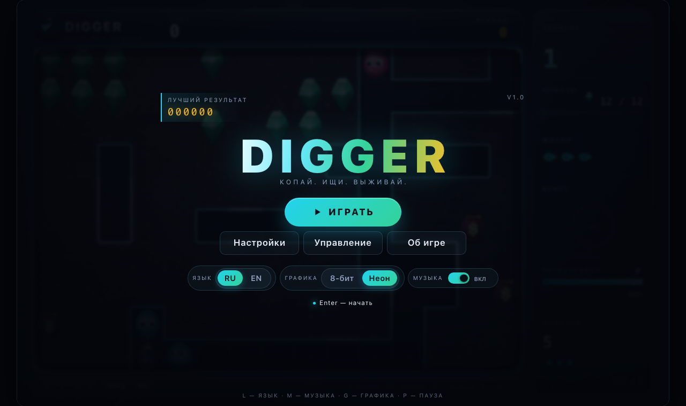
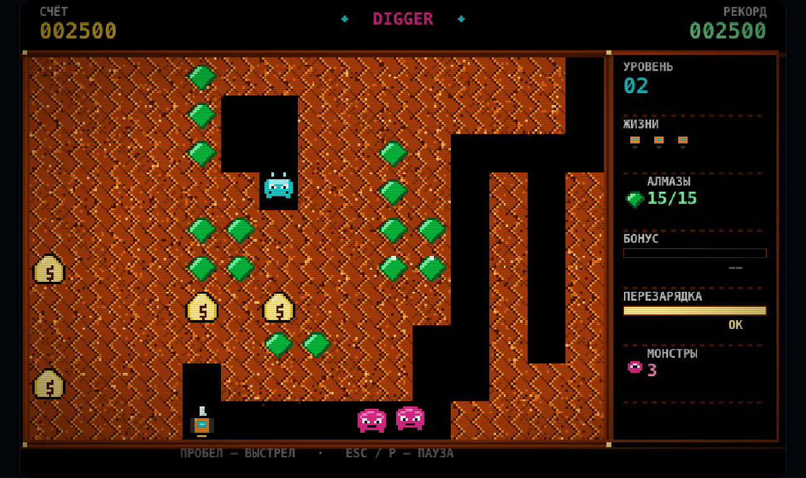
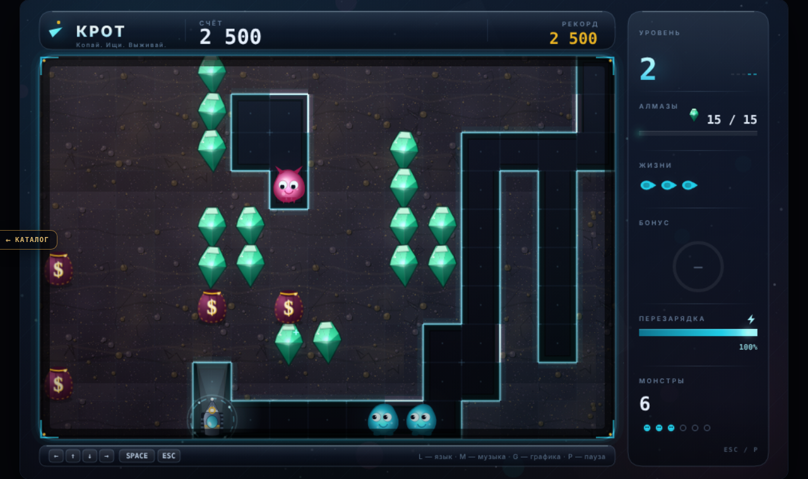
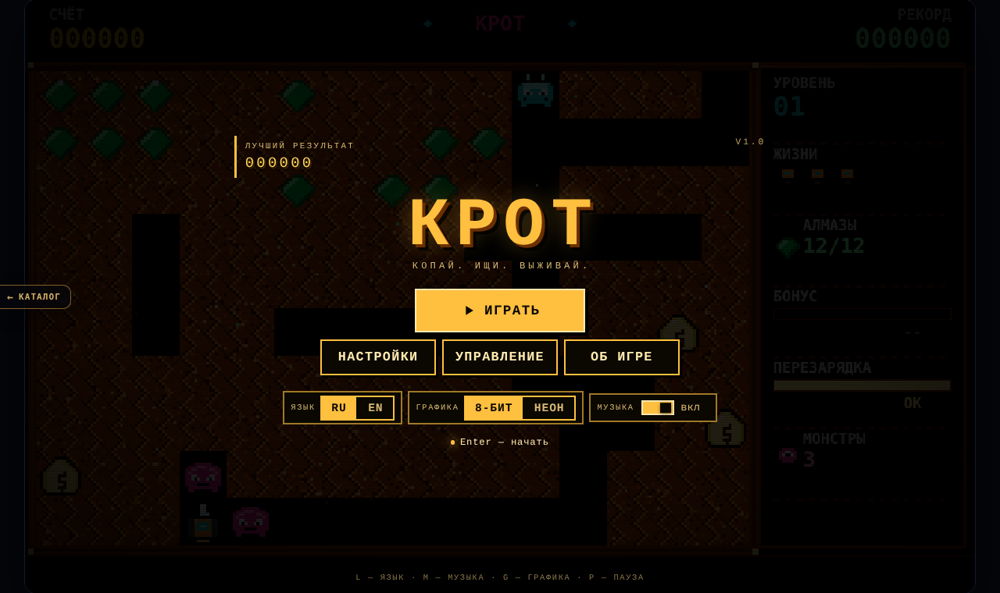
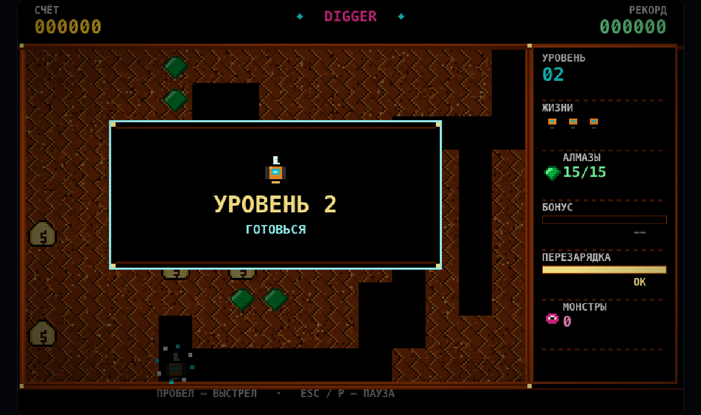
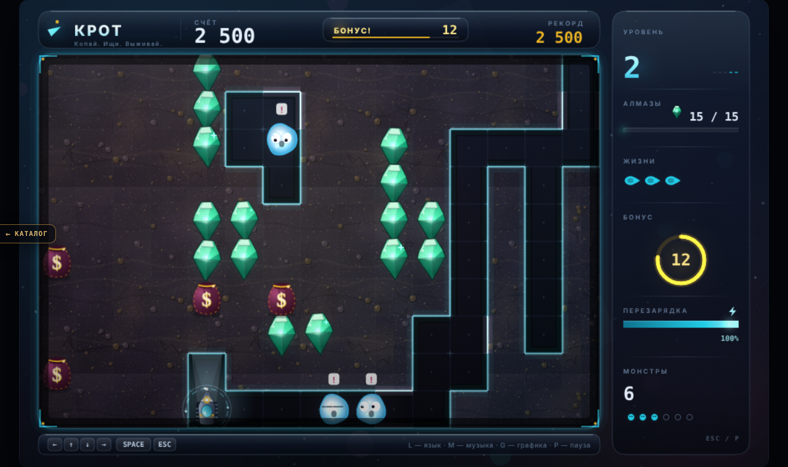
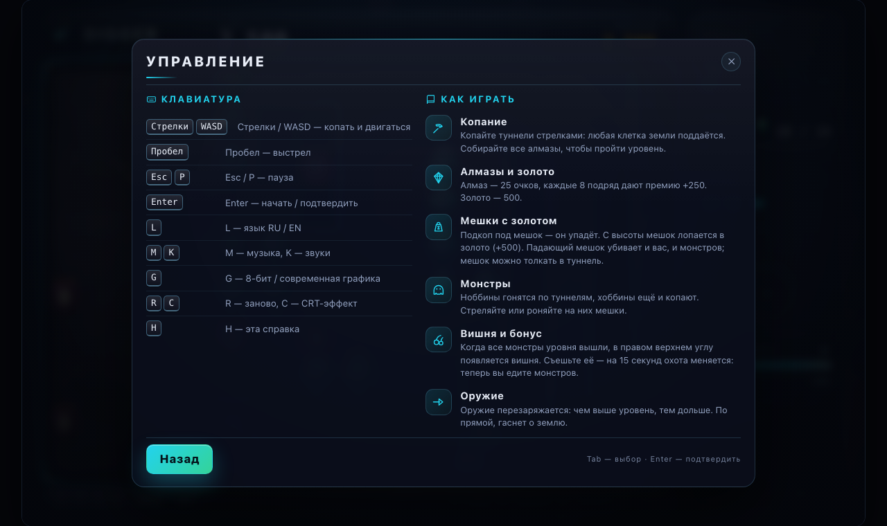
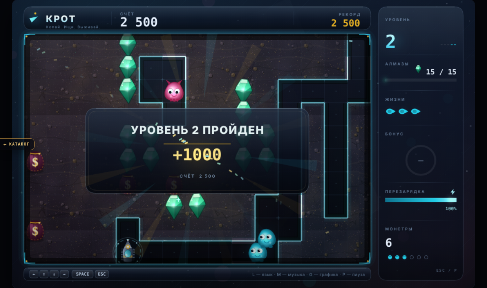
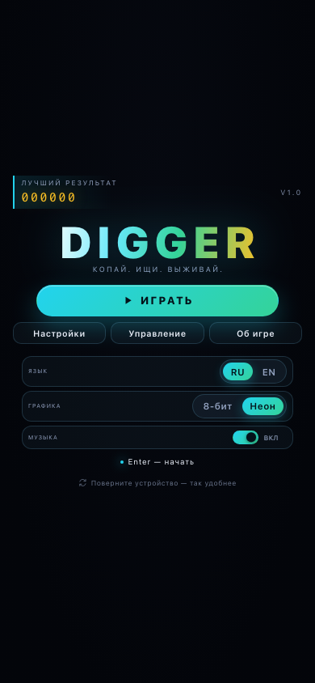
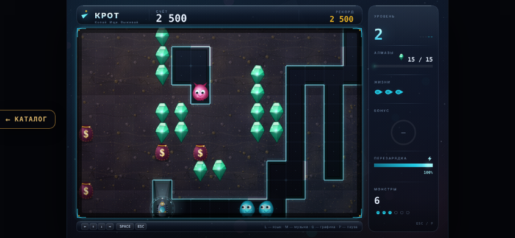

# КРОТ · HTML5

> **v2 (фреймворк Гефест Arcade).** `index.html` — оболочка на движке `engine.js` (копия `_shared/engine.js`):
> меню/пауза (P/Esc)/темы retro↔modern (T, старая G тоже работает)/RU-EN (L)/звук (M)/рекорд `arcade.best.krot`
> (старый `digger.hi.v1` переносится при первом запуске), музыка — `js/music.js`. Логика `js/game.js`,
> рендеры `js/classic.js` (retro) и `js/modern.js`, SFX `js/audio.js` — родные, без изменений.
> Прежняя страница с DOM-меню — `legacy.html` (на неё же смотрят `tools/e2e.mjs`, `tools/qa.mjs`).
> Тесты: `node krot/tests/engine.test.mjs`.

Оригинальная игра студии «Гефест» **КРОТ** — о подземном буре на чистом
HTML/CSS/JavaScript. Копайте туннели в подземном лабиринте, собирайте алмазы, роняйте
на монстров мешки золота — и не попадайте под собственный груз.

Два вида графики (**8-бит** и современный **неон**), русский язык по умолчанию (есть EN),
оригинальная 8-битная музыка и звуки, синтезируемые на лету. Никаких зависимостей,
сборки, CDN и интернета: вся графика, музыка и шрифты генерируются кодом.



## Запуск

1. Откройте `index.html` двойным щелчком (или перетащите в окно браузера).
2. Всё работает офлайн, сервер и сборка не нужны.
3. Нужна клавиатура (телефон — свайпы). Первый клик/клавиша включает звук
   (так требуют браузеры для WebAudio). Игра стартует в **ретро-режиме 8-бит**;
   современную графику можно включить кнопкой «Неон» в настройках или клавишей `G`.

```
krot/index.html
```

## Управление

| Клавиши | Действие |
|---|---|
| `←` `→` `↑` `↓` / `WASD` | копать и двигаться |
| `Пробел` | выстрел |
| `Enter` | начать игру / продолжить / подтвердить |
| `Esc` / `P` | пауза, назад, закрыть экран |
| `M` | музыка вкл/выкл |
| `K` | звуковые эффекты вкл/выкл |
| `L` | язык интерфейса RU / EN |
| `G` | графика: 8-бит / современная |
| `C` | CRT-эффект |
| `H` | справка |
| `R` | начать заново |
| `F` | полноэкранный режим |

На телефоне: свайп — движение, тап — выстрел.

## Как играть

Вы — подземный бур. Поле 15×10 клеток заполнено землёй; копать можно в любую сторону,
любая клетка земли поддаётся. Задача уровня — собрать **все алмазы** (или уничтожить
всех монстров).

- **Алмазы** — 25 очков; каждые 8 собранных подряд дают премию +250.
- **Мешки золота** — если прокопать под мешком, он потрясётся и упадёт. Упал с высоты
  двух и более клеток — лопается, рассыпая золото (+500). Падающий мешок убивает и
  монстров, и вас; мешок можно толкать в туннель.
- **Монстры**: *ноббины* гонятся по туннелям, *хоббины* (с 4-го уровня) умеют копать и
  иногда уничтожают алмазы и мешки. Убить монстра — выстрелом или упавшим мешком: +250.
- **Оружие** стреляет по прямой и перезаряжается тем дольше, чем выше уровень.
- **Вишня**: когда все монстры уровня вышли, в правом верхнем углу появляется вишня.
  Съешьте её (+1000) — на 15 секунд (меньше на высоких уровнях) охота переворачивается:
  монстры разбегаются, а вы едите их (200 → 400 → 800 …).
- **Жизни**: три на старте, +1 за каждые 20 000 очков. Смерть — потеря жизни и перестройка
  уровня; кончились жизни — game over.
- Уровни генерируются процедурно, сложность растёт: больше алмазов и монстров, хоббины,
  быстрее перезарядка. Рекорд хранится в `localStorage`.



А вот та же игра в современном режиме:



## Возможности порта

- **Две графики на лету**: аутентичный 8-бит (внутренние 320×200, ограниченная палитра,
  пиксель-арт, CRT) и современный неон/стекло (960×600, свечение, объём, glassmorphism).
  По умолчанию при каждом запуске включается **ретро-режим 8-бит**; переключение на «Неон» —
  в настройках или клавишей `G`, действует в текущей сессии.
- **Русский и английский** (RU по умолчанию), переключение `L`, перерисовка на лету.
- **Музыка**: собственный чиптюн на WebAudio — темы титула, две игровые темы (чередуются
  по уровням), погоня бонус-режима, марш смерти, фанфара уровня, финал. Все мелодии
  оригинальные (не Popcorn / William Tell / Chopin, которые звучали в оригинале 1983 года).
- **Звуки**: копание, алмаз, золото, выстрел, попадание, падение и поломка мешка,
  появление и смерть монстров, бонус, жизнь, интерфейс.
- Механика оригинала: сумки с опорой и падением, толкание, BFS-погоня монстров, хоббины,
  вишня и режим охоты, очки и бонусы, процедурные уровни.
- Рекорд, язык, музыка/звуки и CRT сохраняются между запусками; графика каждый раз
  стартует в ретро-режиме.

## Скриншоты

| 8-бит | Современная графика |
|---|---|
|  |  |
|  |  |
|  |  |
|  |  |

Мобильные раскладки: 


Все скриншоты снимаются автоматически (`node tools/qa.mjs`): десктоп 1280×760 и мобильные
390×844 / 844×390. Рядом лежит отчёт прогона `screenshots/qa-report.txt`.

## Структура проекта

| Файл | Содержимое |
|---|---|
| `index.html` | каркас страницы: сцена 960×600, оверлей UI, слой эффектов |
| `css/style.css` | дизайн-система интерфейса: панели, кнопки, экраны, темы, CRT |
| `js/game.js` | движок: сетка, копание, сумки, монстры, очки, генерация уровней |
| `js/classic.js` | рендерер 8-бит (320×200 → ×3) |
| `js/modern.js` | современный рендерер (неон/стекло, 960×600) |
| `js/audio.js` | чиптюн-движок: музыка и SFX на WebAudio |
| `js/i18n.js` | строки RU/EN |
| `js/ui.js` | DOM-экраны: титул, настройки, справка, пауза, game over |
| `js/main.js` | цикл, ввод, настройки, события движка, debug-хеши |
| `tests/engine.test.mjs` | автотесты логики движка (Node, без зависимостей) |
| `tools/qa.mjs` | headless-скриншоты и проверка консоли (Chrome + CDP) |
| `tools/e2e.mjs` | E2E-сценарий в реальном браузере (клавиатура, экраны, ошибки консоли) |
| `screenshots/` | скриншоты обеих график и мобильных раскладок + отчёт QA |
| `CONTRACT.md` | контракты модулей: модель состояния, API, зоны ответственности |

Движок не зависит от DOM: `DG.Game` — чистая логика над состоянием, рендереры только
читают состояние и рисуют. Поэтому логика тестируется в Node, а графика проверяется
скриншотами.

## Мобильные устройства

Игра адаптирована под телефоны: в ландшафте сцена занимает весь экран, в портрете
показывается подсказка развернуть устройство (сама сцена при этом остаётся видна).
Управление — свайпы по сцене (движение) и тап (выстрел); на экране тайтла те же
кнопки, что и на десктопе. Интерфейс перестраивается под ширину от 360 px.

## Тесты и отладка

```bash
node tests/engine.test.mjs     # автотесты логики движка (56 проверок, без браузера)
node tools/e2e.mjs             # E2E в реальном Chrome через CDP (24 проверки)
node tools/qa.mjs              # headless Chrome: скриншоты в screenshots/ + отчёт
```

`tools/e2e.mjs` проходит настоящий сценарий: титул → старт → движение и копание →
выстрел → пауза → смена графики/языка → game over → рестарт → возврат в меню,
проверяет отсутствие ошибок консоли и снимает кадры в `.tmp/e2e/`.

Отладочные режимы (добавьте к URL после `#`):

- `#test` — самопроверки в браузере, результат в заголовке вкладки
  (`КРОТ TESTS n/n PASS`) и на странице;
- `#shot=title|play|bonus|gameover|help|settings|about|pause|dying` — зафиксированный
  кадр состояния для скриншотов; параметры `&level=N`, `&gfx=classic|modern`,
  `&lang=ru|en`, `&mute`, `&crt=0|1`, `&nofx`;
- `#lang=en`, `#gfx=modern` — принудительный язык/графика.

Пример:

```bash
"/Applications/Google Chrome.app/Contents/MacOS/Google Chrome" --headless=new --no-sandbox \
  --disable-gpu --hide-scrollbars --window-size=1280,760 --virtual-time-budget=4000 \
  --screenshot=shot.png "file://$PWD/index.html#shot=play&gfx=modern"
```

## Оригинал и правовой статус

**КРОТ** (1983) — игра канадской студии **
В 1998 году исходники открыты под GNU GPL, и **Andrew Jenner** выпустил
**КРОТ Remastered**.

Это неофициальный фан-порт в образовательных целях, не связанный с правообладателями.
Оригинальные ассеты не используются: вся графика, музыка и код порта — авторские.
Права на оригинальную игру и её вселенную принадлежат их владельцам.

## Лицензия

Код порта распространяется по лицензии MIT. Мелодии и графика — оригинальные работы,
созданные для этого проекта.
