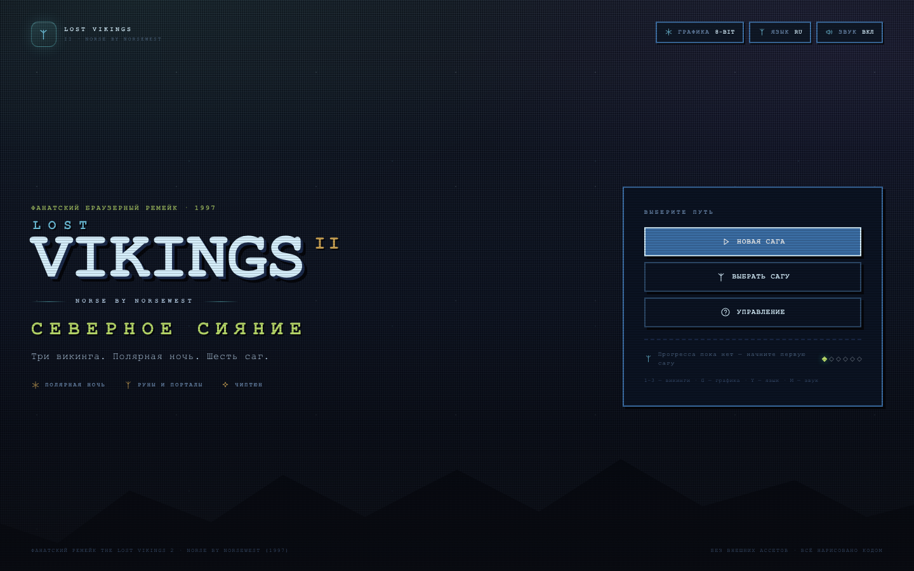
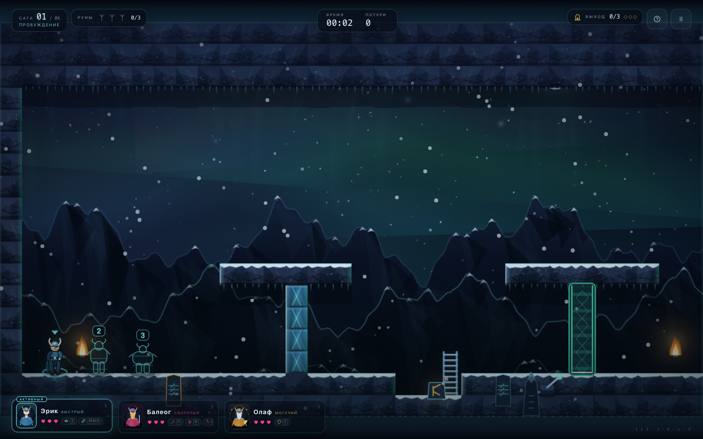
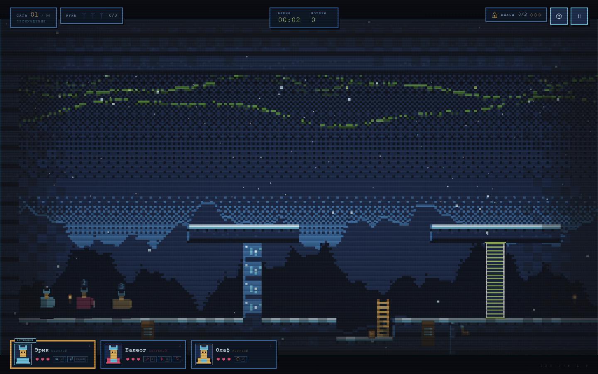
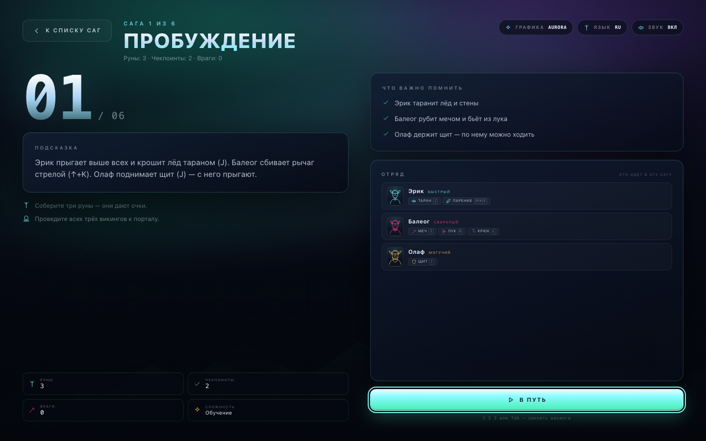
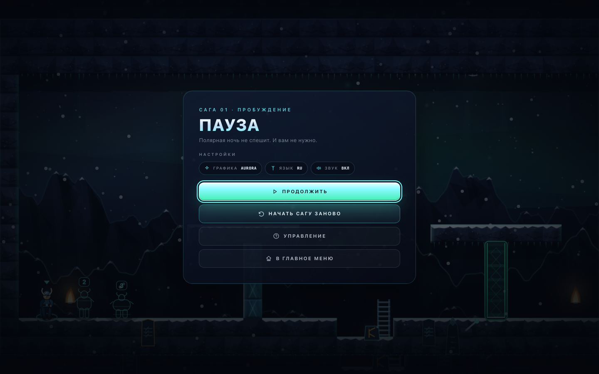
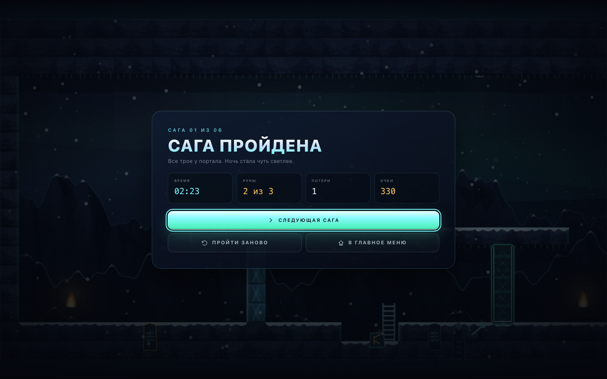
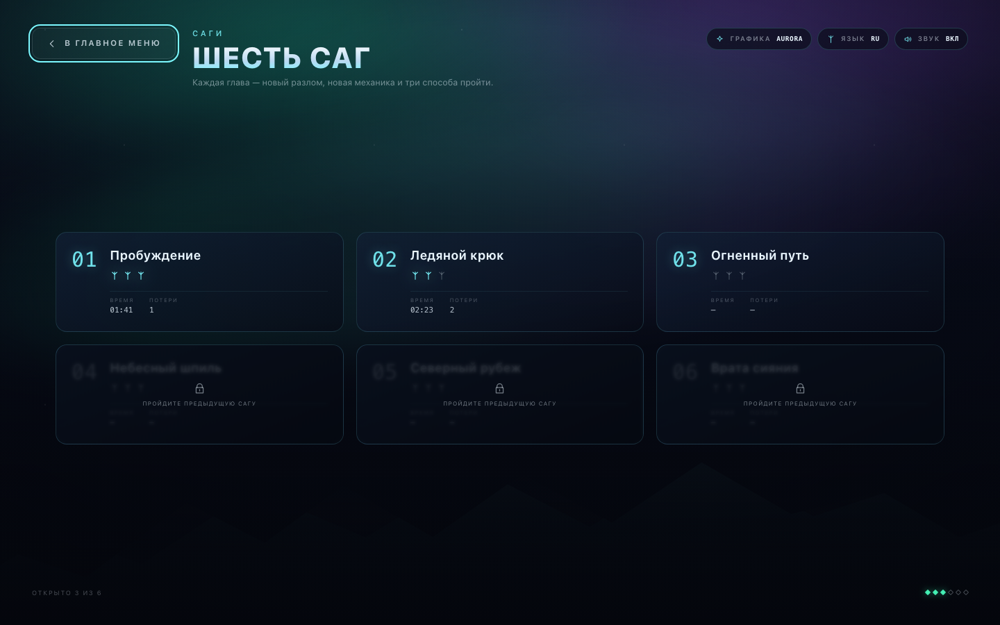
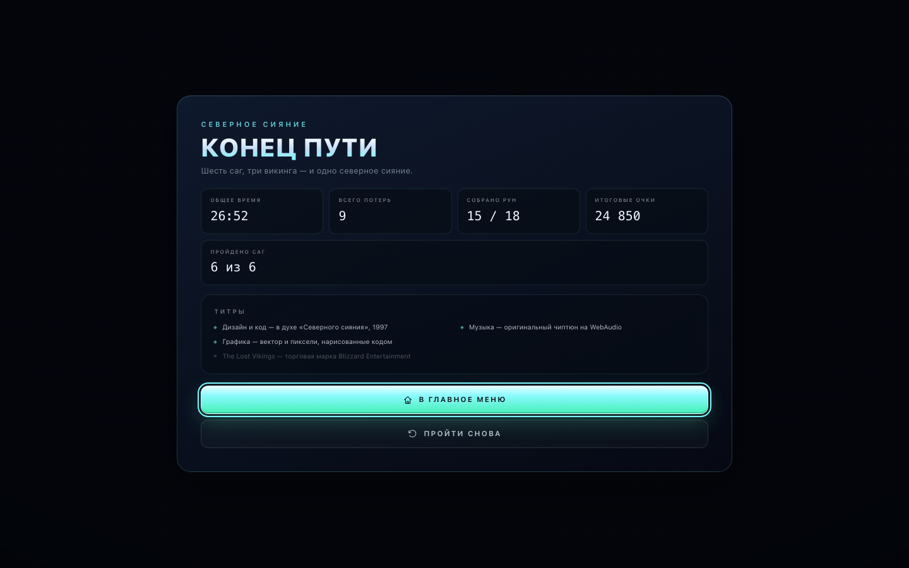
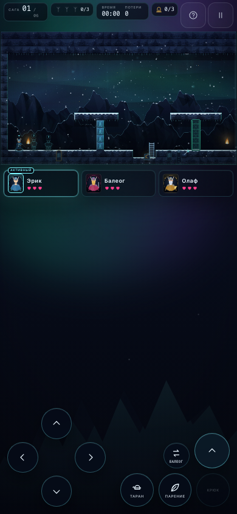

# LOST VIKINGS 2 · NORSE BY NORSEWEST — «Северное сияние»

Браузерный фанатский ремейк **The Lost Vikings 2: Norse by Norsewest** (1997) —
платформенной головоломки о трёх викингах, которых небеса забросили в полярную ночь.
Оригинальная механика сиквела, русский интерфейс, два режима графики и чиптюн-саундтрек.
Всё работает из одного `index.html` по `file://`: без сборки, npm, CDN, интернета и
внешних ассетов. Вся графика, музыка и звук сгенерированы кодом.



## Запуск

1. Откройте `lost-vikings-2/index.html` двойным щелчком (или перетащите в браузер).
2. Нужна клавиатура (на телефоне — экранные кнопки).
3. По умолчанию: русский язык, графика **8-BIT (ретро)**, звук включён.
4. `G` — графика, `Y` — язык RU/EN, `M` — звук, `P`/`Esc` — пауза, `H` — подсказка.
   Выбор графики/языка/звука и прогресс сохраняются в `localStorage`.

## Сюжет

Локи разбил Солнечный камень, и руны разлетелись по северным мирам. Три викинга —
**Эрик Быстрый**, **Балеог Свирепый** и **Олаф Могучий** — идут через ледяные залы,
кузню Имира, небесный шпиль и Врата сияния, чтобы собрать руны и вернуть драккар домой.
Шесть саг, три героя, одна полярная ночь.

## Как играть

В каждый момент вы управляете **одним** викингом; остальные замирают на месте — это
основа головоломок. Переключайтесь `1`/`2`/`3` или `Tab`, оставляйте Олафа на плите,
поднимайте его щит как ступеньку, стреляйте Балеогом в рычаги, ломайте лёд Эриком.

| Клавиши | Действие |
|---|---|
| `←` `→` / `A` `D` | идти |
| `↑` `↓` / `W` `S` | лестницы, прицел лука/крюка |
| `Space` | прыжок (Эрик, Олаф); у Эрика в падении — парение |
| `J` | способность: таран Эрика / меч Балеога / щит Олафа (удерживать) |
| `K` | лук Балеога (с `↑` — вверх) |
| `L` | крюк Балеога (вверх или по взгляду; повторно — отцепиться) |
| `1` `2` `3` / `Tab` | выбор викинга |
| `R` | заново уровень |
| `H` | подсказка уровня |
| `P` `Esc` | пауза |
| `G` / `Y` / `M` | графика / язык / звук |

### Герои и способности сиквела

| | Эрик Быстрый | Балеог Свирепый | Олаф Могучий |
|---|---|---|---|
| Роль | скорость и высота | оружие и дальний бой | щит и опора |
| Способности | высокий прыжок, **таран** (ломает лёд), **парение** | **меч**, **лук**, **крюк-кошка** | **щит**: блок, планирование и платформа, по которой ходят другие |

- 3 сердца у каждого; смерть — возрождение у чекпоинта (счётчик потерь ведётся).
- Руны (по 3 на уровень) дают очки; выход открыт только когда все трое дошли.
- Враги: `grunt`, `thrower` (стреляет — щит Олафа блокирует), `bat`.
- Плиты и рычаги открывают энерговорота; движущиеся платформы возят викингов.

## Два визуальных стиля (`G`)

### AURORA — «Северное сияние»

Современный рендер: полярное небо с живой авророй, параллакс в несколько слоёв, снег,
объёмный свет, rim-light на льду, эмиссивная лава и руны, кинематографичная виньетка.
Спрайты нарисованы векторно и анимированы: бег, прыжок, плащ, щит, крюк, удары.



### 8-BIT — «Sega Saturn, 1997», режим по умолчанию

Честные **512×288**, увеличенные nearest-neighbour, ограниченная палитра, дизеринг,
CRT-скан-линии и пиксельные спрайты. Включён по умолчанию; переключается на лету
клавишей `G` с коротким глитч-переходом. Выбор запоминается в `localStorage`.



## Уровни

1. **Пробуждение** — прыжок, таран, лук по рычагу, щит-ступенька.
2. **Ледяной крюк** — реки льда и крюк Балеога.
3. **Огненный путь** — лава, платформы, враги.
4. **Небесный шпиль** — вертикаль: парение, крюк, лестницы.
5. **Северный рубеж** — комбинированные головоломки.
6. **Врата сияния** — финал у трона Локи.

Подробные прохождения — в `docs/LEVELS.md`.

| | |
|---|---|
|  |  |
|  |  |
|  |  |

## Мобильный режим

Портретная раскладка: кадр 16:9 сверху, компактный HUD, карточки викингов под кадром и
экранные кнопки внизу. Тач-управление появляется автоматически на устройствах с сенсором
(или по `?touch=1`).



## Музыка и звук

Полностью синтезированный чиптюн на WebAudio, без файлов:

- 5 оригинальных тем: `title` (90 BPM, полярная ночь), `game0` (132, A-moll),
  `game1` (140, E-moll), `game2` (120, D-moll), `ending` (100, тёплый финал);
- 2 пульсовых канала, треугольный бас, арпеджио, шумовые барабаны, пэд и «ветер»;
- 32 SFX: прыжки, удары, лёд, меч, лук, крюк, рычаги, двери, руны, урон, победа;
- lookahead-планировщик, бесшовные лупы, плавные переходы, мастер-компрессор и лимитер;
- музыка запускается после первого жеста (правило браузеров), `M` глушит всё.

## Технические заметки

- Классические скрипты, никаких ES-модулей: страница работает с диска.
- Виртуальный экран **1024×576**, тайл **32 px**, физика с фиксированным шагом 60 Гц,
  coyote-time и jump-buffer, AABB-коллизии с тайлами, дверями и платформами.
- Камера со сглаживанием и тряской; уровни до 80×30 тайлов.
- Рендер: отдельные ветки AURORA и 8-BIT, кэш фонов и тайлов, частицы, портреты для HUD.
- Прогресс: `localStorage` (`lv2.progress`, `lv2.mode`, `lv2.lang`, `lv2.muted`).
- Без внешних запросов и ассетов; всё рисуется и звучит кодом.

### Структура

```
lost-vikings-2/
  index.html            — страница игры
  css/style.css         — дизайн-система и оба режима
  js/i18n.js            — RU/EN
  js/levels.js          — 6 уровней
  js/audio.js           — чиптюн и SFX
  js/render.js          — AURORA + 8-BIT
  js/game.js            — движок, физика, способности, пазлы
  js/ui.js              — экраны, HUD, меню, тач
  js/main.js            — ввод, поток экранов, сохранения, цикл
  tools/                — CDP-харнесс, тесты, валидатор уровней, dev-стенд
  docs/LEVELS.md        — прохождения
  screenshots/          — скриншоты
```

## Проверка

```bash
node tools/validate-levels.mjs     # уровни: формат, группы, достижимость
node tools/test-engine.mjs         # физика и способности (headless, без браузера)
node tools/audio-test.mjs          # WebAudio-планировщик на заглушке
node tools/cdp.mjs shot --page index.html --out screenshots/aurora_title.png --width 1440 --height 900
```

## Об оригинале

**The Lost Vikings 2: Norse by Norsewest** — Interplay / Silicon & Synapse, 1997
(продолжение *The Lost Vikings*, 1992). Оригинальные персонажи, название и вселенная
принадлежат правообладателям. Это неофициальный фанатский порт: здесь нет ни одного
оригинального ассета — вся графика, музыка и звук написаны кодом с нуля.

- [The Lost Vikings 2 — Wikipedia](https://en.wikipedia.org/wiki/The_Lost_Vikings_2)
- [Norse by Norsewest — Giant Bomb](https://www.giantbomb.com/norse-by-norse-west-the-return-of-the-lost-vikings/3030-4174/)

Сделано с любовью к северным головоломкам, неоновой авроре и 8-битным драккарам.
