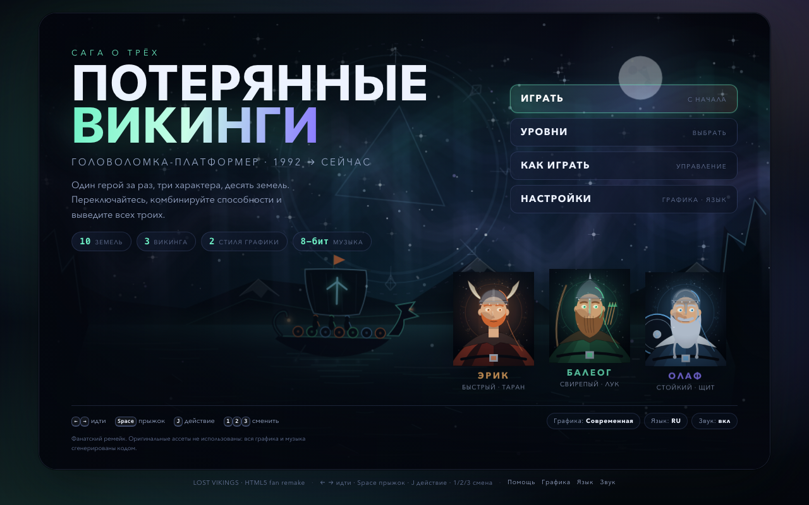
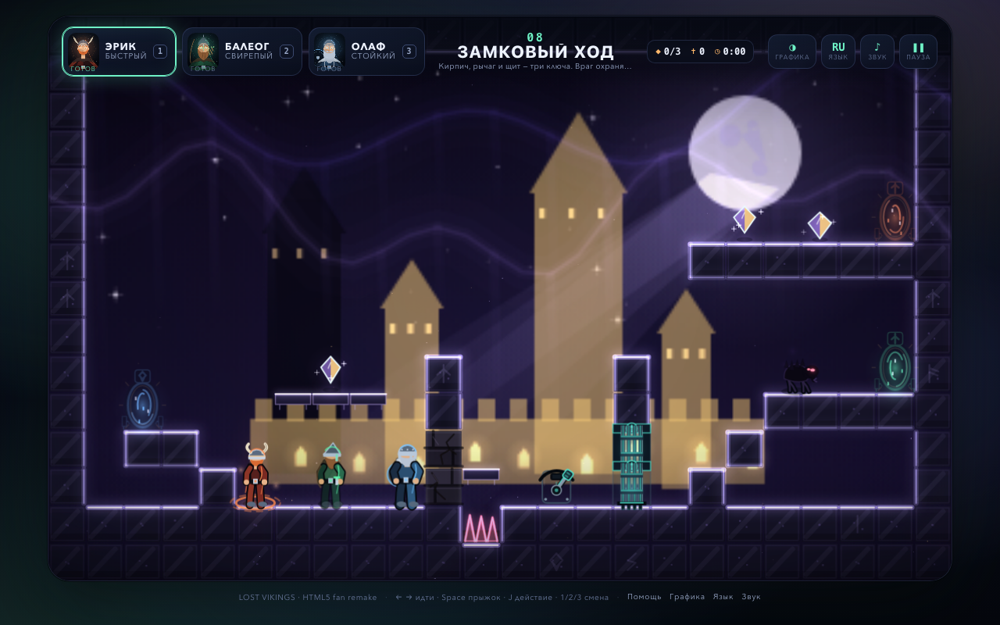
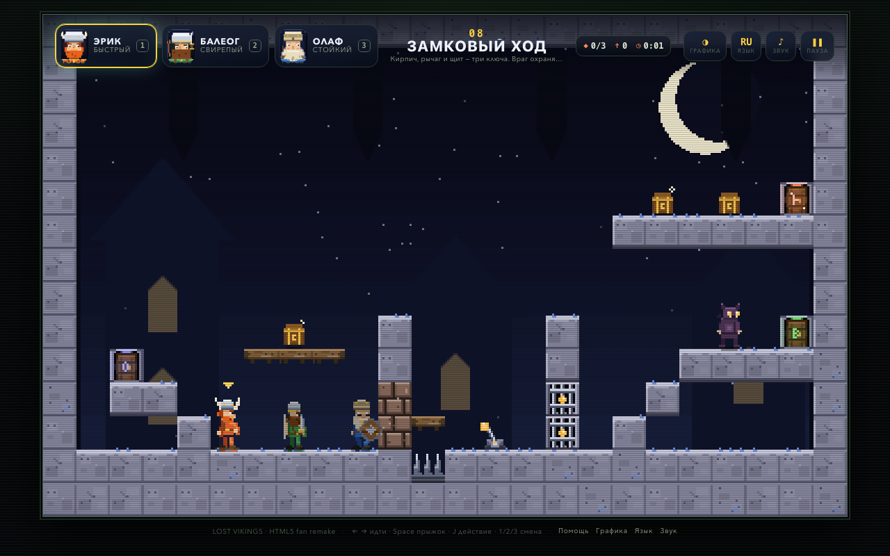
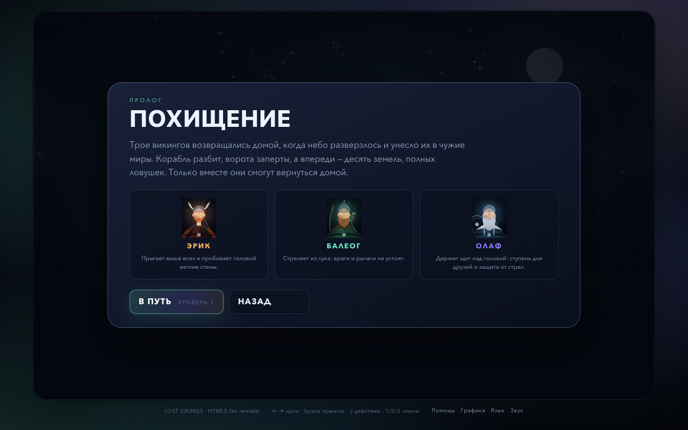
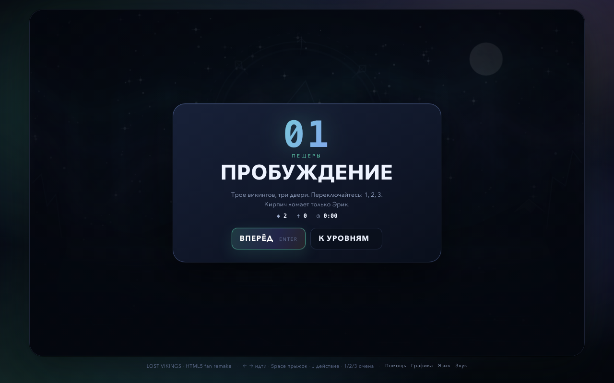
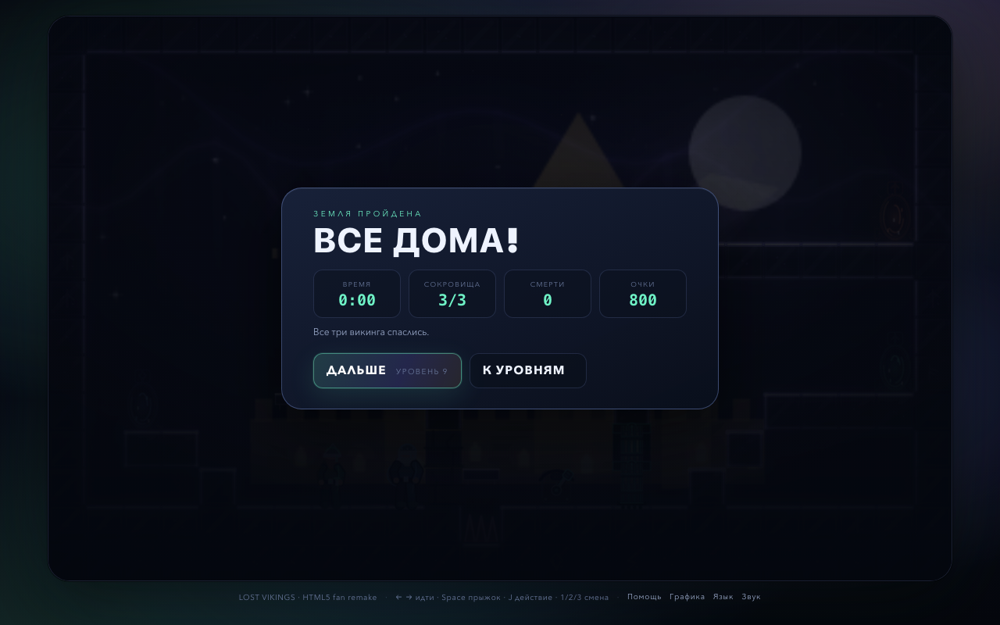
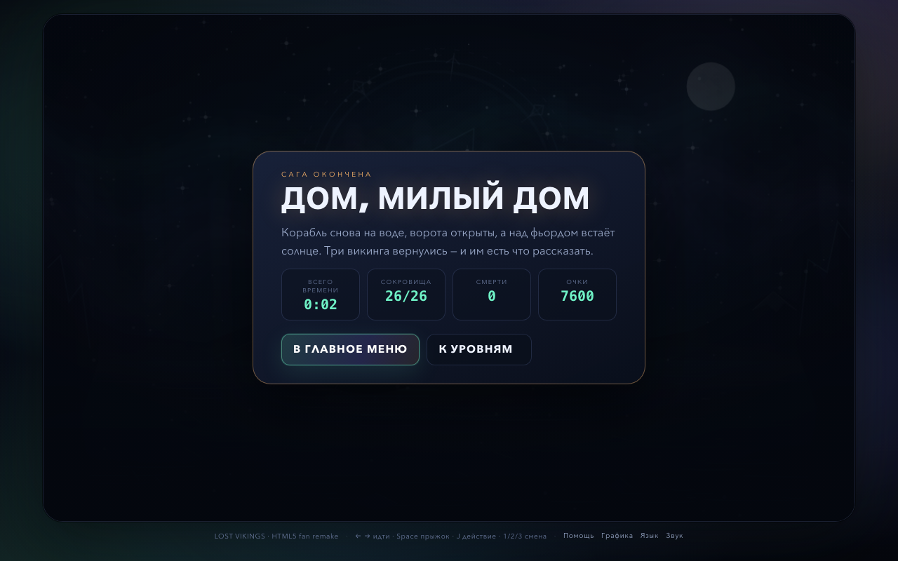
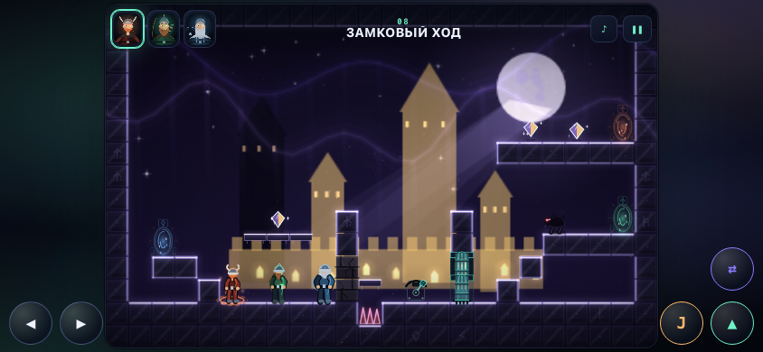

# ПОТЕРЯННЫЕ ВИКИНГИ · HTML5

Браузерный ремейк **The Lost Vikings** (Interplay / Silicon & Synapse, 1992): три викинга
с разными способностями, головоломки-платформеры, переключение героев, два визуальных
стиля и оригинальный 8-битный саундтрек.

## Запуск

1. Откройте `lost-vikings/index.html` двойным щелчком (или перетащите в окно браузера).
2. Ничего устанавливать не нужно: один HTML-файл, без CDN, шрифтов и интернета.
3. По умолчанию включены **современная графика** и **русский язык**.
   `G` — графика, `L` — язык, `M` — звук; выбор запоминается в `localStorage`.

Онлайн-демо: откройте тот же `index.html` на любом статическом хостинге (например,
Vercel/GitHub Pages) — внешних зависимостей нет. Игра работает и по `file://`.

## Как играть

Управляйте одним викингом за раз, остальные ждут на месте. Задача — провести **всех трёх**
к трём дверям-выходам. Один выход принимает одного викинга. Все трое ушли — уровень пройден.

| Клавиши | Действие |
|---|---|
| `←` `→` / `A` `D` | идти |
| `Space` / `W` / `↑` | прыжок |
| `↓` + `Space` | спрыгнуть с односторонней платформы |
| `J` / `K` / `Enter` / `F` | действие героя |
| `1` `2` `3` | выбрать Эрика / Балеога / Олафа |
| `Tab` / `Q` / `E` | следующий викинг |
| `R` | рестарт уровня |
| `P` / `Esc` | пауза |
| `G` | графика: современная ↔ 8-бит |
| `L` | язык: русский ↔ English |
| `M` | звук вкл/выкл |

На телефоне/планшете появляются экранные кнопки; в ландшафтной ориентации они
вынесены в поля по бокам, чтобы не закрывать мир. В портретной ориентации
показывается подсказка повернуть устройство.

### Три героя

| Герой | Способность |
|---|---|
| **Эрик Быстрый** | Быстрее всех бегает, прыгает на 3 клетки, **таранит** ветхие кирпичные стены. |
| **Балеог Свирепый** | **Стреляет из лука**: убивает пещерных врагов и переключает рычаги. Меч бьёт вплотную. |
| **Олаф Стойкий** | Держит **щит** над головой: платформа-ступень для друзей и защита от вражеских стрел. |

### Головоломки

- **Плиты** `1–4` открывают ворота, пока на них кто-то стоит. Оставьте викинга на плите,
  переключитесь на другого — классика кооперативных головоломок.
- **Рычаги** `5–8` переключаются стрелой Балеога (и мечом вплотную).
- **Ворота** `a–d` закрывают проход, пока группа не открыта.
- **Шипы**, **ловушки-стреломёты** `<`/`>` и **пещерные враги** смертельны.
  Щит Олафа блокирует вражеские стрелы.
- **Сокровища** `*` дают очки, но не обязательны.
- Любая смерть — рестарт уровня; сокровища на уровне сбрасываются.

### Двери

У каждого викинга **своя дверь** — как в оригинале: оранжевая у Эрика, зелёная у Балеога,
синяя у Олафа. Чужая дверь не открывается и подсказывает, чья она. На карте похода
показаны лучшие времена и прогресс.

## Два визуальных стиля

### Современный — по умолчанию

Тёмный «северный неон»: аврора, туман, стеклянные тайлы со светящимися контурами,
векторные викинги с процедурной анимацией, порталы-выходы, частицы, свечение активного
героя. Мир 384×240 отрисовывается в буфер 1152×720.

### 8-бит — версия 1992 года

Честный пиксель-арт 384×240: тайлы 16×16, ограниченная палитра, параллакс-фоны шести тем,
пиксельные портреты, скан-линии и виньетка. Тот самый вид консольной эпохи.

Переключение — клавиша `G` в любой момент или кнопка в настройках; выбор сохраняется.
Интерфейс тоже меняет скин: пиксельный monospace в 8-бит и стеклянные панели в современном.

## Экраны

| | |
|---|---|
|  |  |
|  |  |

Мобильный ландшафт (тач-управление вынесено в поля):

## Музыка и звук

Звук полностью синтезируется через WebAudio, без файлов (правило автозапуска браузеров:
контекст создаётся после первого нажатия/клика).

- **title** — 92 BPM, ля-минор: загадочный северный чиптюн с эхом и «ветром».
- **game 0** — 140 BPM, ре-минор; **game 1** — 132 BPM со свингом, ми-минор: два разных
  энергичных лупа, чередуются по уровням.
- Джинглы победы, смерти, финала; 16 звуковых эффектов (прыжок, таран, стрела, рычаг,
  ворота, сокровище, выход…).
- Планировщик нот с lookahead, плавные fade, пауза без щелчков, отдельная шина SFX.

## Уровни

10 земель с нарастающей сложностью и шестью темами: **пещеры, кузня, ледники, лес,
замок, пустота**. Каждый уровень — отдельная головоломка, где нужно комбинировать
способности всех трёх героев. Прогресс, лучшие времена и настройки сохраняются
в браузере; на карте похода можно переиграть пройденные земли.

Прохождения и проверка проходимости: `lost-vikings/docs/LEVELS.md`,
автотест геометрии: `node lost-vikings/tools/validate-levels.mjs`.

## Русский и English

Русский — по умолчанию. `L` или кнопка «Язык» переключает весь интерфейс, подсказки
уровней и меню на English; выбор сохраняется.

## Технические заметки

- Один автономный `index.html` (~400 КБ), без зависимостей, сборки и сети.
- Логическая сетка 24×15 клеток по 16 px (384×240), весь уровень виден сразу, камеры нет.
- Собственная физика: AABB, односторонние платформы, coyote-time, jump-buffer,
  таран, стрелы, щит-платформа, враги, ловушки и ворота.
- Два независимых рендерера на Canvas 2D (8-бит и современный), HUD и меню — DOM/CSS.
- WebAudio-чиптюн-движок с собственным планировщиком.
- Исходники: `lost-vikings/src/` (`levels.js`, `audio.js`, `game.js`, `render-retro.js`,
  `render-modern.js`, `ui.js`, `i18n.js`, `main.js`), сборка — `node lost-vikings/tools/build.mjs`.
- Headless-проверка: `node lost-vikings/tools/probe.mjs <url> out.png [--eval='…'] [--keys=…] [--mobile=1]`.
- 60 fps в обоих режимах (Chrome, 1280×800): 8-бит рисует настоящий буфер 384×240,
  современный — 1152×720; HUD и меню — DOM/CSS без тяжёлых фильтров.
- Проверки: `node lost-vikings/tools/validate-levels.mjs` → 10/10; автотесты экранов,
  ввода, i18n, прогресса и обоих рендереров — в `lost-vikings/reports/qa-report.md`.

## Об оригинале

**The Lost Vikings** — головоломка-платформер 1992 года от **Silicon & Synapse**
(позже Blizzard), издатель **Interplay**. Оригинальный дизайн: Erik the Swift,
Baleog the Fierce, Olaf the Stout; версии для SNES, Mega Drive, Amiga, DOS и др.

- [The Lost Vikings — Wikipedia](https://en.wikipedia.org/wiki/The_Lost_Vikings)
- [The Lost Vikings — Internet Archive](https://archive.org/details/lost_vikings)

Неофициальный фанатский ремейк, не связанный с правообладателями. Оригинальные ассеты
не использованы: вся графика и музыка сгенерированы кодом специально для этого проекта.
