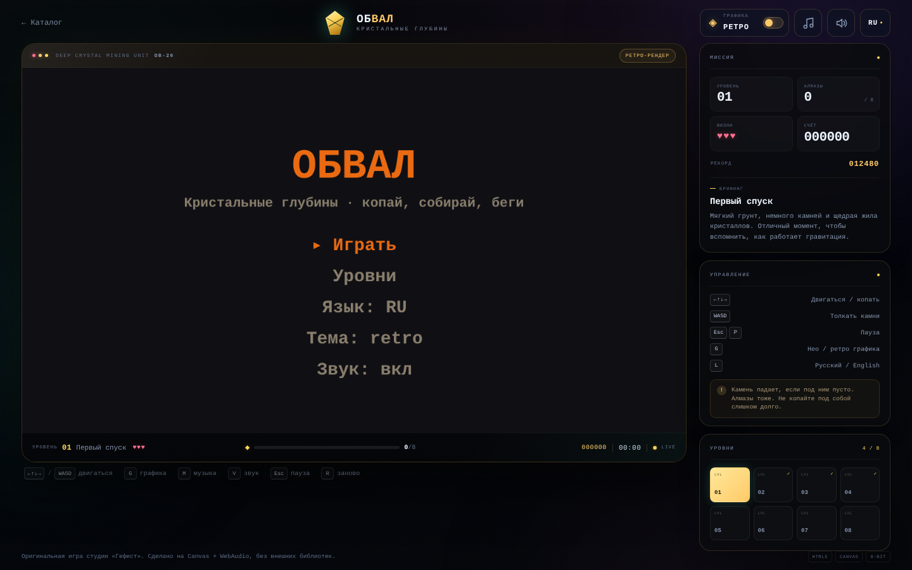
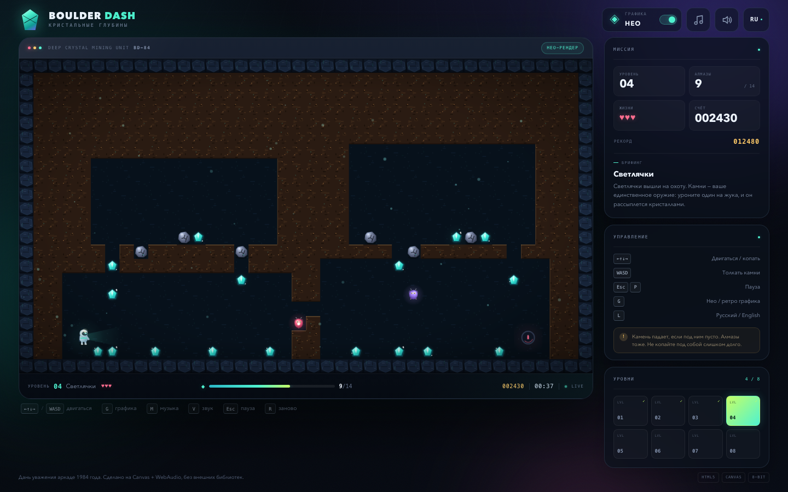
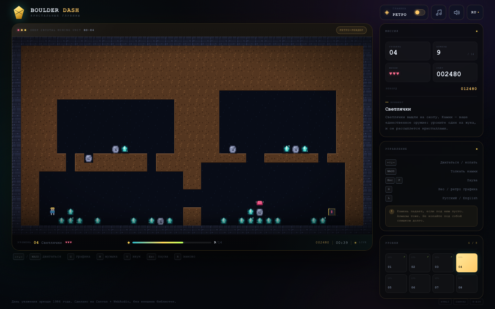
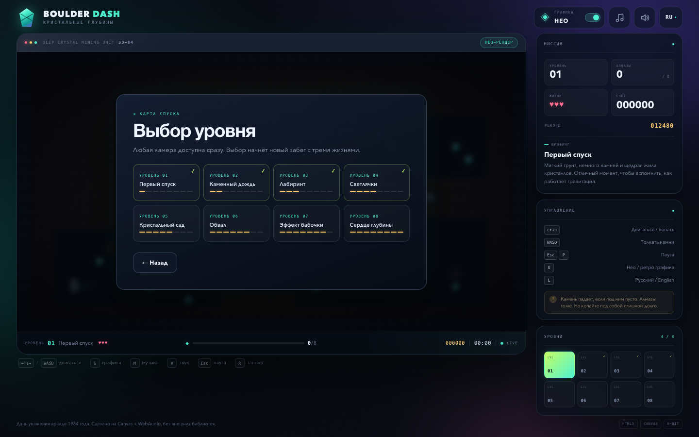
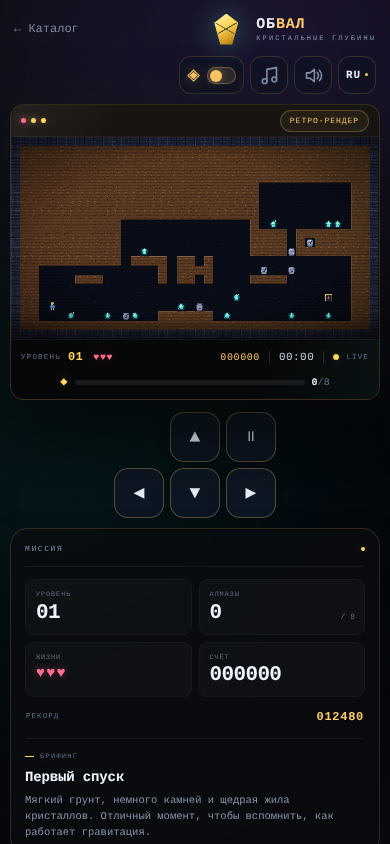
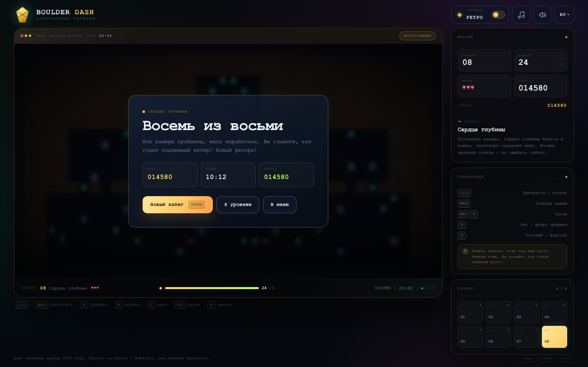

# ОБВАЛ · ШАХТА САМОЦВЕТОВ

Оригинальная аркада студии «Гефест» для браузера.
Восемь уровней, алмазы, падающие камни, светлячки, 8-битная музыка и два полноценных
графических стиля: **ретро** (по умолчанию) и **нео**. Интерфейс по умолчанию русский, английский
переключается на лету.

## Движок v2 («оболочка», волна 2 аркады)

`index.html` поднимает фреймворк **Гефест Arcade v2** (`engine.js` — копия `_shared/engine.js`) поверх
родного кода игры через `js/host.js` («оболочка», как у БОЛТа/КОЛОБКА/ПЛАЩА, но без разбора монолита):
`js/game.js` (логика, 8 уровней, рендеры ретро и нео, HUD и панели страницы, 8-битная музыка) работают без изменений логики, уровней и баланса; движок рисует в отдельный
прозрачный canvas поверх кадра и даёт:

* меню (Играть / Уровни / Язык / Тема / Звук + рекорд), паузу (P/Esc), финалы «победа / конец игры»;
* тема движка **retro ⇄ ретро**, **modern ⇄ нео** (T или G; modern по умолчанию), язык RU/EN (L) —
  синхронно с игрой в обе стороны; звук (M / меню) → музыка + эффекты игры;
* рекорд `arcade.best.obval` (старый рекорд переносится при первом запуске; ключи прежней версии переезжают в `obval:*`);
* ссылку «← Каталог», фавикон студии; тач — родной D-pad игры;
* музыка — родная игры (Crystal Drive / Deep Descent); трек движка (`js/music.js`) не добавлялся, чтобы не играли два.

Связь с игрой — только через её публичный объект `window.OBVAL`. Отладочные адреса (`#shot=`, `#sim=`, `#test`)
отключают оболочку — игра работает как раньше; `#gfx=retro|modern` и `#lang=ru|en` задают тему/язык
на запуск (на них завязан `tools/thumbs.mjs`). Старая страница со своим меню — `legacy.html`.

Тесты порта: `node obval/tests/engine.test.mjs` (Playwright, свой сервер).

**Запуск:** откройте [`index.html`](index.html) двойным щелчком. Сервер, интернет и
установка зависимостей не нужны.



## Что внутри

| | |
|---|---|
| **Уровни** | 8 рукотворных камер с растущей сложностью; квота алмазов, таймер, бонус за скорость |
| **Механики** | копание грунта, толкание камней, гравитация, падающие алмазы, выход с замком, враги |
| **Враги** | светлячки (поворачивают направо) и бабочки (налево); падающий камень разбивает жука на алмазы |
| **Графика** | «Нео» — процедурные градиенты, свечение, частицы, фонарь шахтёра; «Ретро» — ограниченная палитра, пиксели, CRT-скан-линии |
| **Звук** | два оригинальных 8-битных цикла (меню и игра) + 13 синтезированных эффектов, всё на WebAudio |
| **Языки** | русский / английский, переключение клавишей `L`, выбор запоминается |
| **Прогресс** | рекорд, пройденные уровни и настройки хранятся в `localStorage` |
| **Управление** | клавиатура, WASD, экранный D-pad на телефоне |
| **Технологии** | Canvas 2D, WebAudio, ноль внешних библиотек, картинок и аудиофайлов |

## Скриншоты

| Нео-графика | Ретро-графика |
|---|---|
|  |  |

| Выбор уровня | Мобильная версия |
|---|---|
|  |  |



## Управление

| Клавиши | Действие |
|---|---|
| `←` `↑` `↓` `→` / `WASD` | двигаться, копать грунт, толкать камни |
| `Enter` | старт, продолжить, следующий уровень |
| `Esc` / `P` | пауза |
| `R` | начать текущий уровень заново |
| `G` | переключить **Нео / Ретро** графику |
| `M` | включить / выключить музыку |
| `V` | включить / выключить звуковые эффекты |
| `L` | русский / English |
| Экранный D-pad | движение и пауза на сенсорных устройствах |

## Как играть

1. Соберите **квоту алмазов**, указанную в нижней панели (`0 / 8` на первом уровне).
2. После этого выход на другом конце камеры откроется — красный замок станет порталом.
3. Дойдите до выхода. Уровень завершён, начисляется бонус за скорость.
4. У вас три жизни. Камень, алмаз или враг отнимают жизнь; уровень начинается заново,
   а очки, набранные на нём, откатываются.
5. Пройдите все восемь камер, чтобы увидеть финал.

Полезные правила:

* камень падает, если под ним пусто; если он стоит на опоре, но сбоку есть свободная
  диагональ — он может покатиться;
* камень можно толкнуть в свободную клетку за ним;
* нельзя толкать камень в грунт — сначала расчистите путь;
* падающий камень убивает и игрока, и жука; жук рассыпается на алмазы;
* светлячок поворачивает по часовой стрелке при препятствии, бабочка — против;
* выход не откроется, пока не собрана квота, но оставшиеся алмазы дают очки.

## Уровни

| № | Название | Квота | Алмазов в камере | Сложность | Особенность |
|---|---|---|---|---|---|
| 1 | Первый спуск | 8 | 12 | ●○○○○○○○ | обучение, без врагов |
| 2 | Каменный дождь | 10 | 12 | ●●○○○○○○ | шахты и падающие камни |
| 3 | Лабиринт | 12 | 16 | ●●●○○○○○ | первый светлячок |
| 4 | Светлячки | 14 | 17 | ●●●●○○○○ | два врага, каменные «снаряды» |
| 5 | Кристальный сад | 16 | 20 | ●●●●●○○○ | богатая жила под потолком |
| 6 | Обвал | 18 | 22 | ●●●●●●○○ | тонкие полки и три жука |
| 7 | Эффект бабочки | 20 | 24 | ●●●●●●●○ | бабочки и светлячки в лабиринте |
| 8 | Сердце глубины | 24 | 30 | ●●●●●●●● | финальная камера-сокровищница |

## Два графических стиля

**Ретро** (по умолчанию):

* ограниченная палитра в духе 8-битных компьютеров;
* крупные пиксельные спрайты и `image-rendering: pixelated`;
* CRT-развёртка, виньетка и более «тёплая» янтарная палитра интерфейса;
* отдельная отрисовка спрайтов, а не просто фильтр поверх нео-режима.

**Нео**:

* плавные процедурные текстуры, градиентные камни и гранёные алмазы;
* свечение кристаллов, портала и фонаря шахтёра;
* частицы пыли, искры, конфетти, лёгкая тряска экрана;
* анимированные враги, парящая пыль и подсветка тоннелей.

Переключение — кнопкой **ГРАФИКА** в шапке или клавишей `G`. Выбор сохраняется.

## Музыка и звук

Оба трека написаны специально для проекта и синтезируются на лету:

* **Crystal Drive** — игровая тема: квадратная волна, треугольный бас, арпеджио и
  шумовые барабаны;
* **Deep Descent** — атмосферная тема меню;
* отдельные эффекты: копание, шаги, сбор алмаза, толчок, падение, взрыв, открытие
  выхода, смерть, победа, клики интерфейса.

Браузеры не разрешают автозапуск звука: музыка стартует после первого клика или
нажатия клавиши. Кнопки `♪` и `🔊` в шапке (или `M` / `V`) включают и выключают
музыку и эффекты отдельно.

## Технические детали

* Логическое поле: **40 × 22** клетки по 16 px, кадр **640 × 352**;
* canvas имеет задний буфер **1280 × 704** (2×) для чёткости и масштабируется CSS;
* игровой тик — 112 мс, рендер — через `requestAnimationFrame`, эффекты и частицы
  обновляются каждый кадр;
* вся графика рисуется кодом: спрайты, тайлы, портал, шахтёр, жуки, частицы;
* музыка и SFX — `OscillatorNode`, `PeriodicWave`, шумовой буфер, фильтры и дилей;
* адаптивная вёрстка: широкий экран, планшет, телефон; на сенсорных устройствах
  появляется D-pad;
* нет внешних CDN, шрифтов, картинок и аудиофайлов — страница работает офлайн.

## Структура проекта

| Файл | Назначение |
|---|---|
| `index.html` | **игра на движке v2**: `engine.js` + `js/host.js` поверх `js/game.js` |
| `legacy.html` | старая страница со своим меню (тот же `js/game.js`) |
| `js/game.js`, `css/style.css` | собранные игра и стили (из `src/`, не править руками) |
| `js/host.js` | «оболочка» движка v2 над игрой — копия `_shared/host.js`, кладёт `build.sh`, руками не править |
| `src/style.css` | дизайн-система, нео/ретро-скины, адаптивность |
| `src/levels.js` | ASCII-карты восьми уровней, квоты и описания |
| `src/game.js` | движок, рендер, физика, WebAudio, локализация, UI |
| `tools/build.py` | собирает `js/game.js` (игра + уровни) и `css/style.css` из `src/`; `--check` — сверка |
| `tools/levels.py` | генератор карт (для правок удобнее менять его, а не строки вручную) |
| `tools/regenerate_levels.py` | пересобирает `src/levels.js` из `tools/levels.py` |
| `tools/logic-test.mjs` | 34 браузерные проверки механик и сценариев (`CHROME=… PAGE=legacy.html` — по желанию) |
| `tools/test.mjs` | smoke-тест и диагностические скриншоты |
| `tools/screenshots.mjs` | пересборка скриншотов для README |
| `tests/engine.test.mjs` | тесты порта на движок v2 (Playwright) |
| `screenshots/` | финальные изображения |

## Сборка

```bash
# после правки src/style.css, src/game.js или src/levels.js
python3 tools/build.py

# только если меняли tools/levels.py
python3 tools/regenerate_levels.py
python3 tools/build.py
```

Инструменты в `tools/*.mjs` запускают Chrome: путь берётся из `CHROME` (по умолчанию — macOS),
страница — из `PAGE` (по умолчанию `index.html`); запуск из папки `obval/`.

## Тесты

```bash
node tools/logic-test.mjs   # 34 проверки: движение, гравитация, враги, смерти, финал, звук
node tools/test.mjs         # загрузка в headless Chrome + диагностические скриншоты
```

Тесты используют Chrome DevTools Protocol и Chrome для macOS. При необходимости
поправьте путь `CHROME` в начале `.mjs`-скриптов. Тестовая папка
`screenshots/test/` создаётся автоматически.

## Права

ОБВАЛ — оригинальная игра студии «Гефест». Код, процедурная графика, уровни и музыка
написаны с нуля; сторонние ассеты не используются.

---

Сделано с любовью к 8-битным пещерам, тяжёлым камням и блестящим алмазам.
