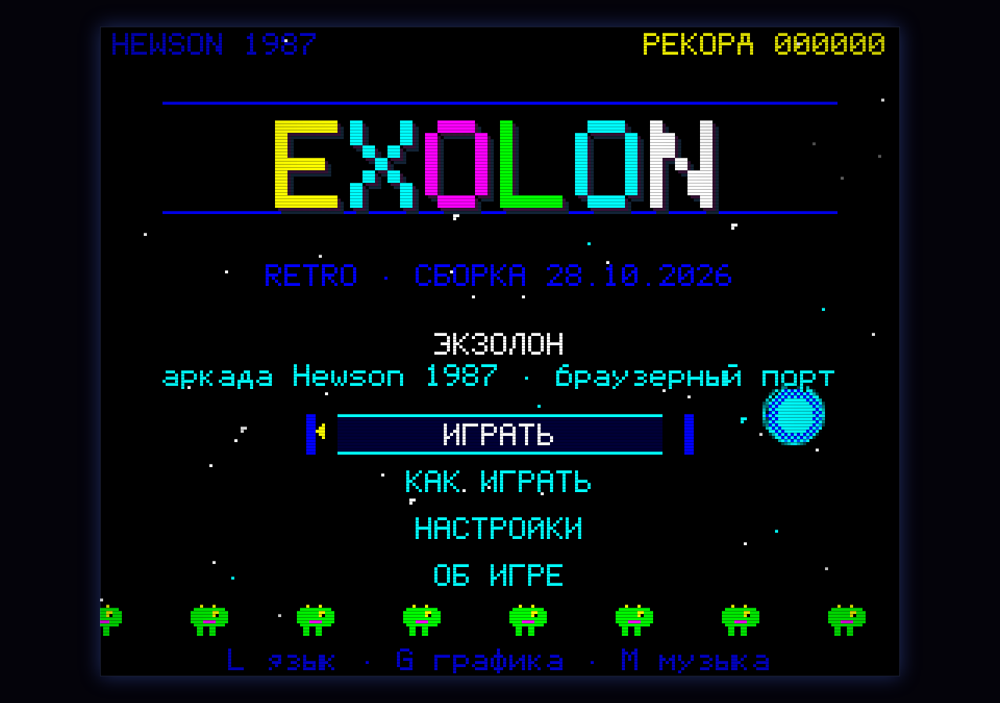
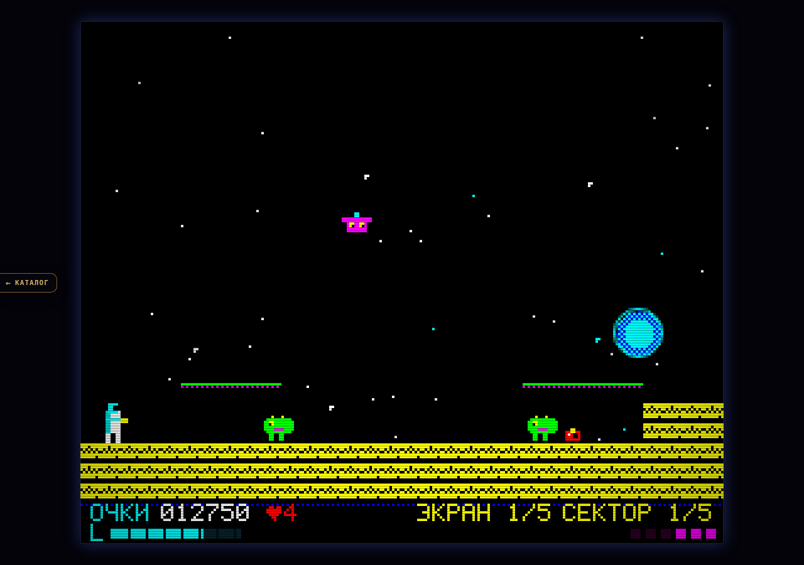
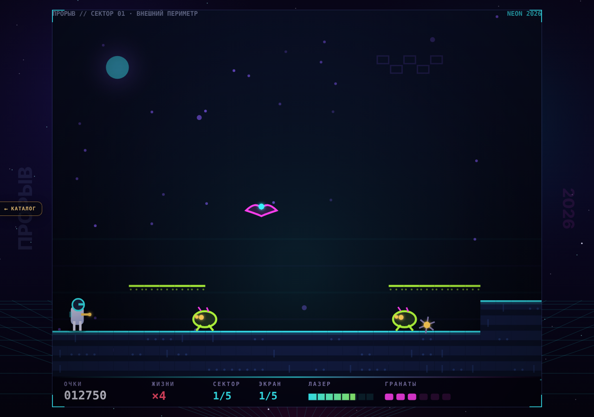
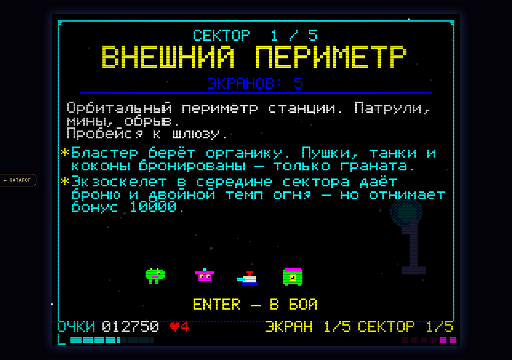
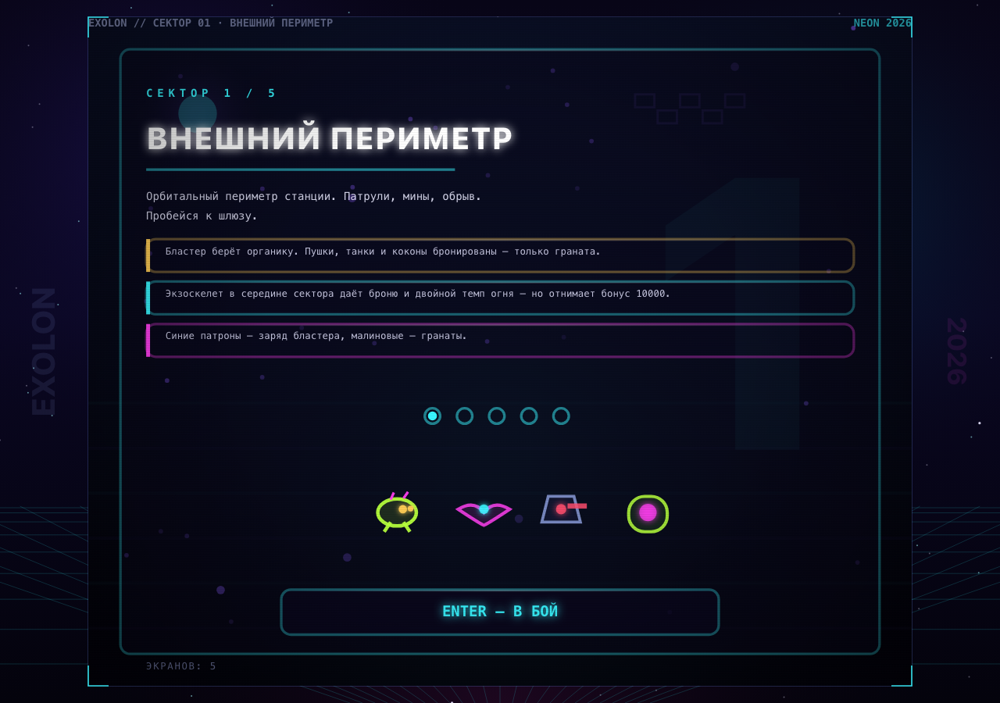
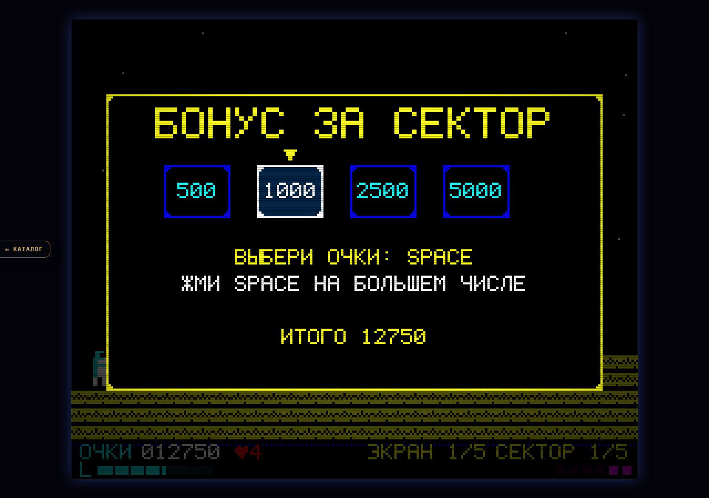
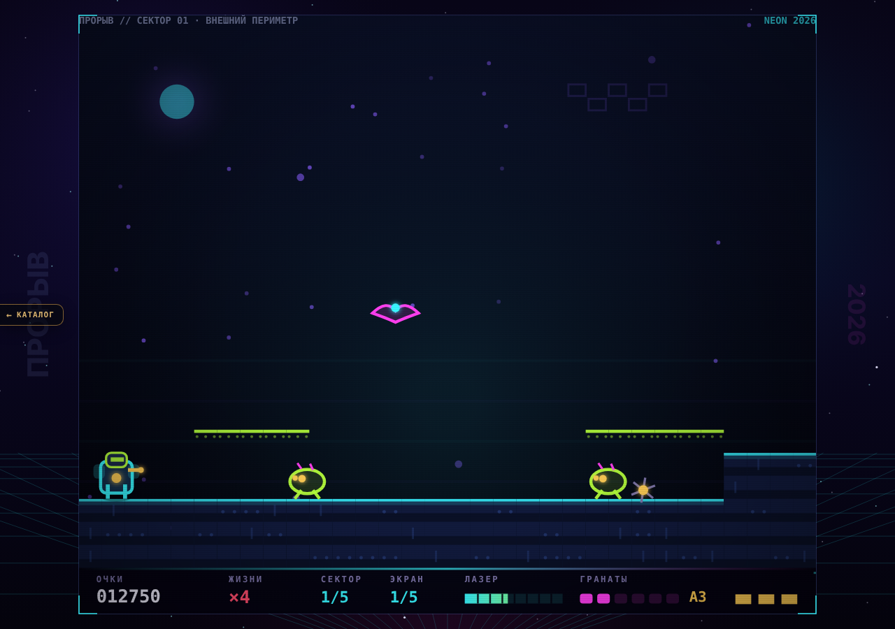
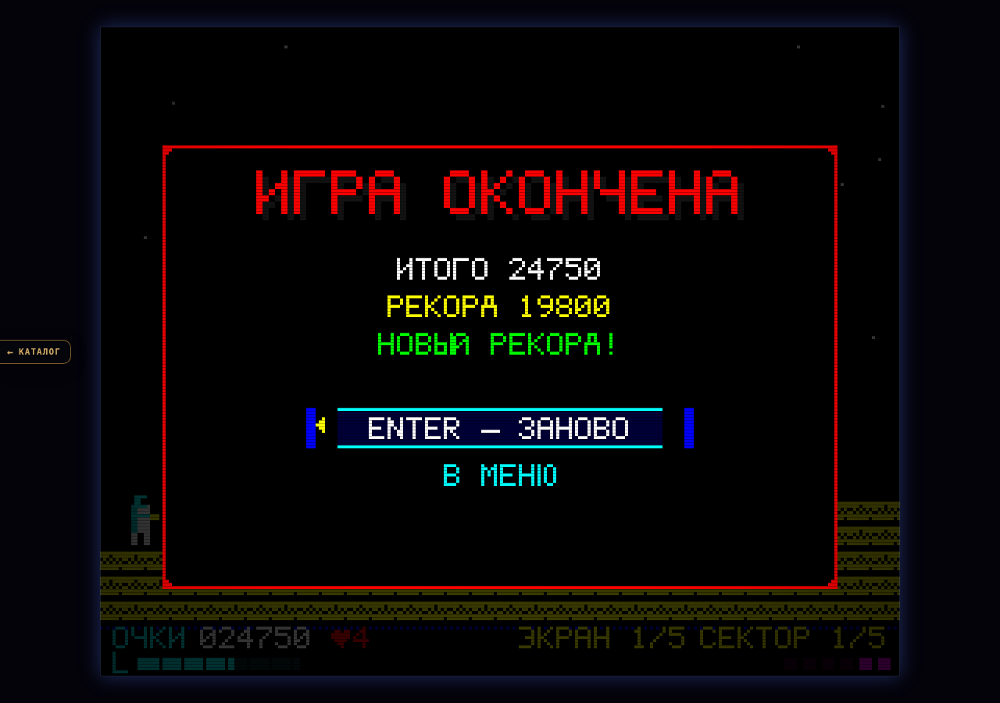
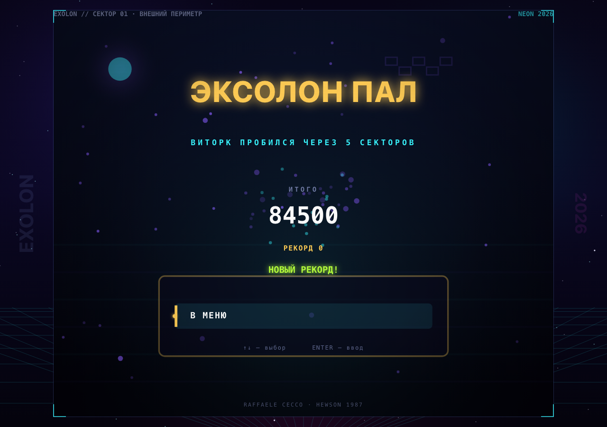

# ПРОРЫВ · HTML5

Оригинальный боевик студии «Гефест» в жанре экранного платформера-стрелялки. Работает офлайн,
без зависимостей и интернета. Две графики: **RETRO ZX** (8 бит) и неоновый **NEON 2026**.
Оригинальная 8-битная музыка на WebAudio. Русский интерфейс по умолчанию, английский — по клавише.



## Движок v2 («оболочка», волна 2 аркады)

`index.html` поднимает фреймворк **Гефест Arcade v2** (`engine.js` — копия `_shared/engine.js`) поверх
родного кода игры через `js/host.js` («хост поверх игры», как у ОБВАЛА/РУБИКОНА/ВИХРЯ):
`js/game.js` (логика, 25 экранов, баланс, рендеры ZX и NEON, брифинги, бонус сектора, своя музыка)
работает без изменений; движок рисует в отдельный прозрачный canvas поверх кадра игры
(рамка `#hostbox` повторяет прямоугольник кадра, который игра сама центрирует и масштабирует) и даёт:

* меню (Играть / Как играть / Язык / Тема / Звук + рекорд), паузу (P/Esc), финалы «победа / конец игры»;
* тема движка **retro ⇄ ZX**, **modern ⇄ NEON** (T или G; modern по умолчанию), язык RU/EN (L) —
  синхронно с игрой в обе стороны; звук (M / меню) → музыка + эффекты игры;
* рекорд `arcade.best.proryv` (старый `exolon.record` переносится при первом запуске);
* ссылку «← Каталог», фавикон студии; тач-пульт на сенсорных экранах (◀ ▶, ▲ прыжок,
  ▼ присесть/телепорт, ● огонь/граната, ⏎ ввод, Ⅱ пауза);
* музыка — родная игры (7 треков); трек движка (`js/music.js`) не добавлялся, чтобы не играли два.

Игровой поток: «Играть» → родной брифинг сектора (Enter — в бой) → экраны → «Сектор очищен» и выбор
очков → брифинг следующего сектора → … → экран победы движка.

Связь с игрой — только через её публичные объекты `window.EX` (состояние и функции), `window.EX_MAIN`
(кадр / resize) и `window.EX_AUDIO`; код игры не менялся. Отладочные адреса (`#shot=`, `#test`) отключают
оболочку — игра работает как раньше; `#gfx=retro|modern` и `#lang=ru|en` задают тему/язык на запуск,
`#nosound`, `#music=off`, `#crt=off` — как раньше. Старая страница со своим меню — `legacy.html`.

Тесты порта: `node proryv/tests/engine.test.mjs` (Playwright, свой сервер; внутри — и самотесты игры `#test`).

## Запуск

Откройте `proryv/index.html` (Chrome, Safari, Firefox, Edge; `file://` подходит). Сервер и интернет
не нужны. Клавиатура, мышь в меню или тач-пульт.

## Управление

| Клавиши | Действие |
|---|---|
| `←` `→` / `A` `D` | идти влево / вправо |
| `↑` / `W` | прыжок |
| `↓` / `S` | присесть · войти в телепорт |
| `Space` / `Z` | огонь: **клик** — бластер, **удержание** — граната |
| `Esc` / `P` | пауза |
| `Enter` | подтвердить, старт, брифинг |
| `L` | язык интерфейса RU / EN |
| `T` / `G` | тема: modern (NEON) / retro (ZX) |
| `M` | звук вкл/выкл |
| `N` | звуковые эффекты игры вкл/выкл |
| `F` | полный экран |
| `R` | заново с экрана |

## Две графики

### RETRO · ZX (тема retro)

256×192 пикселей, поле 32×24 тайла, полоса HUD 16 px, палитра ZX Spectrum, собственный
битмап-шрифт 6×8 с кириллицей, скан-линии, фосфорное послесвечение и «атрибутная»
фактура тайлов. Пиксели масштабируются целым числом.



### NEON · 2026 (тема modern)

Тот же мир и та же логика, но векторная неоновая графика: свечение, параллакс, частицы,
аддитивные снаряды, стеклянный HUD, современная типографика, хроматическая аберрация
и боковые рейлы с управлением на широких экранах. Разрешение — любое, без потери чёткости.



## Музыка и звук

Всё синтезируется кодом (WebAudio), ни одного внешнего файла. 4 канала:
две импульсные волны, треугольный бас и шумовые ударные; секвенсор с lookahead-планированием,
бесшовный луп, вибрато, портаменто, глиссандо, кроссфейд между треками.

| Трек | Где играет |
|---|---|
| `title` — 132 BPM, ля минор, 16 тактов | титульный экран |
| `game` — 150 BPM, ля минор, 32 такта, A–B–A'–C | боевые сектора |
| `exo` — 156 BPM | пока надет экзоскелет |
| `final` — 160 BPM, ре минор | финальный сектор |
| `clear` / `gameover` / `win` | джинглы |

Плюс 21 звуковой эффект (бластер, граната, взрывы, телепорт, подбор патронов, молот,
ракета, смерть, меню…). Подробности: [docs/MUSIC.md](docs/MUSIC.md).

## Как играть

Вы — штурмовик-одиночка. Нужно пройти **5 секторов** (периметр → пещеры → реактор →
улей → ядро), по **5 экранов** в каждом: уйти за правый край экрана и выжить.

* **Бластер** берёт органику. Пушки, танки, коконы и молоты бронированы — **только граната**.
* **Граната** летит по дуге, рвёт броню и толщу камня (разрушаемые блоки `%` открывают секреты).
* **Экзоскелет** — капсула в середине сектора: 3 удара брони и двойной темп огня, но в конце
  сектора вы теряете бонус 10000.
* **Телепорты** — встань и нажми `↓`: пара ведёт в тайник с наградой.
* **Статуи-пушки** — войди в них, чтобы получить 2000/3000 очков.
* **Патроны** — синие пополняют бластер, малиновые дают гранаты.
* В конце сектора — **выбор очков**: стрелка быстро перебирает числа, нажмите `Space` на большем.
* Бонус за сектор: жизни × 1000, +10000 без экзоскелета, дополнительная жизнь.
* Герой гибнет от одного попадания. 5 жизней на старте, максимум 9.

## Скриншоты

| RETRO | NEON |
|---|---|
|  |  |
|  |  |
|  |  |

(Скриншоты — родные экраны игры, `legacy.html`; в `index.html` меню/пауза/финалы — экраны движка.)

## Технические заметки

* Файлы: `index.html` (движок v2) и `legacy.html` (старая страница) подключают общие
  `css/style.css` и `js/game.js`. Никаких библиотек, внешних шрифтов и картинок.
* Мир — 256×208 логических единиц (поле 32×24 тайла по 8 px + HUD 16 px). Оба рендерера
  рисуют одни и те же координаты; RETRO — в offscreen 256×208 с целочисленным апскейлом,
  NEON — векторно при любом размере окна.
* Игра: фиксированный шаг 60 Гц, AABB-коллизии с тайлами, 25 экранов данных в ASCII-арте,
  конечный автомат состояний (титул, брифинг, игра, смерть, бонус, победа…).
* Отладка (оболочка движка в ней выключена): `#test` — 35 встроенных проверок (результат в заголовке вкладки),
  `#shot=title|play|exo|briefing|bonus|paused|settings|help|about|levelclear|gameover|win`
  плюс `&gfx=modern&lang=en&level=3&screen=2`, `#nosound`, `#crt=off`.

### Сборка из исходников

```bash
node proryv/tools/build.mjs                 # src/*.js -> js/game.js, src/style.css -> css/style.css
node proryv/tools/build.mjs --check         # только сверка собранного с src/
node proryv/tools/validate-levels.mjs       # проверка 25 экранов
node proryv/tools/validate-music.mjs        # структура треков, гармония, SFX
```

Исходники разбиты по модулям (порядок подключения фиксирован в
[docs/CONTRACT.md](docs/CONTRACT.md)):

| Файл | Что внутри |
|---|---|
| `src/font.js` | пиксельный шрифт 6×8, ASCII + кириллица + символы (188 глифов) |
| `src/i18n.js` | все строки RU/EN |
| `src/audio.js` | WebAudio-движок: 7 треков, 21 SFX, секвенсор |
| `src/levels.js` | 5 секторов × 5 экранов в ASCII-арте |
| `src/game.js` | физика, враги, оружие, счёт, состояния, ввод, тесты |
| `src/render-retro.js` | RETRO-рендерер (ZX Spectrum) |
| `src/render-modern.js` | NEON-рендерер (векторы, свечение, параллакс) |
| `src/main.js` | масштабирование, цикл, ввод, звук, отладочные режимы |
| `src/style.css` | стили страницы |

### Проверки

* `#test` — **35/35 PASS** (физика, враги, бонусы, телепорт, переходы, локализация, шрифт, аудио).
* `tools/validate-levels.mjs` — 0 ошибок: каждая площадка/выход достижимы.
* Автоплеер `tools/autoplay.eval.js` проходит все **25/25** экранов на реальном движке.
* `node proryv/tests/engine.test.mjs` — порт на движок v2.
