# РУБЕЖ: НЕОНОВЫЙ РАССВЕТ

Оригинальный run-and-gun студии «Гефест» для браузера. Работает офлайн, без CDN,
сборщиков и внешних ассетов. Вся графика, музыка и звуки сгенерированы кодом.

**Два этапа · два босса · четыре оружия · два визуальных стиля · русский и английский.**

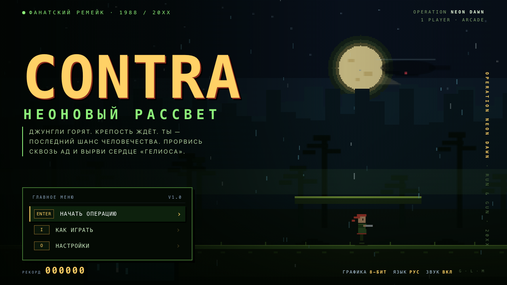

## Движок v2 («оболочка», волна 2 аркады)

`index.html` поднимает фреймворк **Гефест Arcade v2** (`engine.js` — копия `_shared/engine.js`) поверх
родного кода игры через `js/host.js` («хост поверх игры», как у ОБВАЛА/РУБИКОНА/ВИХРЯ):
`js/game.js` + `js/audio.js` (логика, этапы, боссы, баланс, рендеры 8-BIT и NEON, HUD, брифинги,
свой чиптюн-саундтрек) работают без изменений логики; движок рисует в отдельный прозрачный canvas
поверх кадра и даёт:

* меню (Играть / Как играть / Язык / Тема / Звук + рекорд), паузу (P/Esc), финалы «победа / конец игры»;
* тема движка **retro ⇄ 8-BIT**, **modern ⇄ NEON** (T или G; modern по умолчанию), язык RU/EN (L) —
  синхронно с игрой в обе стороны; звук (M / меню) ⇄ звук игры;
* рекорд `arcade.best.rubezh` (старый `contra.best` переносится при первом запуске);
* ссылку «← Каталог», фавикон студии; тач — родная крестовина игры (A — прыжок, B — огонь) + кнопка паузы Ⅱ;
* музыка — родная игры (6 тем); трек движка (`js/music.js`) не добавлялся, чтобы не играли два.

Игровой поток: «Играть» → родной брифинг этапа (Enter — в бой, Esc — в меню) → бой → «Этап пройден»
(родной экран, Enter — дальше) → брифинг этапа 2 → … → экран победы движка. Секретный код вводится
на брифинге или в бою.

Связь с игрой — только через её публичные объекты `window.__RUBEZH` (экспорт функций, добавлен для
оболочки) и `window.__CONTRA` (отладочный API). Отладочные адреса (`#shot=`, `#test`) отключают
оболочку — игра работает как раньше; `#gfx=retro|modern` и `#lang=ru|en` задают тему/язык на запуск.
Старая страница со своим меню — `legacy.html`.

Тесты порта: `node rubezh/tests/engine.test.mjs` (Playwright, свой сервер; внутри — и самотесты игры `#test`).

## Запуск

Откройте `rubezh/index.html` в Chrome / Safari / Firefox (двойной щелчок, `file://` подходит).
Нужны клавиатура, геймпад или тач-экран. Рекомендуется горизонтальная ориентация; на
телефоне в портрете появится подсказка «поверни устройство».

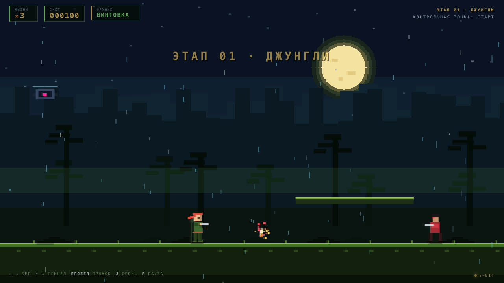

## Что внутри

* **2 этапа** — «Джунгли» и «Крепость «Гелиос»» — с разными фонами, опасностями и боссами.
* **Механика жанра run-and-gun**: бег, прыжок с переменной высотой, спрыгивание
  с платформ, стрельба в восьми направлениях, лежачая стойка, смерть от одного
  попадания, 3 жизни, чекпоинты и продолжение со сцены.
* **Оружие**: винтовка (R), пулемёт (M), дробовик на 5 пуль (S), пробивающий лазер (L)
  и щит на 3 заряда (B). Оружие выпадает из летающих капсул и лежит на уровнях.
* **Враги**: стрелки, бегуны, турели и дроны. У боссов свои фазы и рисунок атаки.
* **Два полноценных рендерера**:
  * **NEON / 20XX** — векторные спрайты, градиенты, bloom, параллакс, дождь,
    свет боссов, стеклянный HUD;
  * **8-BIT** — честные 480×270, ограниченная палитра, пиксельные спрайты,
    лунный свет, CRT-строки.
* **Оригинальный чиптюн-саундтрек** на WebAudio: 6 тем (титул, два этапа, босс,
  победа, game over), 4 канала, живой секвенсор, 16 SFX. Никаких сэмплов и файлов.
  Музыка стартует после первого нажатия клавиши — этого требуют браузеры.
* **Локализация**: русский (по умолчанию) и английский, `L` — переключение.
* **Секрет**: код `↑ ↑ ↓ ↓ ← → ← → B A` даёт +30 жизней (один раз за забег;
  подсказка спрятана в «Как играть»).
* **Геймпад** (Gamepad API) и **тач-кнопки** на мобильных.
* **Чекпоинты и рекорд**; +1 жизнь за каждые 20 000 очков.

## Управление

| Клавиши | Действие |
|---|---|
| `←` `→` / `A` `D` | бег |
| `↑` `↓` / `W` `S` | прицел вверх/вниз и по диагонали; `↓` на земле — лечь |
| `Пробел` / `Z` / `K` | прыжок (держите дольше — выше; `↓` + прыжок — спрыгнуть) |
| `J` / `X` / `Ctrl` | огонь (удерживайте для автоматической стрельбы) |
| `P` / `Esc` | пауза |
| `Enter` | подтвердить / начать |
| `T` / `G` | тема: modern (NEON) ↔ retro (8-BIT) |
| `L` | язык: русский ↔ английский |
| `M` | звук вкл/выкл |

На тач-экране: крестовина слева, `A` — прыжок, `B` — огонь, `Ⅱ` — пауза. В меню работают
стрелки, `Enter` и клики/касания. Геймпад: стик/крестовина, `A` — прыжок,
`X`/`B` — огонь, `Select` — подтвердить, `Start` — пауза.

## Два визуальных стиля

### NEON — тема modern

Логическое поле 480×270 рендерится в буфер 1440×810 (3×) с мягкими формами,
аддитивными свечениями, параллаксом из пяти слоёв и погодой. Спрайты героя и
врагов — векторные, с анимацией конечностей и неоновой подсветкой. Боссы —
отдельные многослойные конструкции со светом, роторами и фазовыми атаками.

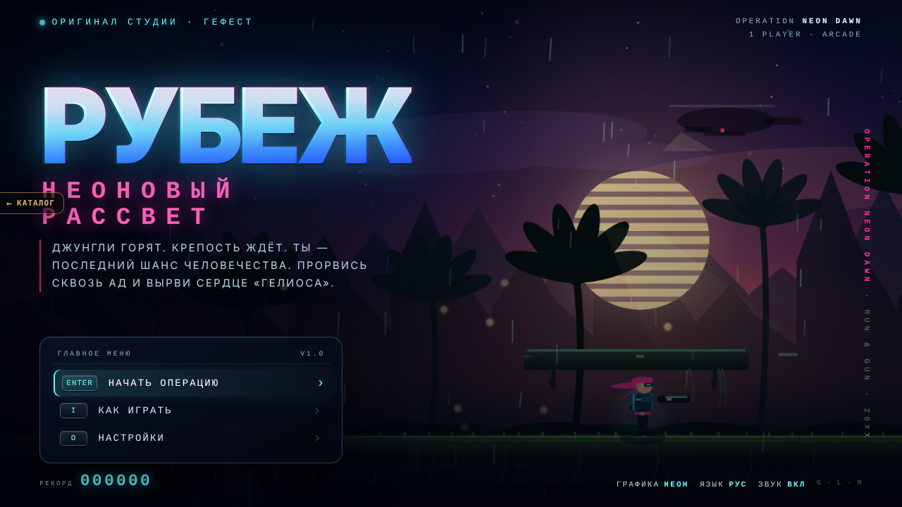
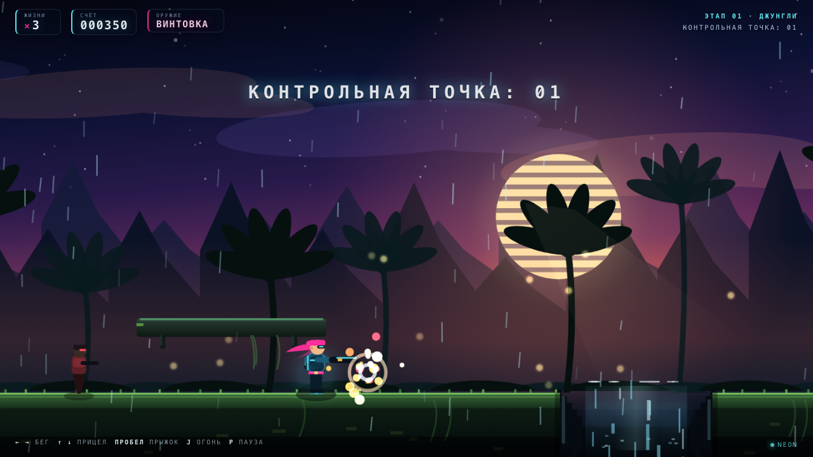

### 8-BIT — тема retro

Рендер в нативные 480×270 с ближайшим масштабированием, ограниченная палитра,
пиксельные спрайты героя и врагов, лестничные горы, луна с гало, дизеринг,
CRT-скан-линии и зелёно-янтарный интерфейс. Другой шрифт, другие панели, другая
подача — но тот же геймплей.

## Музыка

Полностью оригинальная 8-битная музыка, синтезируемая в браузере: два импульсных
канала, треугольный бас, шумовые барабаны и лёгкое эхо. Темы:

| Трек | Настроение |
|---|---|
| `title` | тёмный synthwave-чиптюн, 104 BPM, A minor |
| `stage1` | героический run-and-gun, 150 BPM, A minor |
| `stage2` | индустриальная крепость, 136 BPM, D Phrygian |
| `boss` | тревожный босс-темп, 168 BPM, E minor |
| `victory` / `gameover` | короткие джинглы |

Планировщик работает по lookahead, плавно кроссфейдит треки, глушится по `M` и
переживает скрытие вкладки. Подробности — в [docs/AUDIO.md](docs/AUDIO.md).

## Скриншоты

| | |
|---|---|
| 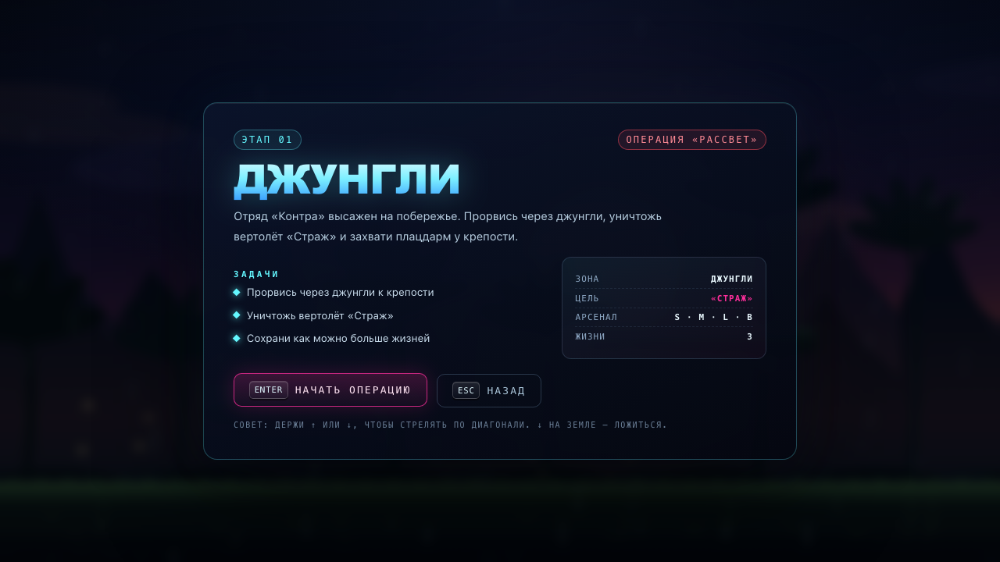 | 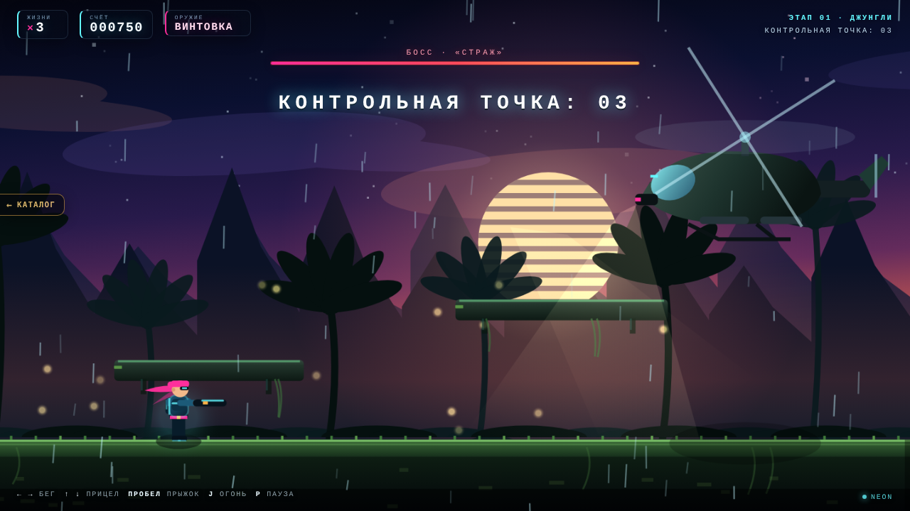 |
| 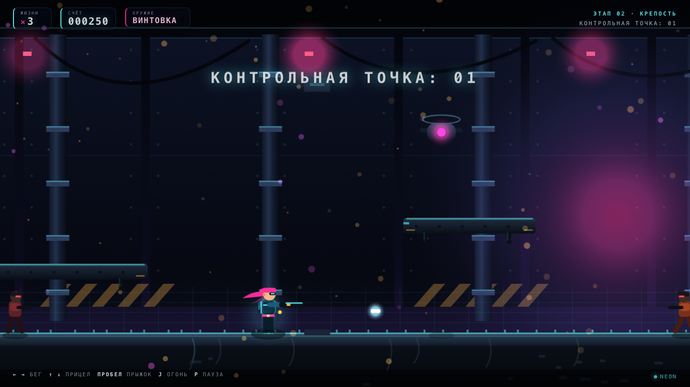 | 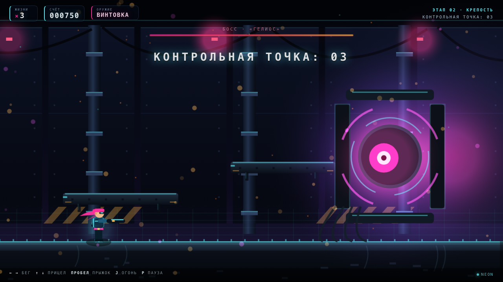 |
| 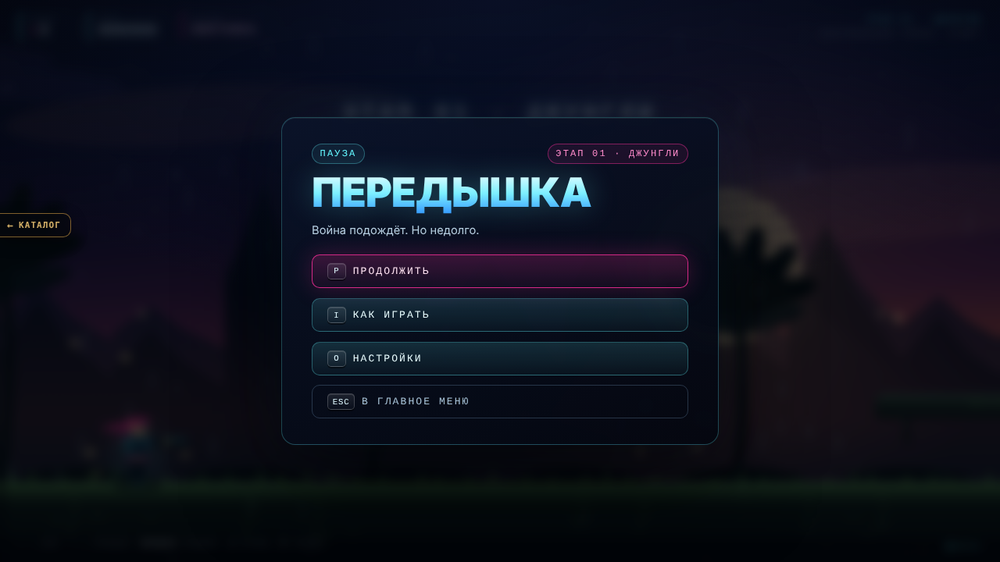 | 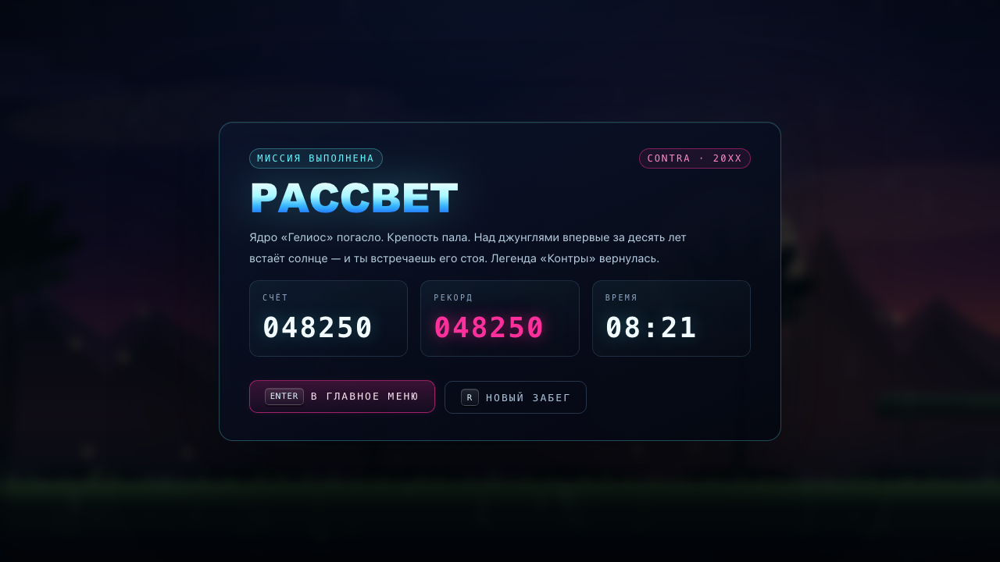 |
| 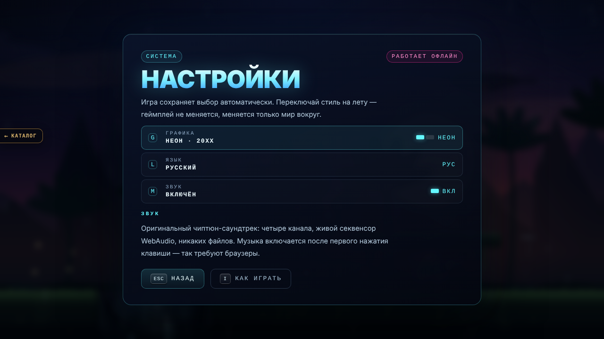 | 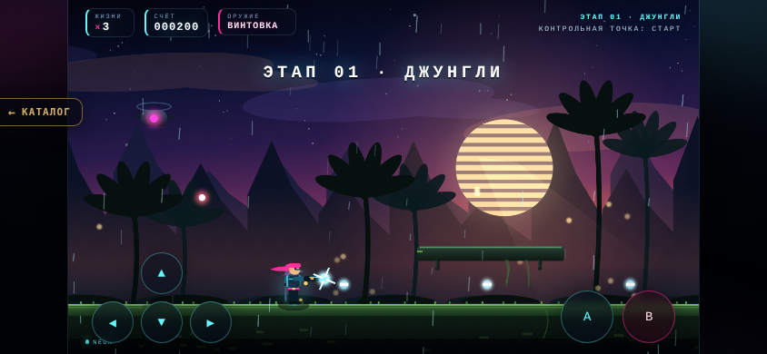 |

(Скриншоты — родные экраны игры, `legacy.html`; в `index.html` меню/пауза/финалы — экраны движка.)

## Как играть

* Один контакт с пулей, телом врага, лазером или падение в пропасть — потеря жизни.
  Щит поглощает три попадания.
* Оружие меняется мгновенно; `S` — лучший выбор против толпы, `L` пробивает врагов
  насквозь, `M` — максимальный DPS, `B` — страховка.
* Летающие капсулы сбиваются выстрелом: из них падает оружие. Не пропускайте их.
* Чекпоинты отмечены флагом; после смерти вы возвращаетесь к последнему.
* У боссов есть окно уязвимости и телеграфы атак: учите ритм.
* Рекорд и настройки сохраняются автоматически.

## Технические заметки

* Файлы: `index.html` (движок v2) и `legacy.html` (старая страница) подключают общие
  `css/style.css`, `js/audio.js`, `js/game.js`; ноль зависимостей и сетевых запросов, работает с `file://`.
* Логическое разрешение 480×270; NEON — 3× буфер, 8-BIT — 1× + nearest-neighbor.
* Спрайты, фоны, частицы и UI нарисованы кодом; шрифты — системные.
* Музыка и SFX — WebAudio без сэмплов.
* Исходники — `src/audio.js`, `src/game.js`, `src/style.css`. Сборка: `python3 tools/build.py`
  копирует их в `js/` и `css/` с проверкой `node --check`, `</script>` и внешних ссылок;
  `python3 tools/build.py --check` — только сверка.
* Самотесты: `rubezh/index.html#test` (или `legacy.html#test`) — **40/40 PASS** (данные уровней,
  i18n, физика, оружие, щит, смерть/респавн, чекпоинт, боссы, переходы этапов, лазер, секретный код,
  оба рендерера, HUD).
* Отладочные URL (оболочка движка в них выключена): `#shot=title|brief|play|boss|over|clear|win|pause|howto|settings`
  + `stage=1|2`, `gfx=modern|retro`, `lang=ru|en`, `x=...`, `fire=1`, `freeze=1`,
  `touch=1`, `lasers=on`, `dump=1`.
* Публичный отладочный API: `window.__CONTRA.state()`, `.start(stage)`, `.warp(x)`,
  `.spawnBoss()`, `.damageBoss(n)`, `.tick(sec)`, `.setGfx()`, `.setLang()`,
  `.selfTest()`; для оболочки — `window.__RUBEZH`.
* `node tools/shots.mjs` — пересобрать скриншоты в `screenshots/` (по `legacy.html`);
  `node tools/audio-smoke.mjs` — smoke-тест аудио; `node tools/cdp.mjs` — CDP-харнесс.
