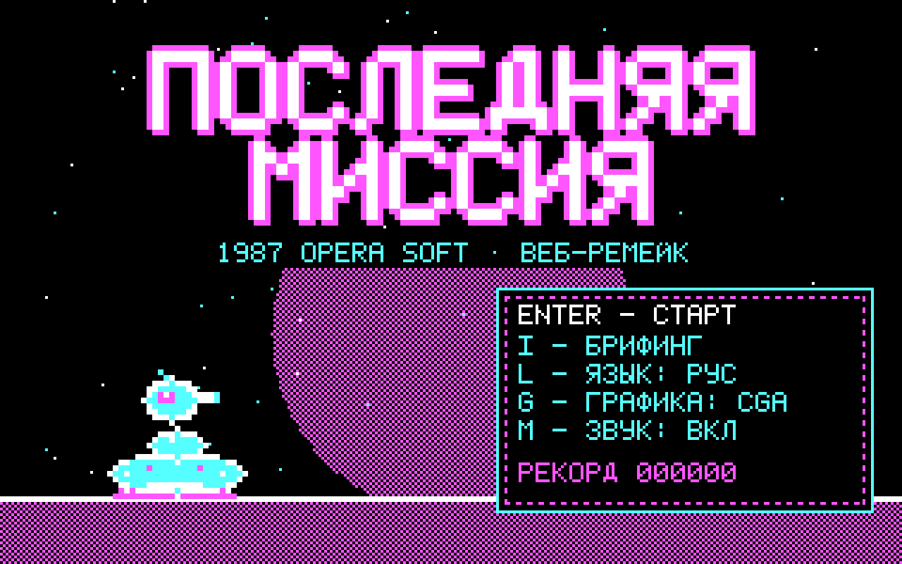
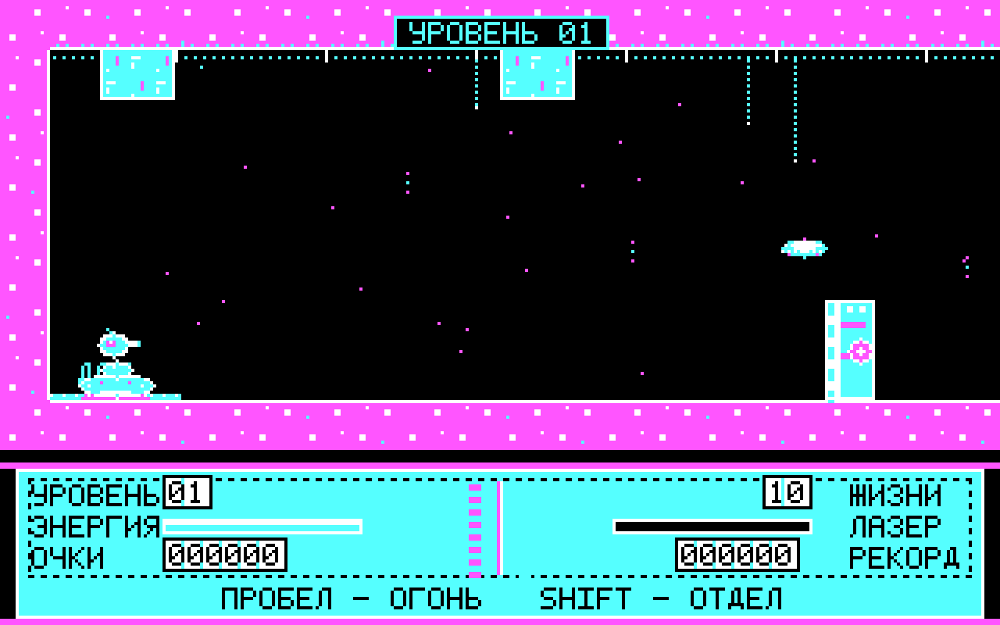
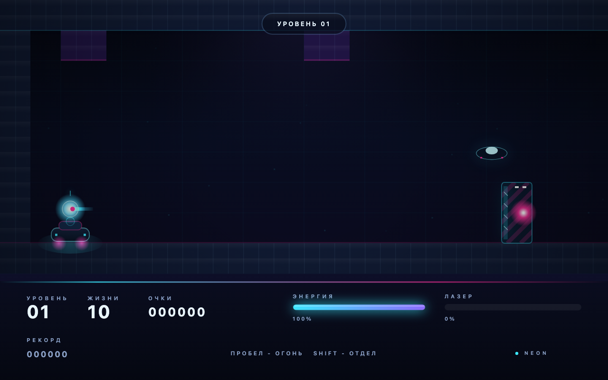
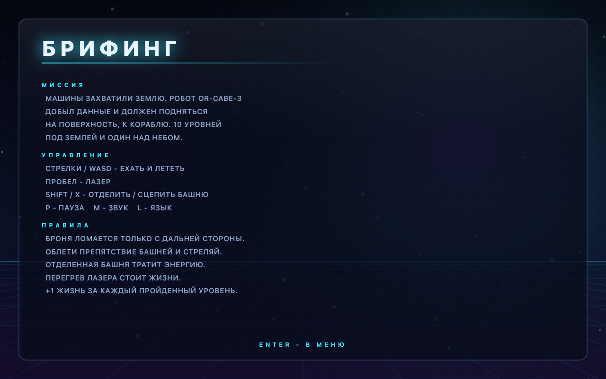
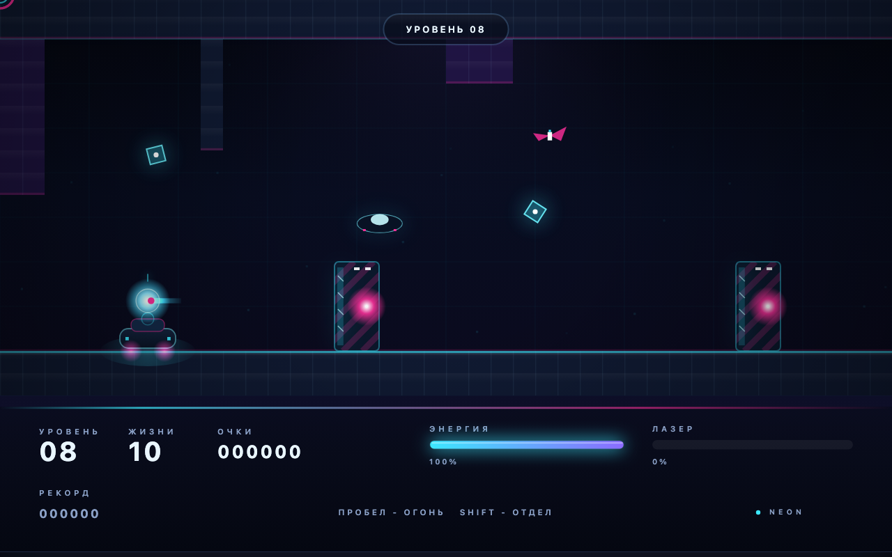
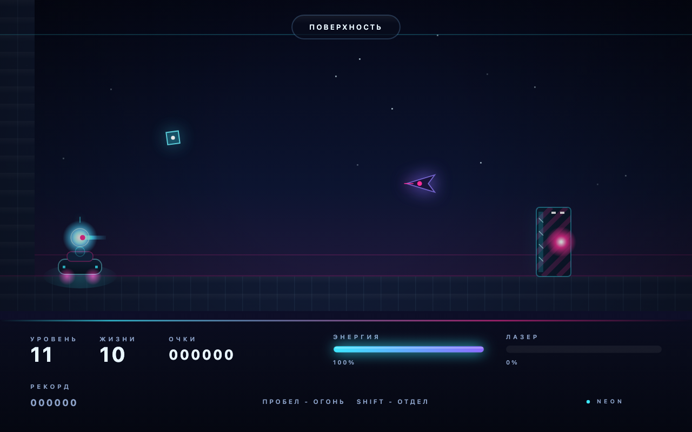
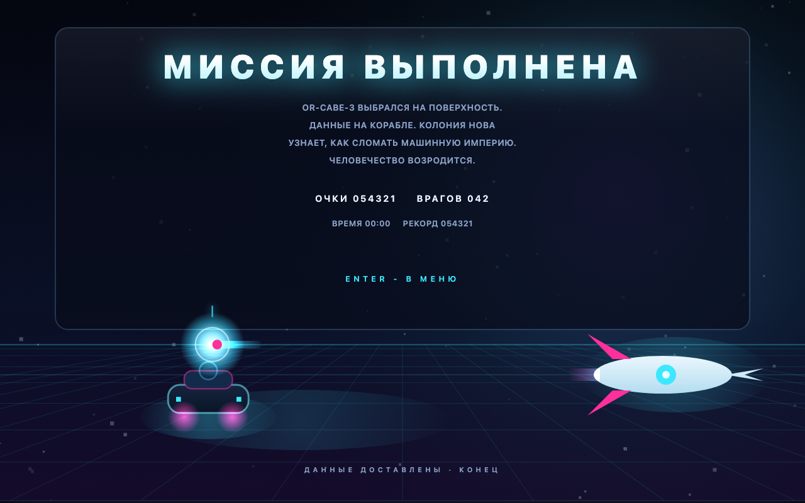
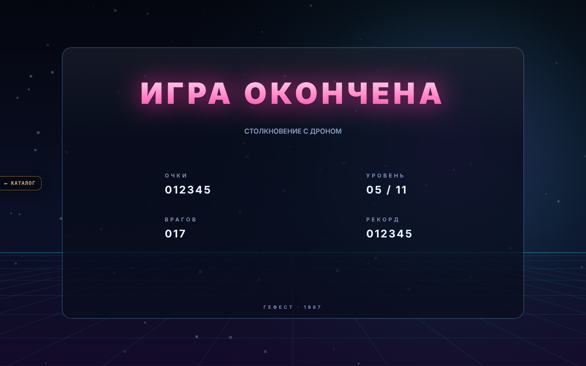

# THE LAST MISSION — HTML5 / NEON

Браузерный ремейк аркады **The Last Mission** (Opera Soft, 1987) в одном HTML-файле:
оригинальная механика, русский интерфейс, чиптюн-саундтрек и два визуальных стиля —
верный CGA-режим 1987 года (по умолчанию) и неоновая «современная» графика по клавише `G`.

## Движок v2 («оболочка», волна 2 аркады)

`index.html` поднимает фреймворк **Гефест Arcade v2** (`engine.js` — копия `_shared/engine.js`) поверх
родного кода игры через `js/host.js` («оболочка», как у БОЛТа/КОЛОБКА/ПЛАЩА, но без разбора монолита):
`js/game.js` (логика, 10 уровней + поверхность, рендеры CGA и неон, своя музыка-трекер) работают без изменений логики, уровней и баланса; движок рисует в отдельный
прозрачный canvas поверх кадра и даёт:

* меню (Играть / Брифинг / Язык / Тема / Звук + рекорд), паузу (P/Esc), финалы «победа / конец игры»;
* тема движка **retro ⇄ CGA**, **modern ⇄ неон** (T или G; modern по умолчанию), язык RU/EN (L) —
  синхронно с игрой в обе стороны; звук (M / меню) → mute игры;
* рекорд `arcade.best.rubikon` (старый `lastmission.record` переносится при первом запуске);
* ссылку «← Каталог», фавикон студии; тач-пульт на сенсорных экранах (кнопки шлют обычные клавиши);
* музыка — родная игры (трекер title/game); трек движка (`js/music.js`) не добавлялся, чтобы не играли два.

Связь с игрой — только через её публичный объект `window.__LM`. Отладочные адреса (`#shot=`, `#sim=`, `#test`)
отключают оболочку — игра работает как раньше; `#gfx=retro|modern` и `#lang=ru|en` задают тему/язык
на запуск (на них завязан `tools/thumbs.mjs`). Старая страница со своим меню — `legacy.html`.

Тесты порта: `node rubikon/tests/engine.test.mjs` (Playwright, свой сервер).

## Запуск

1. Откройте `index.html` двойным щелчком (или перетащите в окно браузера).
2. Нужна клавиатура. Работает офлайн, без сервера и зависимостей.
3. По умолчанию включены **CGA-графика** и **русский язык**. `L` — язык, `G` — стиль
   графики, `M` — звук; выбор графики и языка запоминается в localStorage.
   После этого обновления стиль один раз принудительно сбрасывается на CGA, дальше
   выбор игрока сохраняется.

## Два визуальных стиля (`G`)

### CGA — по умолчанию

Честные 320×200, четыре цвета (чёрный / белый / циан / маджента), пиксельный шрифт
5×7 с кириллицей и спрайты, нарисованные кодом. Тот самый вид DOS-порта.

### NEON

Отдельный рендерер высокого разрешения: неоновые свечения, стеклянные панели,
градиенты, частицы, системная типографика с разрядкой, параллакс и виньетка.
Логика игры при этом остаётся в сетке 320×200 — просто рисуется она векторно.

Переключение — клавиша `G` в любой момент (титул, игра, пауза), выбор сохраняется.
На титульном экране текущий стиль показан в меню.

## Музыка

Звук полностью синтезируется через WebAudio, без файлов:

* 4 канала: два пульсовых (12.5% и 25% duty), треугольный бас и шумовые барабаны;
* тема титульного экрана (96 BPM), основной игровой луп (152 BPM, ля-минор),
  джинглы «уровень пройден», «game over» и «победа»;
* музыка запускается после первого нажатия клавиши (правило автозапуска браузеров),
  приглушается на паузе и останавливается с джинглом на финальных экранах;
* `M` выключает весь звук.

## Управление

| Клавиши | Действие |
|---|---|
| `←` `→` / `A` `D` | ехать на гусеничном основании / лететь башней |
| `↑` `↓` / `W` `S` | лететь башней вверх/вниз (когда она отделена) |
| `Пробел` | лазер |
| `Shift` / `X` | отделить башню / пристыковать к базе |
| `G` | графика: NEON ↔ CGA |
| `L` | язык: русский ↔ английский |
| `M` | звук вкл/выкл |
| `P` / `Esc` | пауза |
| `Enter` | старт, меню, подтверждение |

## Как играть

Робот **OR-CABE-3** состоит из двух частей: гусеничное основание едет по полу,
а башня отделяется и летит в любом направлении, стреляя лазером. Нужно подняться
с самого дна подземной базы на поверхность — **10 подземных уровней + поверхность**.
На каждом уровне надо добраться до лифта в правом конце.

* Броня перекрывает коридор и не пробивается с «лицевой» стороны — облетите её
  башней и выстрелите с дальней стороны.
* Пока башня отделена, тратится энергия; перегрев лазера стоит жизни.
* Если база уничтожена, новая ждёт на доке в начале уровня.
* Ячейки данных в верхних закоулках дают очки.
* 10 жизней на старте, +1 за пройденный уровень. Лифт также восстанавливает
  немного энергии (небольшое отступление ради играбельности).
* Финал — поверхность и корабль.

## Скриншоты

| | |
|---|---|
|  |  |
|  |  |

## Оригинал

**The Last Mission** (1987) — аркадное приключение студии **Opera Soft** (Испания).
Дизайн и программирование — Pedro Ruiz, графика — Carlos A. Díaz de Castro.
Версии для Amstrad CPC, ZX Spectrum, MSX, MSX2, DOS, Amstrad PCW и Atari ST.

* [The Last Mission (Wikipedia)](https://en.wikipedia.org/wiki/The_Last_Mission_(video_game))
* [The Last Mission — Opera Soft (Internet Archive)](https://archive.org/details/zx_Last_Mission_The_1987_Opera_Soft_es)

Неофициальный фанатский порт, не связанный с Opera Soft. Оригинальные название и
вселенная принадлежат правообладателям; здесь нет оригинальных ассетов — вся графика
и звук сгенерированы кодом.

## Технические заметки

Один файл `index.html` (≈120 КБ), без зависимостей и сборки.

* Логическая сетка 320×200; CGA-режим (по умолчанию) рендерится в нативный буфер
  320×200, NEON-режим — в масштабированный буфер с векторными градиентами/свечениями.
* Собственный битмап-шрифт 5×7 для CGA, системный шрифт для NEON; кириллица в обоих.
* Чиптюн-трекер на WebAudio: пульсовые волны через `PeriodicWave`, треугольник и шум.
* Автотесты: `index.html#test` — **23/23 PASS** (логика, все этажи, оба рендерера,
  треки, локализация).
* Отладочные URL-параметры: `#shot=title|briefing|play&floor=6|win|gameover`,
  `#gfx=modern|retro`, `#lang=ru|en`, `#shot=play&floor=8&screen=2`.

Публичные функции для отладки — `window.__LM` (состояние, треки, переключение стилей,
ручной тик).
