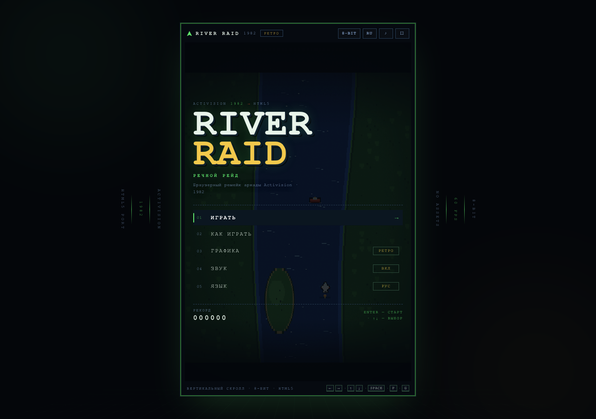
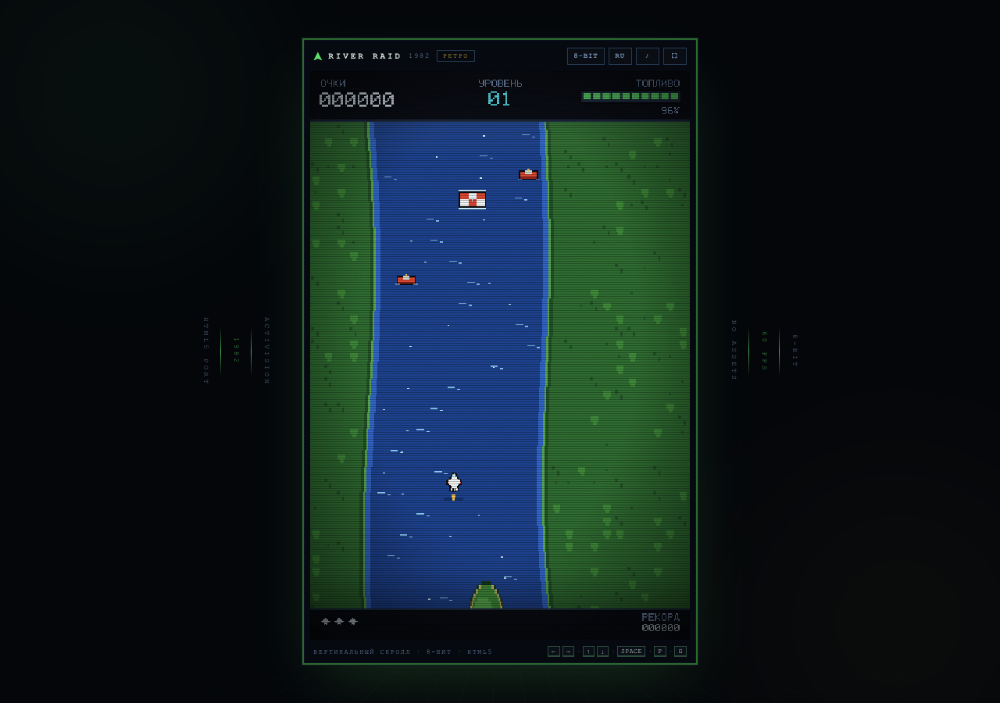
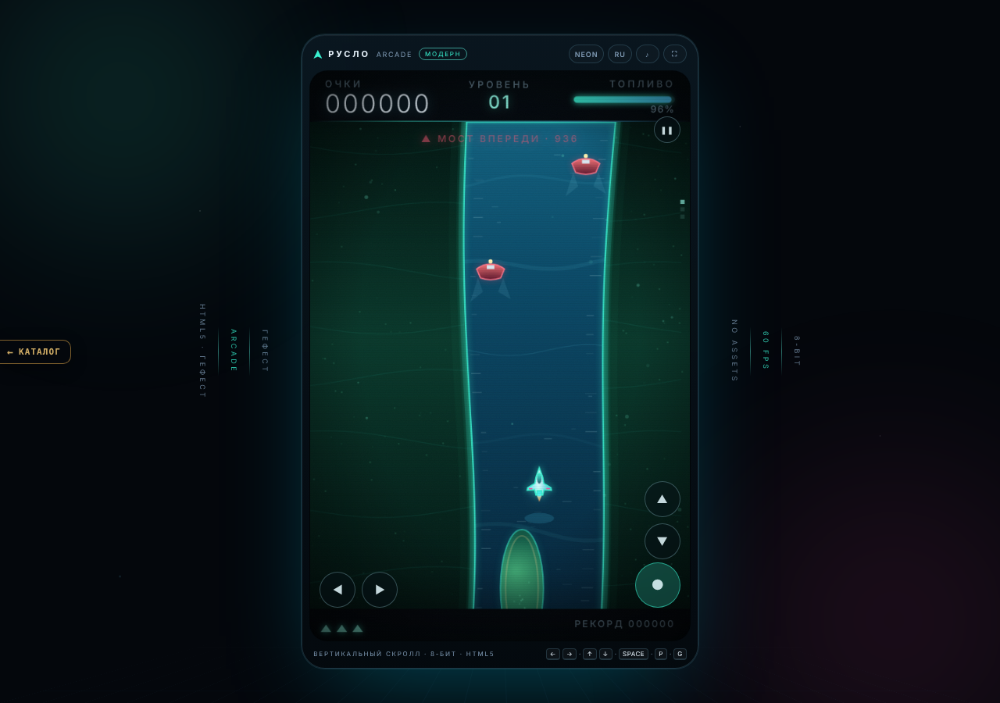
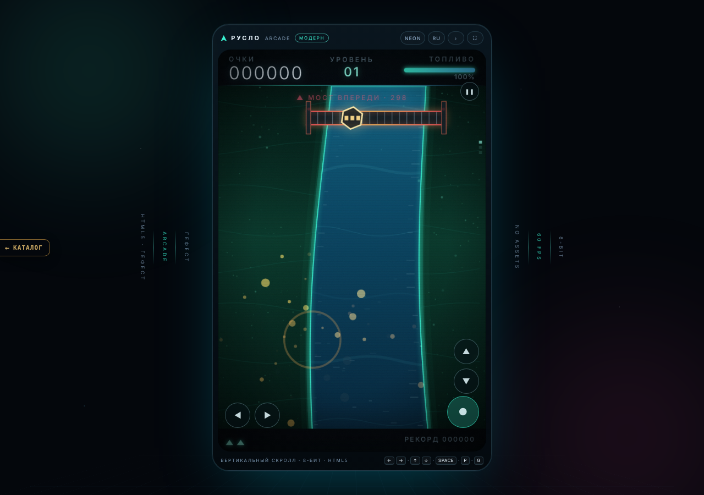
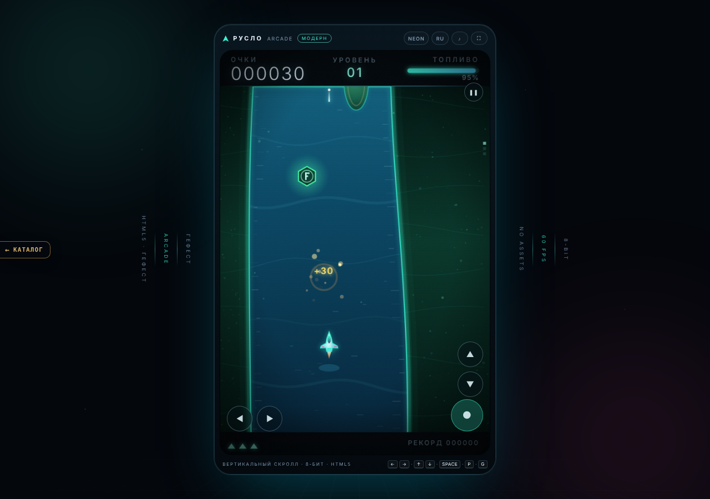
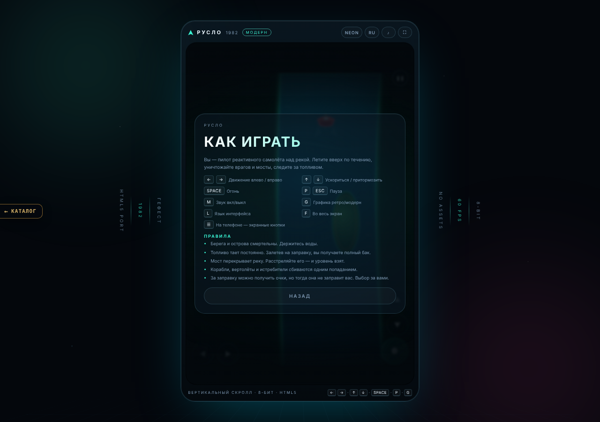
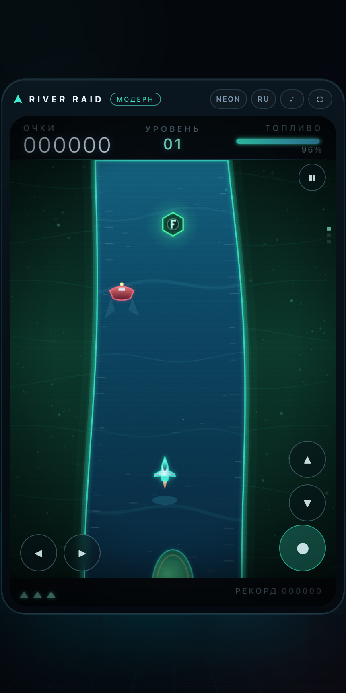

# РУСЛО — HTML5

> **v2 (фреймворк Гефест Arcade).** `index.html` — оболочка на движке `engine.js` (копия `_shared/engine.js`):
> меню/пауза (P/Esc)/темы retro↔modern (T, старая G тоже работает)/RU-EN (L)/звук (M)/рекорд `arcade.best.ruslo`
> (старый рекорд переносится при первом запуске; ключи прежней версии переезжают в `ruslo.*`), музыка — `js/music.js`. Раскладка v2: пробел — огонь,
> пауза — P/Esc (Enter в полёте больше не ставит паузу). Логика `js/game.js` (через `RUSLO.test`, без своего цикла),
> рендер `js/render.js`, SFX `js/audio.js` — родные, без изменений. Прежняя страница — `legacy.html`
> (на неё смотрят `tools/cdp.mjs` и `tools/test-*.js`). Тесты: `node ruslo/tests/engine.test.mjs`.

**РУСЛО** — оригинальная аркада студии «Гефест»:
вертикальный скроллер над рекой, где нужно лететь вверх по течению, сбивать
катера, вертолёты и истребители, заправляться на плавучих базах и уничтожать
мосты, чтобы пройти дальше.

Всё в одном каталоге, без сборки, CDN и внешних ассетов: открывается как
`ruslo/index.html` по `file://`, работает офлайн. Вся графика и весь звук
генерируются кодом.



## Что внутри

- **Два режима графики**, переключаются на лету клавишей `G` (или в меню).
  По умолчанию включён **ретро**:
  - **Ретро** — 8-битная палитра, крупные пиксели, пиксельный шрифт 5×7 с
    кириллицей, растровый HUD, скан-линии;
  - **Модерн** — неоновая вода с каустикой и пеной, светящиеся берега,
    частицы, стеклянная приборная панель с градиентной шкалой топлива.
  Выбор запоминается в `localStorage`.
- **Русский язык по умолчанию**, английский — по клавише `L`; выбор
  запоминается. Переведено всё: меню, инструкция, подсказки, HUD, финал.
- **8-битная музыка и звуки** синтезируются на WebAudio: три зацикленных трека
  (меню / игра / финал) в духе 8-битных приставок — пульсовые волны, треугольный бас и шумовые
  барабаны, планировщик с lookahead, кроссфейд, лимитер, мьют и пауза.
  Никаких mp3, сэмплов и внешних файлов.
- **Механика оригинала**: топливо, заправки, мосты, враги, берега и острова,
  три жизни, рост сложности, рекорд в `localStorage`.
- **Адаптивная оболочка**: портретный экран 2:3, экранные кнопки на телефоне,
  полноэкранный режим (`F`), пауза при уходе со вкладки, уважение
  `prefers-reduced-motion`, без горизонтального скролла от 320 px.
- **Производительность**: современный режим рендерится в 540×810 (1× экраны) или
  720×1080 (Retina) и не использует дорогие `backdrop-filter`/`mix-blend-mode`;
  в headless Chrome без GPU даже с 50 врагами кадр укладывается в ~28 мс.
- **Пиксельный HUD**: очки, уровень, топливо, жизни, рекорд, предупреждение
  «мост впереди» и всплывающие очки за сбитых врагов.

## Запуск

1. Откройте `index.html` двойным щелчком (Chrome, Safari, Firefox).
2. Либо поднимите статический сервер (необязательно):

   ```bash
   cd ruslo
   python3 -m http.server 8000
   # http://localhost:8000
   ```

3. Звук включается с первым нажатием клавиши или кликом — так требуют
   браузерные правила автовоспроизведения.

## Управление

| Клавиши | Действие |
|---|---|
| `←` `→` / `A` `D` | движение самолёта влево / вправо |
| `↑` `↓` / `W` `S` | ускориться / притормозить (влияет и на расход топлива) |
| `Пробел` | огонь (до 4 ракет в воздухе) |
| `P` / `Esc` | пауза |
| `M` | звук вкл/выкл |
| `G` | графика: ретро ⇄ модерн |
| `L` | язык: русский ⇄ английский |
| `F` | на весь экран |
| `Enter` | старт / подтверждение, в финале — новый забег |
| `R` | начать заново (на паузе и в финале) |

На телефоне и планшете появляются экранные кнопки: `◀ ▶` — движение,
`▲ ▼` — скорость, `●` — огонь, `❚❚` — пауза. Поддерживаются клавиши в русской
раскладке (`ЦФЫВ` = `WASD`).

## Правила и очки

| Объект | Очки | Примечание |
|---|---:|---|
| Катер | 30 | ходит поперёк реки, отражается от берегов |
| Вертолёт | 60 | быстрее катера |
| Истребитель | 80 | пересекает реку с большой скоростью |
| Заправка (расстрелять) | 80 | бак при этом **не** пополняется |
| Заправка (пролететь над ней) | +50 и полный бак | основной способ не упасть |
| Мост | 500 + 50×уровень | три попадания; после уничтожения — новый уровень |

- Берега, острова и столкновения с врагами и мостом смертельны. На старте и
  после возрождения действует короткая неуязвимость (самолёт мигает).
- Топливо тратится постоянно (чуть быстрее на форсаже). Пустой бак — потеря
  жизни.
- Жизни: 3 на старте, +1 за каждые три пройденных уровня; после возрождения
  остаётся минимум 60 % бака.
- Сложность растёт: скорость течения, плотность и скорость врагов, а также
  расстояние до следующего моста.
- Рекорд хранится в `localStorage` (`ruslo.hi`), настройки — там же.

## Экраны

| | |
|---|---|
|  |  |
| 8-битная палитра и пиксельный HUD (по умолчанию) | Неоновая вода, свечение, частицы |
|  |  |
| Мост: три попадания в энергоядро | Сбитый катер, всплывающие очки |
|  |  |
| Инструкция с клавишами и правилами | Мобильная раскладка с экранными кнопками |

Дополнительно в `screenshots/`: `title_retro.png`, `bridge_retro.png`,
`pause_modern.png`, `pause_retro.png`, `over_modern.png`, `over_retro.png`,
`help_retro.png`, `mobile_menu.png`.

## Структура

| Файл | Содержимое |
|---|---|
| `index.html` | оболочка: меню, инструкция, пауза, финал, экранные кнопки |
| `css/style.css` | дизайн-система двух тем (`data-gfx="retro" / "modern"`), скан-линии, стекло, адаптив |
| `js/core.js` | константы, математика, `localStorage`, пиксельный шрифт 5×7 с кириллицей |
| `js/lang.js` | словари RU/EN и переключение на лету |
| `js/audio.js` | процедурный чиптюн-движок: секвенсор, инструменты, три трека, 13 SFX |
| `js/render.js` | два независимых рендера (ретро/модерн), HUD, частицы, эффекты |
| `js/game.js` | состояние, физика полёта, река, враги, заправки, мосты, уровни, ввод, UI |
| `tools/cdp.mjs` | мини-харнесс на Chrome DevTools Protocol: прогон скриптов и скриншоты |
| `tools/test-game.js` | 43 автотеста механики и интерфейса |
| `tools/test-stress.js` | 20 стресс-проверок: состояния, память, сеть, WebAudio, localStorage, FPS |
| `tools/test-autopilot.js` | автопилот для проверки баланса (топливо, сложность, уровни) |
| `tools/scenes.json` | сценарий пакетной съёмки скриншотов |
| `tools/audio-test.html`, `tools/audio-probe.js` | офлайн-рендер треков и SFX (61 проверка) |

Внутреннее разрешение — **360×540** (портрет 2:3). Ретро рисуется в натуральную
величину и растягивается с `image-rendering: pixelated`; модерн — в увеличенном
backing store (540×810 на экранах 1×, 720×1080 на Retina) ради плавных свечений. Шрифт HUD — собственный битмап 5×7
(латиница, цифры, пунктуация, кириллица), поэтому кириллица выглядит так же
пиксельно, как латиница; в современном режиме подписи набраны системным
шрифтом.

## Проверка

Нужен Chrome (или Chromium) и Node.js ≥ 18; зависимостей нет. Путь к браузеру можно задать
переменной `CHROME` (например, Chromium из Playwright). Тесты `tools/test-*.js` гоняются на старой
странице `legacy.html` (её собственные меню и DOM-интерфейс; страница v2 `index.html` с оболочкой движка
проверяется `tests/engine.test.mjs`).

```bash
cd ruslo
node tools/cdp.mjs eval --page legacy.html --script tools/test-game.js --wait 600
node tools/cdp.mjs eval --page legacy.html --script tools/test-stress.js --wait 600
node tools/cdp.mjs eval --page legacy.html --script tools/test-autopilot.js --wait 500
node tools/cdp.mjs scenes --page index.html --scenes tools/scenes.json --width 1280 --height 900
node tools/cdp.mjs eval --page tools/audio-test.html --script tools/audio-probe.js --args '{}'
```

Ожидаемый результат:

- `test-game.js` — `"passed": 43, "failed": 0`, в конце `✅ чисто`;
- `test-stress.js` — `"passed": 20, "failed": 0`: переключения в игре/паузе/смерти,
  отсутствие внешних запросов, ограниченный рост массивов за 2 минуты,
  работа без WebAudio и без localStorage, средний кадр < 33 мс (на живой
  видеокарте — 60 fps; про headless без GPU — см. «Порог FPS» ниже);
- `test-autopilot.js` — бот доходит до 2–5 уровня за 60–100 секунд
  (проверка, что топлива и заправок хватает, а мосты проходятся);
- `scenes` — 15 PNG в `screenshots/`;
- `audio-probe.js` — 61 проверка, 0 failed (треки меню/игры/финала и 13 SFX
  рендерятся через `OfflineAudioContext`, считается RMS/peak).

**Порог FPS в `test-stress.js`.** Замер кадра зависит от железа: в контейнере без GPU
(headless Chrome, `--disable-gpu`, рендер SwiftShader/llvmpipe на CPU, соседние процессы)
средний кадр бывает > 33 мс, хотя игра исправна. Поэтому порог зависит от окружения:

- `RUSLO_FRAME_MS=50 node tools/cdp.mjs eval ... --script tools/test-stress.js` — свой порог в мс
  (или `--args '{"frameMs":50}'`), по умолчанию 33;
- если окружение «мягкое» (UA `HeadlessChrome`, программный WebGL или WebGL нет) и порог превышен —
  проверка не проваливается, а в результате появляется `"warnings": ["кадр … мс ≥ 33 мс — headless …"]`;
  в `out.fps` видно `limitMs`, `softEnv`, `gpu`;
- `RUSLO_STRICT_FPS=1` (или `--args '{"strictFps":true}'`) — строгий режим: превышение = провал
  в любом окружении (для замера на машине с видеокартой).

`cdp.mjs` передаёт скрипту все переменные окружения `RUSLO_*` как `args.env`.

Харнесс сам поднимает headless Chrome на свободном порту, собирает
`console`/`error`, умеет эмулировать мобильный вьюпорт и делать скриншоты
сцен из `tools/scenes.json`.

## Дизайн-решения

- Враг не стреляет; опасность — в столкновении.
- Мост выдерживает три попадания, чтобы перестрелка перед мостом была читаемой.
- Острова и изгибы реки генерируются процедурно по сидам, поэтому каждый забег
  выглядит по-новому; сложность сглажена для игры с клавиатуры и тача.

## Лицензия

Код — MIT. РУСЛО — оригинальная игра студии «Гефест».
