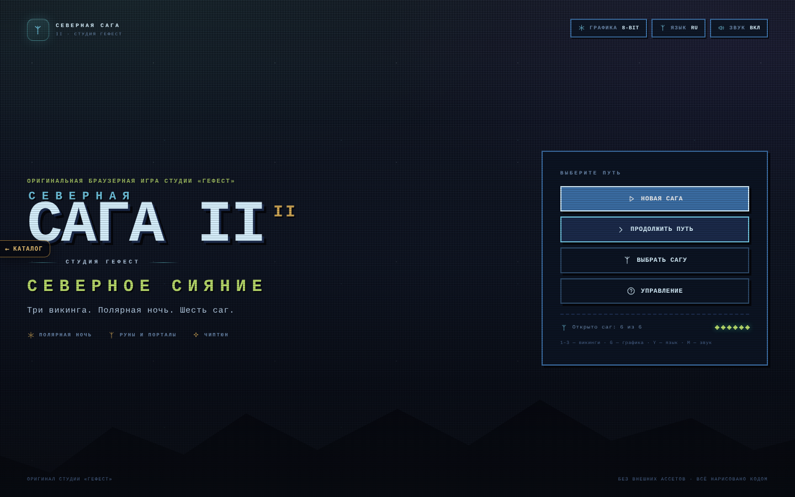
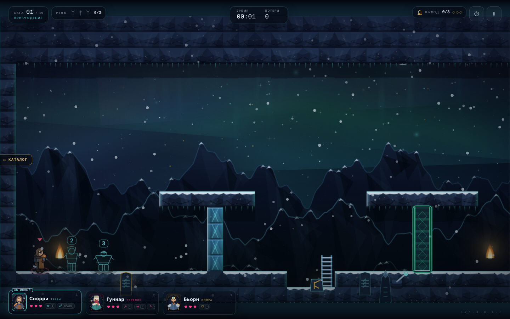
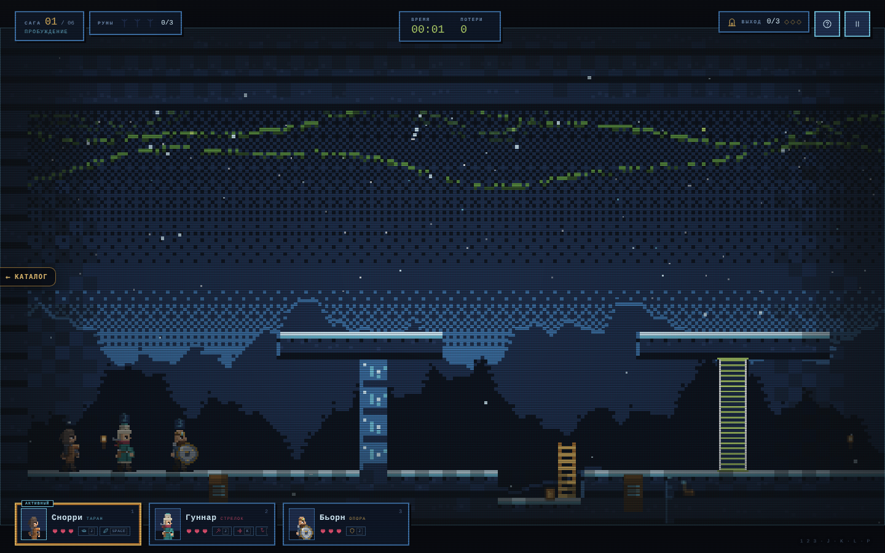
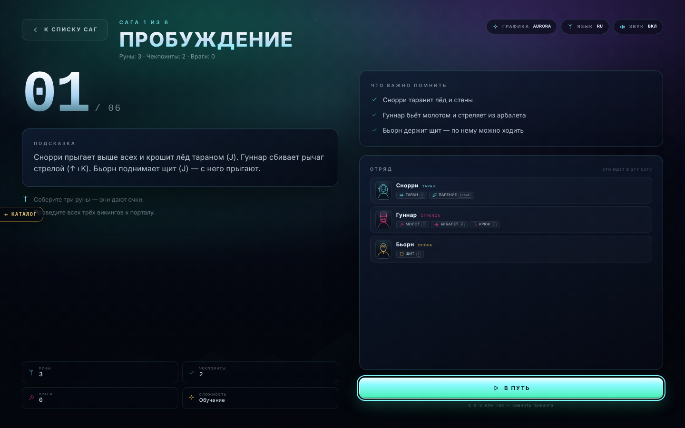
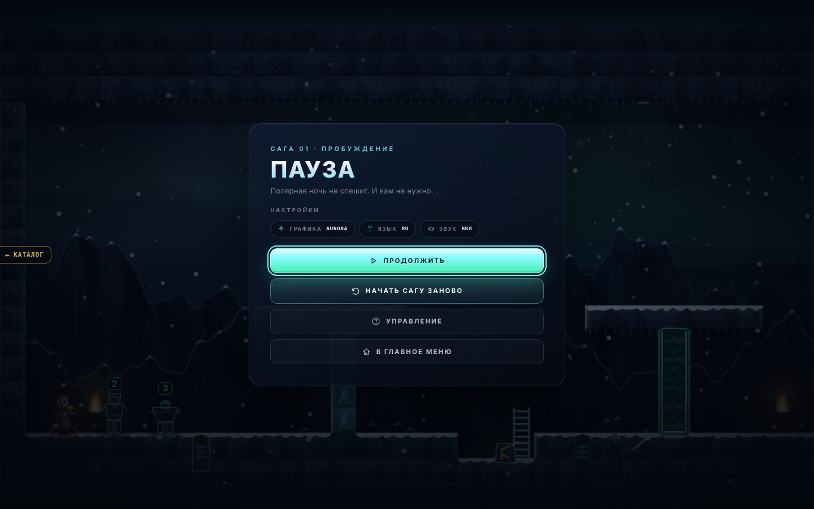
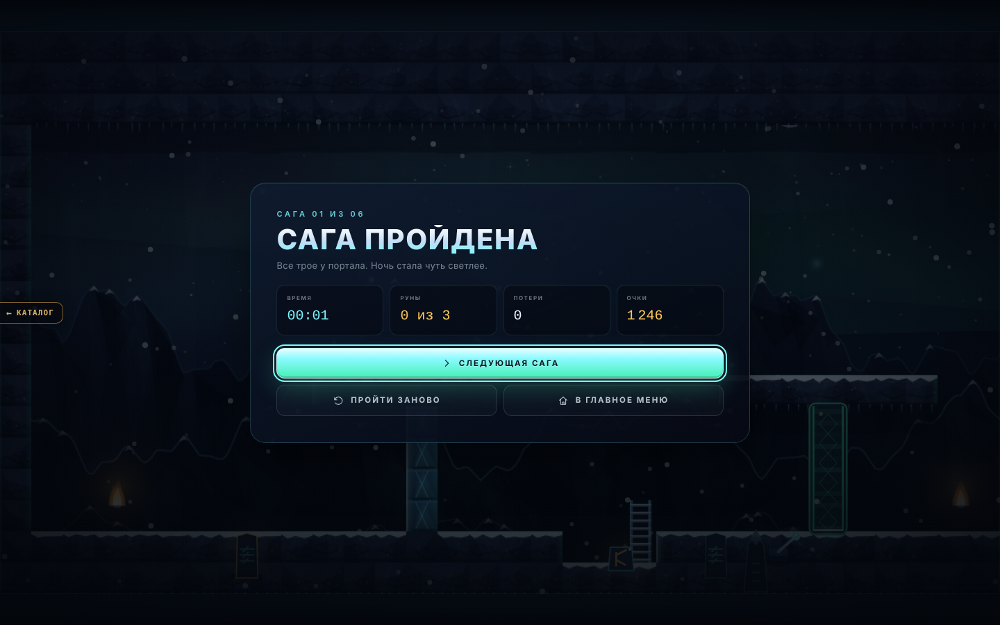
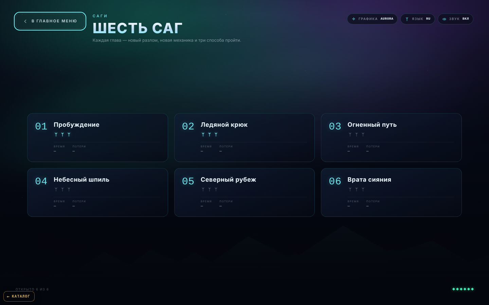
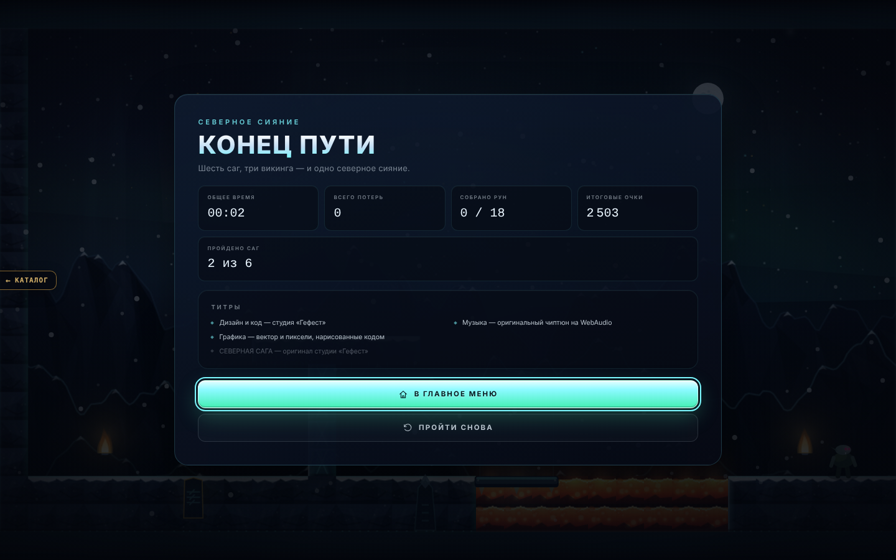
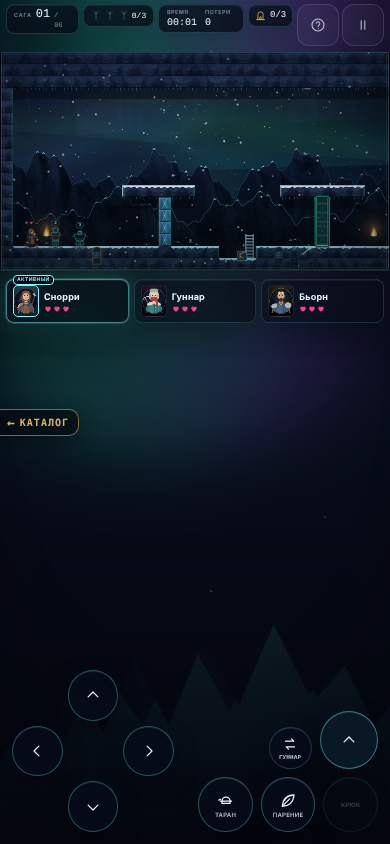

# СЕВЕРНАЯ САГА 2 · «Северное сияние» · Гефест Arcade

Оригинальная платформер-головоломка с тремя героями студии «Гефест»: три викинга, которых
небеса забросили в полярную ночь, шесть саг, два режима графики и чиптюн-саундтрек.
Всё работает без сборки, npm, CDN, интернета и внешних ассетов — графика, музыка и звук
сгенерированы кодом.



## Движок v2 («оболочка», волна 2 аркады)

`index.html` поднимает фреймворк **Гефест Arcade v2** (`engine.js` — копия `_shared/engine.js`) поверх
родного кода игры через `js/host.js` (вариант «хост поверх игры», как у ОБВАЛА/РУБИКОНА/ВИХРЯ;
копия `saga/js/host.js`). Родные `js/*.js` (логика, 6 саг, физика, рендеры AURORA и 8-BIT —
включая общие с первой частью пиксельные спрайты викингов `js/vikings-retro.js`, HUD, брифинги,
своя музыка) работают без изменений логики, уровней и баланса. В `js/main.js` добавлен только экспорт
`SAGA2.main.newGame / continueGame / pause / resume`. Движок рисует в отдельный canvas (рамка 16:9 по центру)
поверх кадра и даёт:

* меню: **Играть** (новая сага с первой земли; прогресс не сбрасывается) / **Продолжить · N**
  (брифинг последней открытой саги) / **Саги** (родной выбор) / **Язык** / **Тема** / **Звук**;
  паузу (P/Esc) с «Продолжить / Звук / В меню»; финал — экран победы движка;
* тема движка **modern ⇄ AURORA**, **retro ⇄ 8-BIT** (T или G; modern по умолчанию), язык RU/EN —
  синхронно с игрой в обе стороны; звук (M / меню) → музыка и эффекты игры;
* рекорд `arcade.best.saga-2` — очки забега; старый результат (сумма лучших очков по сагам из
  `saga2.progress`) переносится при первом запуске;
* ссылку «← Каталог» (в самой игре скрыта, чтобы не перекрывать HUD), фавикон студии;
  тач — родные экранные кнопки игры.

Родными остались брифинг саги («В путь»), выбор саги, «Сага пройдена» и помощь; родные титул,
пауза и финал скрыты — их заменяют экраны движка.

**Клавиши языка:** в меню движка — `L`; в игре `L` по-прежнему **крюк Гуннара-лучника** (Гуннара), а язык,
как и раньше, — `Y`. Переключение героев (1/2/3, Tab) и все игровые клавиши — как раньше.

**Прогресс игроков сохраняется:** старые ключи `lv2.*` (до ребрендинга) игра при запуске переносит в `saga2.*`
и удаляет (тест в `tests/engine.test.mjs`); `saga2.progress` (открытые саги, руны, лучшие времена/очки) оболочка
не трогает. Настройки графики/языка/звука теперь общие для аркады (`arcade.theme`, `arcade.lang`,
`arcade.sound`) — игра следует за ними (её `saga2.mode` / `saga2.lang` / `saga2.muted` обновляются вслед).

Музыка — родная игры (5 тем); трек движка (`js/music.js`) не добавлялся, чтобы не играли два.

Отладочные адреса работают как раньше: `?mode=retro|aurora`, `?lang=ru|en`, `?level=N` (сразу в игру),
`?screen=levels`, `?touch=1`; тему/язык движка они задают на этот запуск. `#gfx=` / `#lang=` — то же
для `tools/thumbs.mjs`. `#shot=` / `#sim=` / `#test` (и `?shot=`) отключают оболочку.
Старая страница со своим меню — `legacy.html` (те же `css/` и `js/`).

Тесты порта: `node saga-2/tests/engine.test.mjs` (Playwright, свой сервер).

## Сюжет

Локи разбил Солнечный камень, и руны разлетелись по северным мирам. Три викинга —
**Снорри Таран**, **Гуннар Стрелок** и **Бьорн Опора** — идут через ледяные залы,
кузню Имира, небесный шпиль и Врата сияния, чтобы собрать руны и вернуть драккар домой.

## Как играть

В каждый момент вы управляете **одним** викингом; остальные замирают на месте — это
основа головоломок. Переключайтесь `1`/`2`/`3` или `Tab`, оставляйте Бьорна на плите,
поднимайте его щит как ступеньку, стреляйте Гуннаром в рычаги, ломайте лёд Снорри.

| Клавиши | Действие |
|---|---|
| `←` `→` / `A` `D` | идти |
| `↑` `↓` / `W` `S` | лестницы, прицел лука/крюка |
| `Space` | прыжок (Снорри, Бьорн); у Снорри в падении — парение |
| `J` | способность: таран Снорри / меч Гуннара / щит Бьорна (удерживать) |
| `K` | лук Гуннара (с `↑` — вверх) |
| `L` | крюк Гуннара (вверх или по взгляду; повторно — отцепиться) |
| `1` `2` `3` / `Tab` | выбор викинга |
| `R` | заново уровень |
| `H` | подсказка уровня |
| `P` `Esc` | пауза (на родных экранах между сагами — в меню) |
| `G` / `T` | графика AURORA ↔ 8-BIT |
| `Y` (в меню — `L`) | язык |
| `M` | звук |

### Герои

| | Снорри Таран | Гуннар Стрелок | Бьорн Опора |
|---|---|---|---|
| Роль | скорость и высота | оружие и дальний бой | щит и опора |
| Способности | высокий прыжок, **таран** (ломает лёд), **парение** | **молот**, **арбалет**, **крюк-кошка** | **щит**: блок, планирование и платформа, по которой ходят другие |
| Облик | кожаный капюшон, кузнечный фартук, медный наплечник | меховая шапка, длинный кафтан, шарф, арбалет | кузнечные очки, борода-косица, стёганый жилет, щит-кузнечный круг |

- 3 сердца у каждого; смерть — возрождение у чекпоинта (счётчик потерь ведётся).
- Руны (по 3 на уровень) дают очки; выход открыт только когда все трое дошли.
- Враги: `grunt`, `thrower` (стреляет — щит Бьорна блокирует), `bat`.
- Плиты и рычаги открывают энерговорота; движущиеся платформы возят викингов.

## Два визуальных стиля

### AURORA (modern, по умолчанию в аркаде)

Полярное небо с живой авророй, параллакс в несколько слоёв, снег, объёмный свет, rim-light на льду,
эмиссивная лава и руны, кинематографичная виньетка. Спрайты нарисованы векторно и анимированы.



### 8-BIT (retro)

Честные **512×288**, увеличенные nearest-neighbour, ограниченная палитра, дизеринг,
CRT-скан-линии и пиксельные спрайты героев (`js/vikings-retro.js`: блок `HERO-SPRITES` дословно общий
с первой частью, проверяет `tests/engine.test.mjs`).



## Уровни

1. **Пробуждение** — прыжок, таран, выстрел по рычагу, щит-ступенька.
2. **Ледяной крюк** — реки льда и крюк.
3. **Огненный путь** — лава, платформы, враги.
4. **Небесный шпиль** — вертикаль: парение, крюк, лестницы.
5. **Северный рубеж** — комбинированные головоломки.
6. **Врата сияния** — финал у трона Локи.

Подробные прохождения — в `docs/LEVELS.md`.

| | |
|---|---|
|  |  |
|  |  |
|  |  |

## Мобильный режим

Портретная раскладка: кадр 16:9 сверху, компактный HUD, карточки викингов под кадром и
экранные кнопки внизу. Тач-управление появляется автоматически на устройствах с сенсором
(или по `?touch=1`).



## Музыка и звук

Полностью синтезированный чиптюн на WebAudio, без файлов: 5 оригинальных тем (`title`, `game0`,
`game1`, `game2`, `ending`), 32 SFX, lookahead-планировщик, бесшовные лупы, мастер-компрессор;
музыка запускается после первого жеста (правило браузеров), `M` глушит всё.

## Технические заметки

- Классические скрипты, никаких ES-модулей.
- Виртуальный экран **1024×576**, тайл **32 px**, физика с фиксированным шагом 60 Гц,
  coyote-time и jump-buffer, AABB-коллизии с тайлами, дверями и платформами.
- Камера со сглаживанием и тряской; уровни до 80×30 тайлов.
- Прогресс: `localStorage` (`saga2.progress`, `saga2.mode`, `saga2.lang`, `saga2.muted`).

### Структура

```
saga-2/
  index.html            — страница игры на движке v2 (оболочка)
  legacy.html           — старая страница со своим меню
  engine.js             — копия _shared/engine.js
  css/style.css         — дизайн-система и оба режима
  js/host.js            — оболочка движка поверх игры
  js/i18n.js            — RU/EN
  js/levels.js          — 6 уровней
  js/audio.js           — чиптюн и SFX
  js/vikings-retro.js   — пиксельные викинги (общие с первой частью)
  js/render.js          — AURORA + 8-BIT
  js/game.js            — движок игры, физика, способности, пазлы
  js/ui.js              — экраны, HUD, меню, тач
  js/main.js            — ввод, поток экранов, сохранения, цикл
  tests/engine.test.mjs — тесты порта на движок v2
  tools/                — CDP-харнесс, тесты, валидатор уровней, dev-стенд
  docs/LEVELS.md        — прохождения
  screenshots/          — скриншоты
```

## Проверка

```bash
node saga-2/tests/engine.test.mjs        # оболочка движка v2 (Playwright)
node saga-2/tools/validate-levels.mjs    # уровни: формат, группы, достижимость
node saga-2/tools/test-engine.mjs        # физика и способности (headless, без браузера)
node saga-2/tools/audio-test.mjs         # WebAudio-планировщик на заглушке
```

Вся графика, музыка и звук написаны кодом специально для этой игры; сторонние ассеты не использованы.
