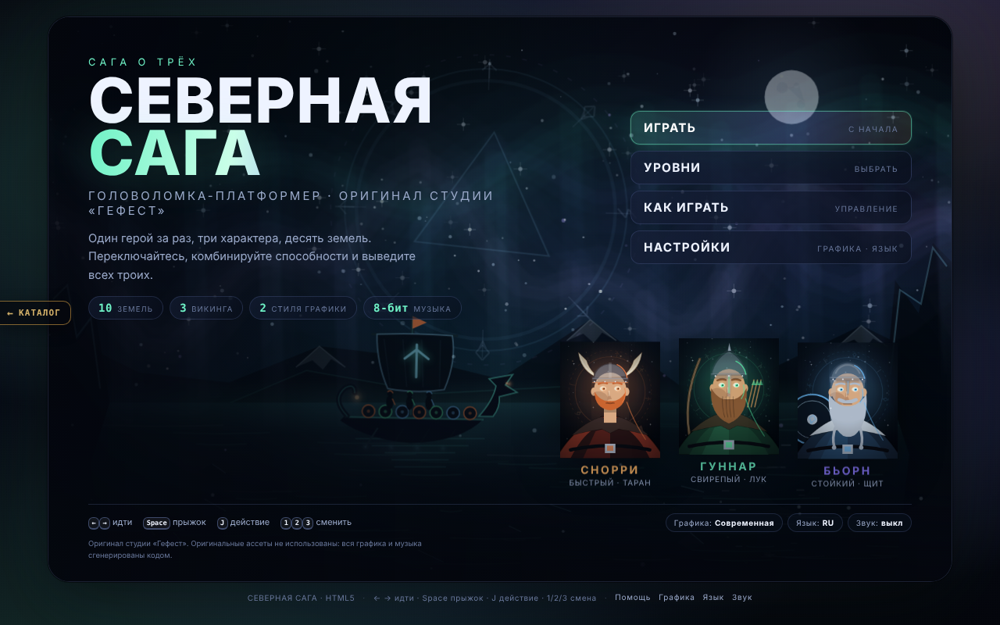
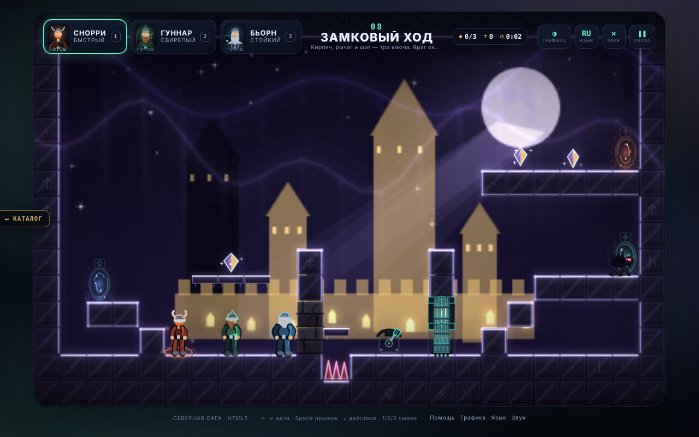
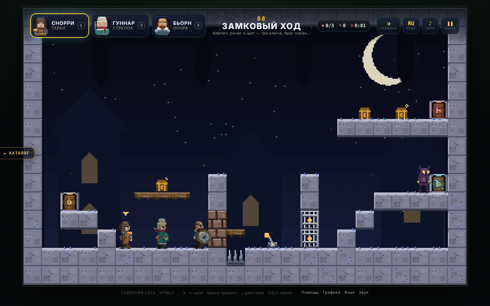
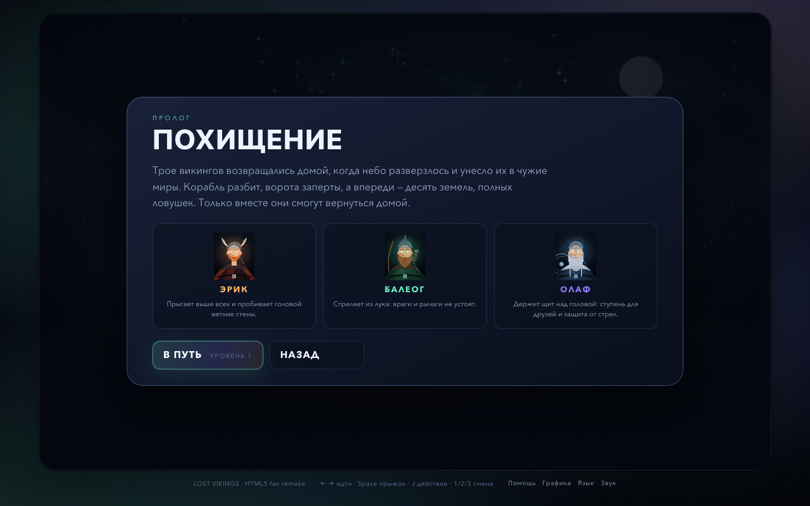
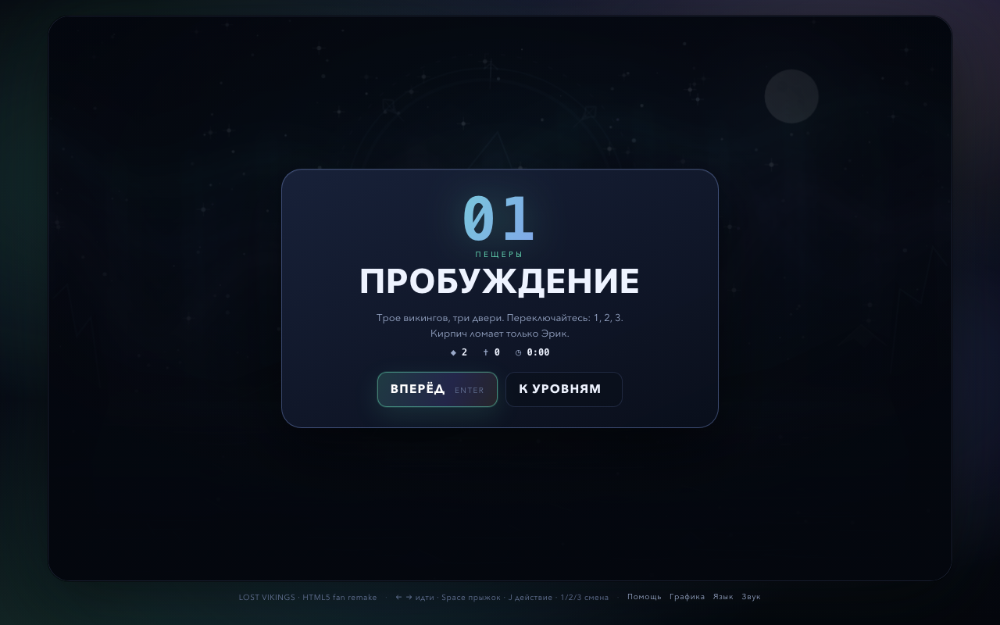
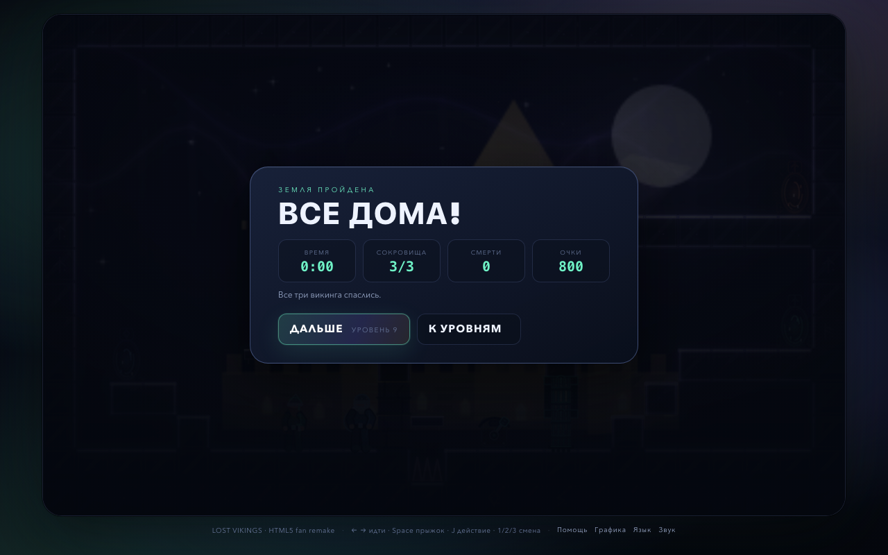
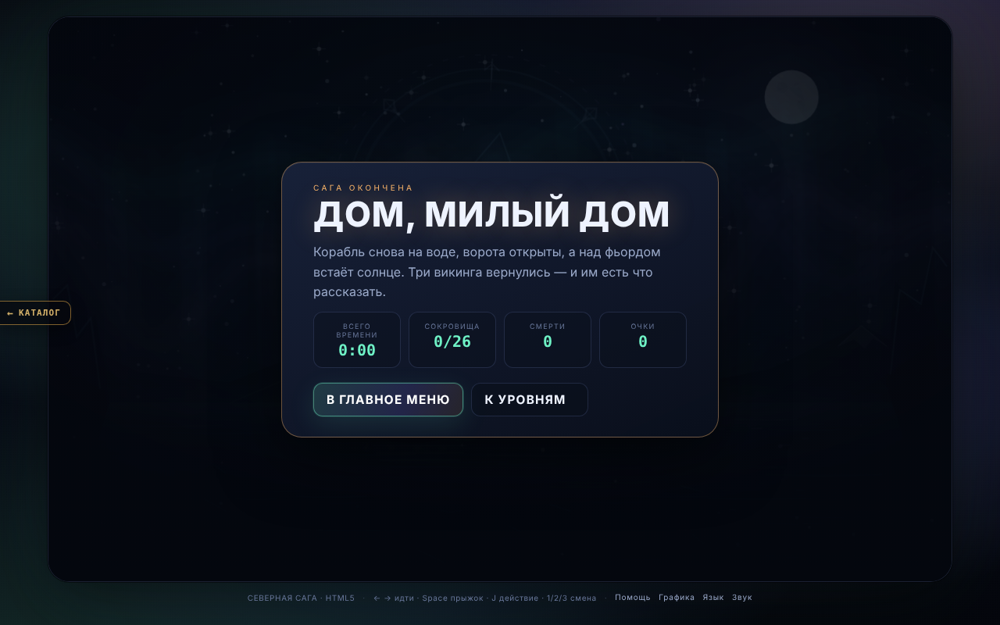

# СЕВЕРНАЯ САГА · Гефест Arcade

Оригинальная платформер-головоломка с тремя героями студии «Гефест»: три северянина с разными
способностями, переключение героев, головоломки на десяти землях, два визуальных стиля
и оригинальный 8-битный саундтрек.

## Движок v2 («оболочка», волна 2 аркады)

`index.html` поднимает фреймворк **Гефест Arcade v2** (`engine.js` — копия `_shared/engine.js`) поверх
родного кода игры через `js/host.js` (вариант «хост поверх игры», как у ОБВАЛА/РУБИКОНА/ВИХРЯ).
`js/game.js` (логика, 10 земель, физика, рендеры modern и 8-бит, HUD, брифинги, своя музыка) работает
без изменений логики, уровней и баланса — это код старой страницы, вынесенный из инлайна как есть;
`css/style.css` — её стили. Движок рисует в отдельный прозрачный canvas поверх кадра и даёт:

* меню: **Играть** (сага с начала: пролог при первом запуске, затем брифинг земли 1) /
  **Продолжить · N** (брифинг последней открытой земли) / **Уровни** (родная карта земель) /
  **Язык** / **Тема** / **Звук**; паузу (P/Esc) с «Продолжить / Звук / В меню»; финал саги — экран победы движка;
* тема движка **modern ⇄ современная графика**, **retro ⇄ 8-бит** (T или G; modern по умолчанию,
  G, как и раньше, уводит из modern в retro), язык RU/EN (L) — синхронно с игрой в обе стороны;
  звук (M / меню) → звук игры;
* рекорд `arcade.best.saga` — очки саги (у игры раньше рекорда очков не было);
* ссылку «← Каталог», фавикон студии; тач — родные экранные кнопки игры.

Родными остались экраны между уровнями: пролог («В путь»), брифинг земли («Вперёд»), карта земель,
«Земля пройдена», «Северянин пал», «Как играть», «Настройки». Родные титул, пауза и финал скрыты —
их заменяют экраны движка. Переключение героев (1/2/3, Tab/Q/E) и все игровые клавиши — как раньше.

**Прогресс игроков сохраняется:** `saga.progress.v1` (открытые земли, лучшие времена), `saga.story.v1`
(пролог просмотрен), `saga.prefs.v1` оболочка не трогает. Старые ключи `lv.*` (до ребрендинга) игра при
запуске переносит в новые и удаляет — прогресс не теряется (тест в `tests/engine.test.mjs`). Настройки графики/языка/звука теперь общие для аркады
(`arcade.theme`, `arcade.lang`, `arcade.sound`) — игра следует за ними.

Музыка — родная игры (`title`, `game 0`, `game 1`, джинглы); трек движка (`js/music.js`) не добавлялся,
чтобы не играли два. Связь с игрой — только через её публичные `window.SAGA_UI` / `window.SAGA_GAME`.

Отладочные адреса работают как раньше: `?gfx=retro|modern`, `?lang=ru|en`, `?level=N` (сразу в игру),
`?level=N&screen=intro`, `?mute=1`; тему/язык движка они задают на этот запуск. `#gfx=` / `#lang=` —
то же для `tools/thumbs.mjs`. `#shot=` / `#sim=` / `#test` (и `?shot=`) отключают оболочку.
Старая страница со своим меню — `legacy.html` (самодостаточная, как раньше).

Тесты порта: `node saga/tests/engine.test.mjs` (Playwright, свой сервер).

## Запуск

Откройте `index.html` в браузере (или любой статический хостинг). Зависимостей, CDN и сети нет.

## Как играть

Управляйте одним северянином за раз, остальные ждут на месте. Задача — провести **всех трёх**
к трём дверям-выходам. Один выход принимает одного северянина. Все трое ушли — земля пройдена.

| Клавиши | Действие |
|---|---|
| `←` `→` / `A` `D` | идти |
| `Space` / `W` / `↑` | прыжок |
| `↓` + `Space` | спрыгнуть с односторонней платформы |
| `J` / `K` / `Enter` / `F` | действие героя |
| `1` `2` `3` | выбрать Снорри / Гуннара / Бьорна |
| `Tab` / `Q` / `E` | следующий северянин |
| `R` | рестарт уровня |
| `P` / `Esc` | пауза (на родных экранах между уровнями — в меню) |
| `G` / `T` | графика: современная ↔ 8-бит |
| `L` | язык: русский ↔ English |
| `M` | звук вкл/выкл |

На телефоне/планшете появляются экранные кнопки; в ландшафтной ориентации они
вынесены в поля по бокам, чтобы не закрывать мир.

### Три героя

| Герой | Способность |
|---|---|
| **Снорри Таран** | Быстрее всех бегает, прыгает выше всех, **таранит** плечом ветхие кирпичные стены. |
| **Гуннар Стрелок** | **Бьёт из арбалета**: убивает пещерных врагов и переключает рычаги. Вплотную бьёт молотом. |
| **Бьорн Опора** | Держит **щит** над головой: платформа-ступень для друзей и защита от вражеских стрел. |

Облик героев — мастера северной кузни студии «Гефест»: **Таран** — кожаный капюшон, кузнечный фартук
и медный наплечник; **Стрелок** — высокая меховая шапка, длинный кафтан, шарф и арбалет;
**Опора** — бритая голова, кузнечные очки на лбу, борода-косица, стёганый жилет и большой круглый
щит-кузнечный круг с заклёпками. Пиксельные спрайты героев (блок `HERO-SPRITES` в `js/game.js`)
дословно общие с СЕВЕРНОЙ САГОЙ 2 (`saga-2/js/northmen-retro.js`) — тест в `tests/engine.test.mjs`.

### Головоломки

- **Плиты** `1–4` открывают ворота, пока на них кто-то стоит. Оставьте северянина на плите,
  переключитесь на другого.
- **Рычаги** `5–8` переключаются выстрелом Гуннара (и молотом вплотную).
- **Ворота** `a–d` закрывают проход, пока группа не открыта.
- **Шипы**, **ловушки-стреломёты** `<`/`>` и **пещерные враги** смертельны.
  Щит Бьорна блокирует вражеские стрелы.
- **Сокровища** `*` дают очки, но не обязательны.
- Любая смерть — рестарт уровня; сокровища на уровне сбрасываются.

У каждого северянина **своя дверь**: оранжевая, зелёная, синяя. Чужая дверь не открывается
и подсказывает, чья она. На карте земель показаны лучшие времена и прогресс.

## Два визуальных стиля

**Современный (modern, по умолчанию)** — тёмный «северный неон»: аврора, туман, стеклянные тайлы
со светящимися контурами, векторные герои с процедурной анимацией, порталы-выходы, частицы.
Мир 384×240 отрисовывается в буфер 1152×720.

**8-бит (retro)** — честный пиксель-арт 384×240: тайлы 16×16, ограниченная палитра, параллакс-фоны
шести тем, пиксельные портреты, скан-линии и виньетка.

## Экраны

| | |
|---|---|
|  |  |
|  |  |

## Музыка и звук

Звук полностью синтезируется через WebAudio, без файлов (контекст создаётся после первого
нажатия/клика): **title** — 92 BPM, ля-минор; **game 0** — 140 BPM, ре-минор; **game 1** — 132 BPM
со свингом, ми-минор; джинглы победы, смерти, финала; 16 звуковых эффектов.

## Уровни

10 земель с нарастающей сложностью и шестью темами: **пещеры, кузня, ледники, лес,
замок, пустота**. Каждая — отдельная головоломка, где нужно комбинировать способности
всех трёх героев. Прохождения: `docs/LEVELS.md`; автотест геометрии:
`node saga/tools/validate-levels.mjs`.

## Технические заметки

- Логическая сетка 24×15 клеток по 16 px (384×240), весь уровень виден сразу, камеры нет.
- Собственная физика: AABB, односторонние платформы, coyote-time, jump-buffer,
  таран, стрелы, щит-платформа, враги, ловушки и ворота.
- Два независимых рендерера на Canvas 2D, HUD и экраны — DOM/CSS.
- Код игры — `js/game.js` + `css/style.css` (вынесены из старой одностраничной сборки без изменений).
  Устаревшие исходники `src/` и сборщик `tools/build.mjs` удалены; валидатор уровней читает уровни
  прямо из `js/game.js`.
- Headless-проверка: `node saga/tools/probe.mjs <url> out.png [--eval='…'] [--keys=…] [--mobile=1]`.

Вся графика и музыка сгенерированы кодом специально для этой игры; сторонние ассеты не использованы.
