# SILKWORM · ШЕЛКОПРЯД — HTML5

Браузерный ремейк аркадного горизонтального скролл-шутера **Silk Worm** (Tecmo, 1988).
Один самодостаточный `index.html`: без сборки, зависимостей, CDN и внешних файлов —
вся графика, музыка и звук генерируются кодом. Открывается двойным щелчком, работает офлайн.

Внутреннее разрешение — **320×224** (как в аркаде), русский интерфейс по умолчанию,
два полноценных визуальных режима и 8-битный саундтрек.

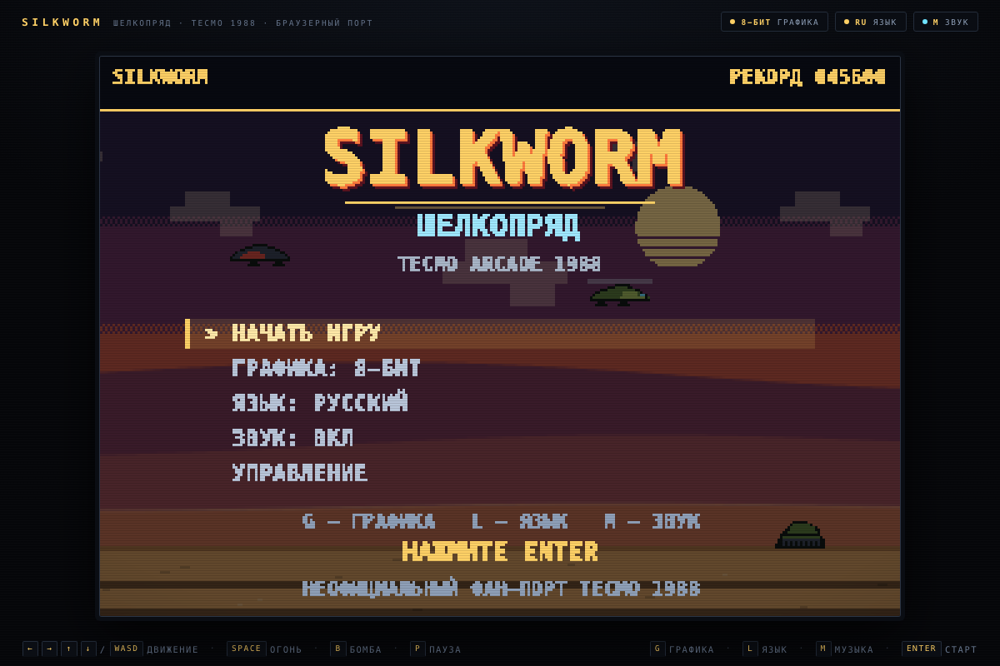

## Запуск

1. Откройте `index.html` двойным щелчком (или перетащите в окно браузера).
2. Нужна клавиатура; на телефоне — тач (палец ведёт вертолёт, огонь автоматический).
3. По умолчанию **русский** язык и **8-битная** графика — игра всегда открывается
   в ретро-режиме. `L` — язык, `G` — современная графика (на время сессии), `M` — звук.
   Язык, звук и рекорд запоминаются в `localStorage`.

## Управление

| Клавиши | Действие |
|---|---|
| `←` `→` `↑` `↓` / `WASD` | движение вертолёта |
| `Space` / `Z` | огонь (удерживайте) |
| `B` / `X` | бомба: сносит пули и бьёт всех врагов на экране |
| `P` / `Esc` | пауза |
| `G` | переключить графику: **8-бит ↔ современная** |
| `L` | переключить язык: **русский ↔ English** |
| `M` | звук вкл/выкл |
| `Enter` | старт, меню, подтверждение |
| `Esc` | из паузы/финала — в меню |

Тач: коснитесь экрана на титуле — игра начнётся. В игре ведите пальцем: вертолёт летит
за пальцем и стреляет сам. Пауза — тап по верхнему правому углу.

## Как играть

Четыре зоны: **Дюны → Морской патруль → Неоновый город → Цитадель**. В каждой зоне
нужно пролететь полосу препятствий, уничтожая танки, зенитки, «Гусей», реактивные
самолёты и грузовики, а в конце — завалить босса зоны. Боссы: Железный Гусь, Морской
Дьявол, Неоновый Хищник и Генерал Шелкопряд.

* **Жизни** — 3. Одно попадание (без щита) — потеря жизни; после респауна 2,4 секунды
  неуязвимости.
* **Оружие** — собирайте жёлтые капсулы `P`: уровень растёт с 1 до 4 (одиночный огонь →
  спаренный → тройной веер → плотный веер).
* **Щит** — голубая капсула `S` даёт щит (держит два попадания). В капсулу щита можно
  **выстрелить** — тогда она сносит всех врагов на экране (фирменная механика оригинала).
* **Бомбы** — красные `B`; запас бомб виден в HUD, бомба очищает экран от пуль.
* **1UP** — редкая капсула с дополнительной жизнью.
* **Зенитки** уязвимы только когда открыт купол; стреляйте в момент раскрытия.
* За зачистку зоны — бонус (1000 + 500 за каждый уровень оружия + 500 за жизнь).
* Рекорд хранится в `localStorage`.

## Два визуальных режима

| 8-бит (по умолчанию) | Современная графика |
|---|---|
| 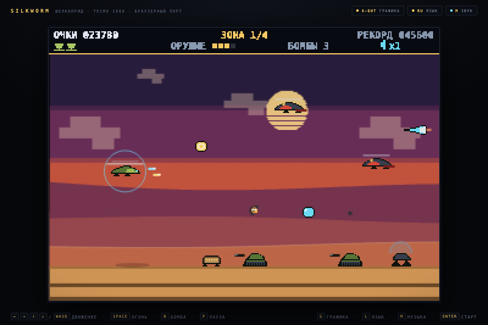 | 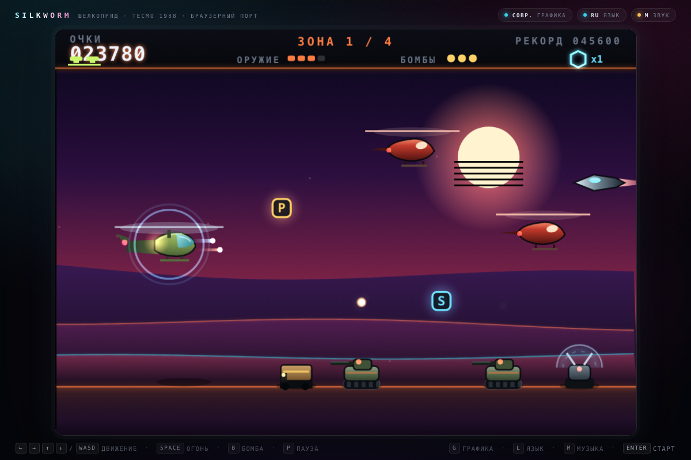 |

* **8-бит** — ограниченная палитра, пиксельные спрайты, дизеринг неба, «пиксельный»
  шрифт с кириллицей, CRT-текстура и лёгкие скан-линии (CSS-оверлей). Разрешение
  честное, масштабирование целым коэффициентом.
* **Современная** — синтвейв-неон: градиентное небо, светящееся солнце с полосами,
  параллакс, bloom-частицы, векторные спрайты с контурной подсветкой, стеклянные панели,
  неоновые отражения на земле. Отрисовка идёт в 2–5× разрешении.

Переключение — `G` на любом экране или пункт «ГРАФИКА» в меню. Оба режима полностью
играбельны, логика и уровни общие. **При каждом запуске игра стартует в 8-битном
режиме** — это дефолт; современная графика включается по `G` и живёт до перезагрузки.
Страница вокруг игры тоже перекрашивается под выбранный режим: плоский «аркадный»
интерфейс для 8-бит и неоновое стекло для современного.

| 8-бит: босс | Современная: город и босс |
|---|---|
| 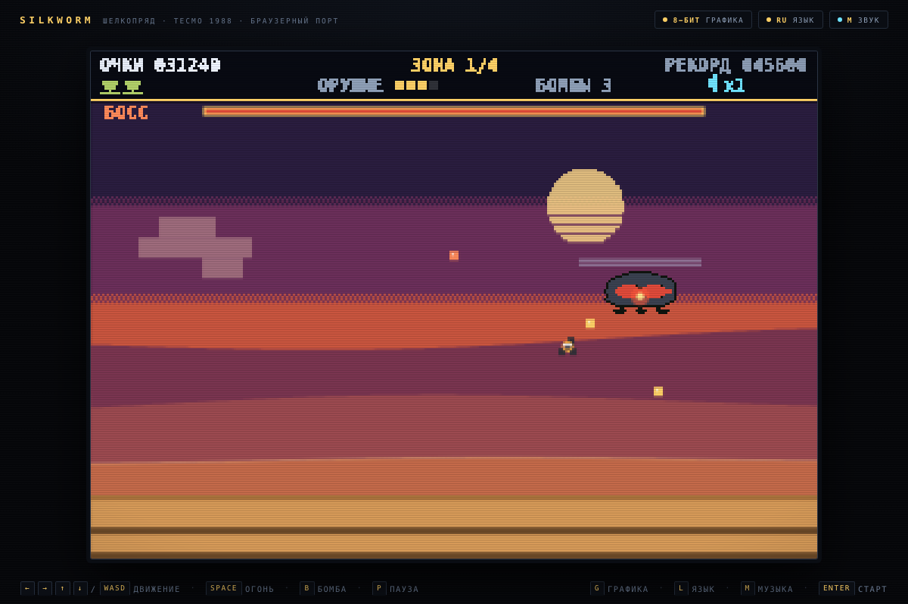 | 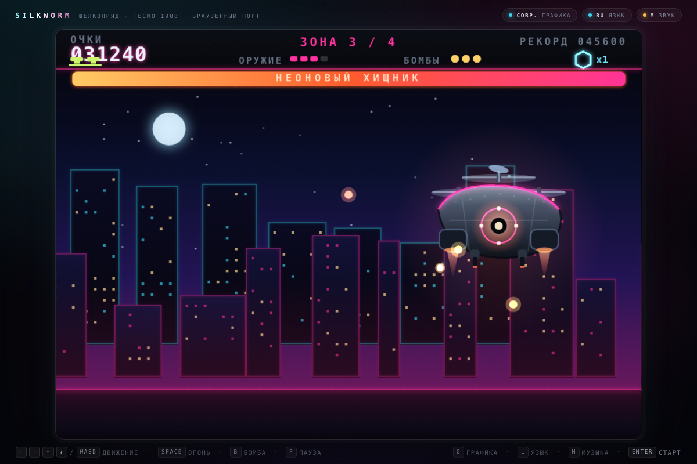 |

## Музыка и звук

Вся музыка — оригинальный процедурный чиптюн, написанный для этого порта (не тема
Barry Leitch из оригинальной игры). Движок на WebAudio: два пульс-канала (мелодия и
арпеджио), треугольный бас, шумовые барабаны, вибрато, дилей, компрессор и мягкий
лимитер. Пять треков: титул, зона, босс, зачистка зоны, game over; 12 звуковых эффектов
(выстрелы, взрывы, бонусы, смерть, предупреждение о боссе, бомба и т. д.). Всё
синтезируется на лету, аудиофайлов нет. `M` — вкл/выкл звук.

## Особенности порта

* Механика оригинала: вертолёт с передним огнём, зенитки со щитами, бонусы-капсулы,
  щит, который можно сбить и очистить экран, боссы в конце зоны, очки и рекорд.
* Четыре зоны с разными палитрами, фонами и наборами врагов; разрушаемое окружение
  заменено декоративными слоями.
* Русская и английская локализация всех экранов; переключение на лету.
* Два визуальных стиля, CRT-эффект для 8-битного режима, адаптивное масштабирование.
* Тач-управление, авто-пауза при уходе со вкладки, сохранение языка, звука и рекорда.
* Неофициальный фан-порт: ассеты оригинала не используются, весь код и графика — свои.

Отличия от аркады: здесь только одиночная игра (в оригинале был кооператив
«вертолёт + джип»), четыре зоны вместо полного набора, упрощённые бонусы и новая
музыка. Это осознанные отступления ради короткой сессии в браузере.

## Скриншоты

| | |
|---|---|
|  | 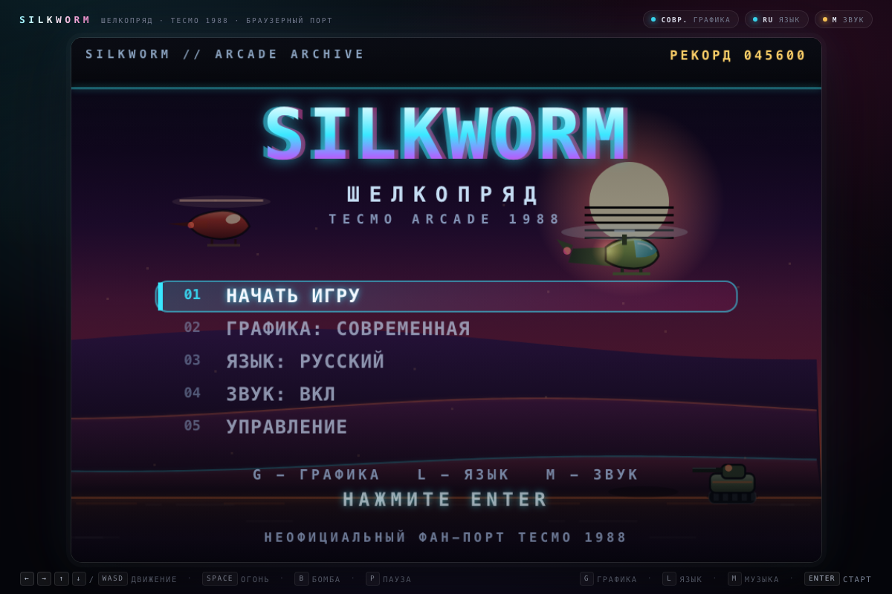 |
| 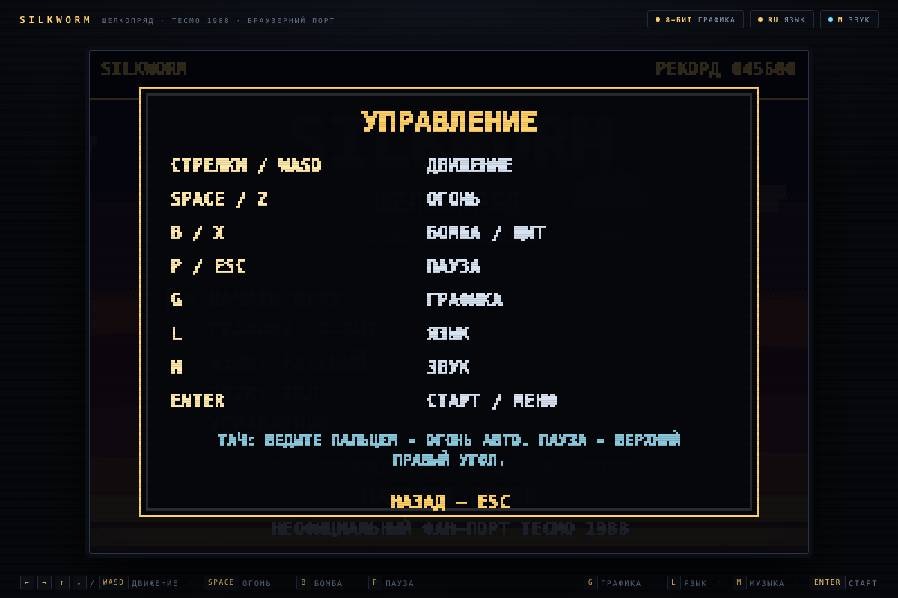 | 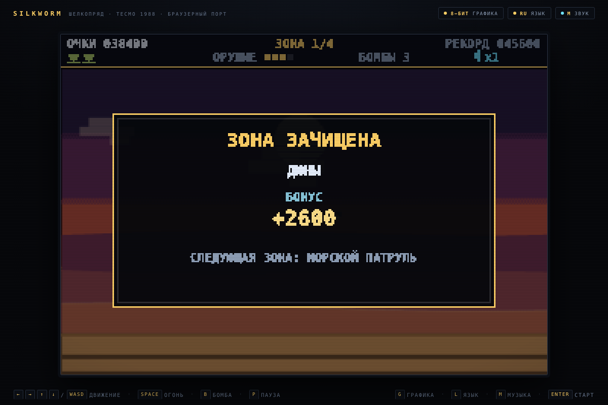 |
| 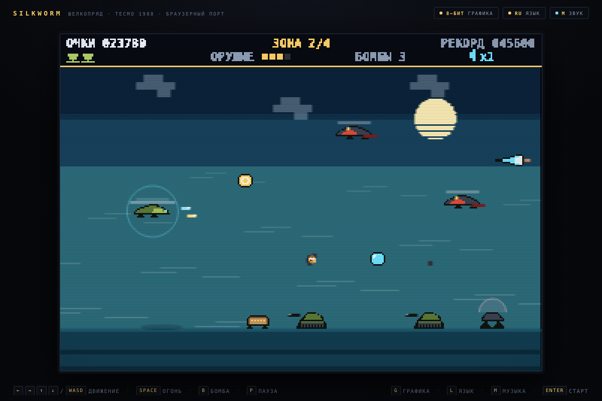 | 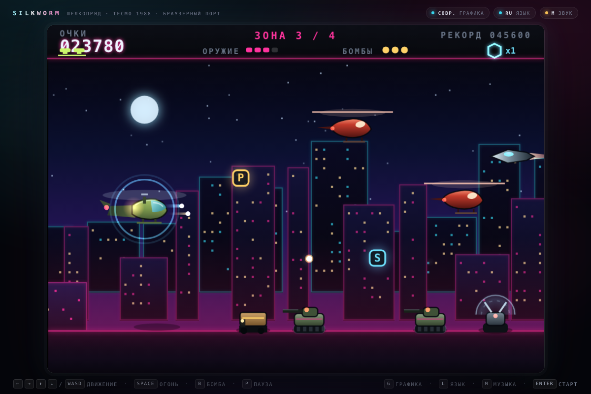 |
| 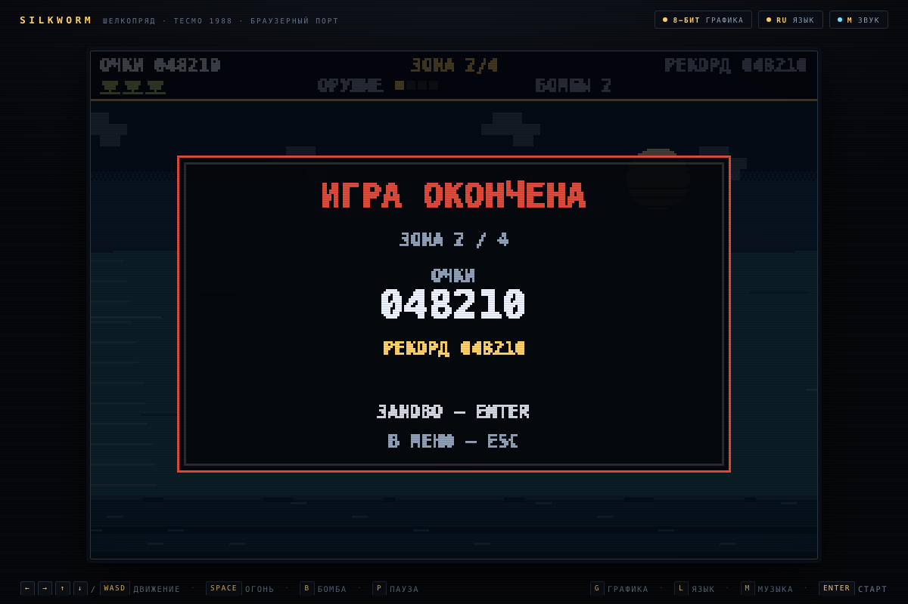 | 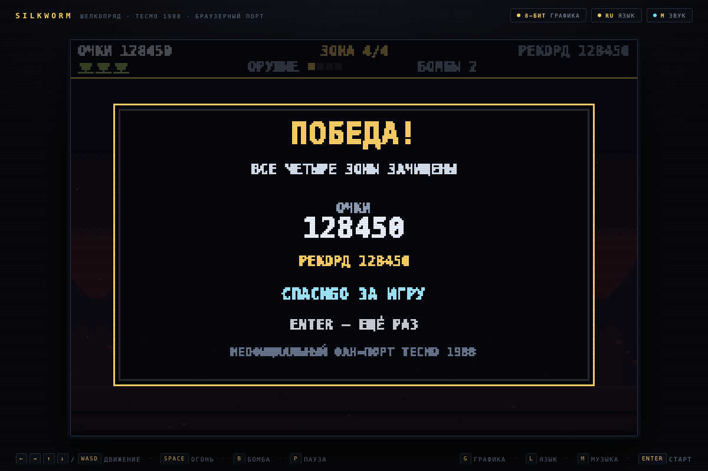 |

## Отладочные режимы

Добавляются к URL после `#` (например, `index.html#shot=boss&stage=3&gfx=modern`):

* `#test` — автотесты (35 проверок: локализация, коллизии, волны, оружие, бонусы, босс,
  аудиодвижок и его selftest, дефолтный ретро-режим). Результат — в заголовке вкладки и на странице.
* `#sim=600` — прогон полного забега без рендера; в конце печатается отчёт о смене
  зон, фаз и боссов.
* `#shot=title|controls|intro|play|boss|clear|pause|gameover|victory` — постановочный кадр.
* `#stage=1..4`, `#gfx=modern`, `#lang=en`, `#mute=1` — параметры кадра.
* `#shot=play&stage=2` — конкретная зона.

## Технические заметки

* `index.html` собирается из фрагментов: `src/shell.html` + `src/audio.js` + `src/game.js`.
  ```bash
  python3 tools/build.py          # собрать index.html
  python3 tools/build.py --check  # только проверки, без записи
  ```
  Сборщик проверяет маркеры, отсутствие `</script>` внутри кода и внешних ссылок.
* `src/game.js` — движок, логика, два рендерера, локализация, автотесты (~3,6 тыс. строк).
* `src/audio.js` — синтезатор и секвенсор (`window.SWAudio`), без зависимостей.
* `node tools/shots.mjs` — скриншоты всех экранов через headless Chrome (CDP).
  Полезные ключи: `--test`, `--sim=600`, `--audio`, `--viewport=390x844`,
  `--prefix=mobile-`, и фильтр по имени кадра: `node tools/shots.mjs title boss`.
* `screenshots/` — кадры для README; мобильные варианты — `mobile-*.png`, широкие — `wide-*.png`.

Ограничения: нет звука без первого действия пользователя (политика браузеров);
в Safari возможны отличия в сглаживании канваса; порт рассчитан на современные
Chrome/Firefox/Safari.

## Оригинал

**Silk Worm** (Tecmo, 1988) — аркадный горизонтальный скролл-шутер. Два игрока могли
играть одновременно: один управлял вертолётом с передним и нижним огнём, второй —
джипом с пулемётом. В игре были зенитки с открывающимися щитами, вертолёт-босс «Goose»,
бонусы-щиты (их можно было сбить, чтобы уничтожить всех врагов на экране) и ячейки
энергии, усиливающие огонь. Домашние порты вышли в 1989 году (Amiga, Atari ST, C64,
ZX Spectrum, Amstrad CPC; музыку для Amiga написал Barry Leitch), версия для NES —
в 1990-м. Игра вдохновила SWIV (1991).

* [Silk Worm (Wikipedia)](https://en.wikipedia.org/wiki/Silkworm_(video_game))
* [Arcade Archives: Silk Worm (HAMSTER)](https://www.arcadearchives.com/title/aca-293/)

Это неофициальный фан-порт, не связанный с Tecmo, HAMSTER или правообладателями.
Название и вселенная принадлежат их владельцам; код, графика и музыка порта написаны
с нуля в образовательных целях.
