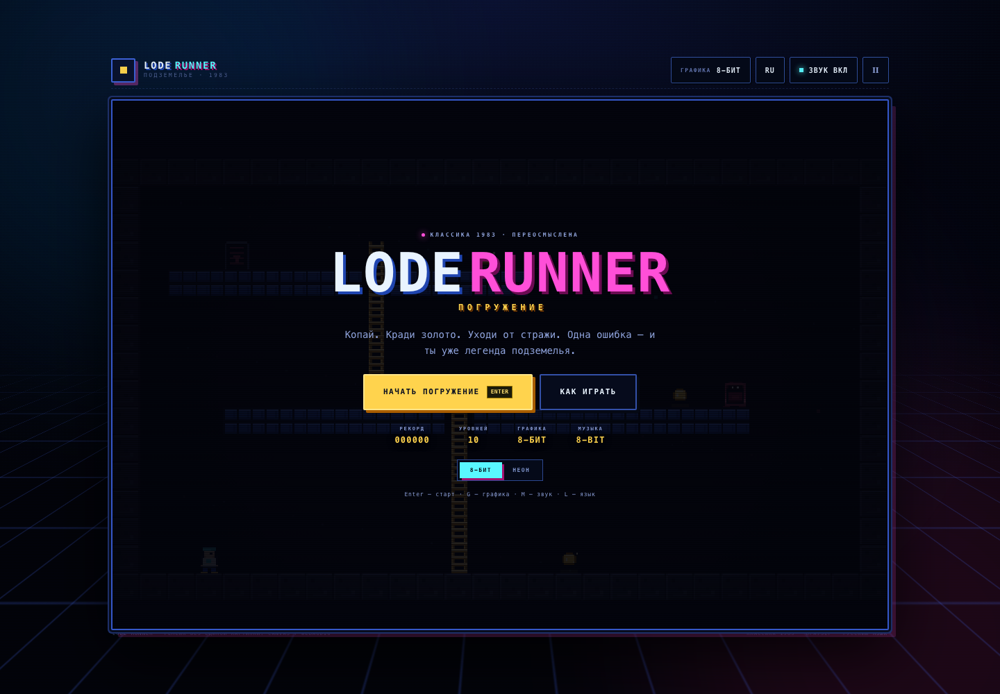
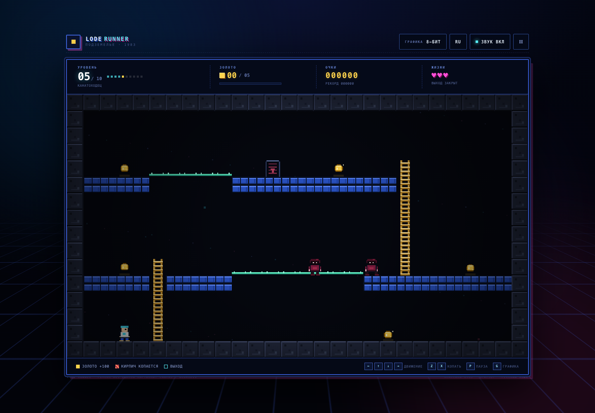
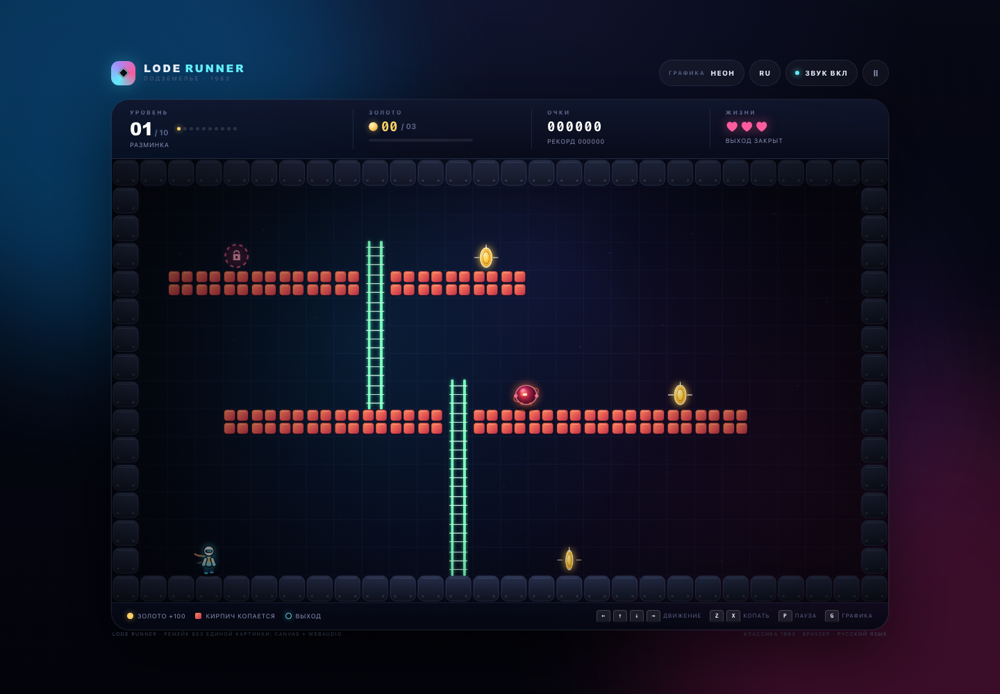
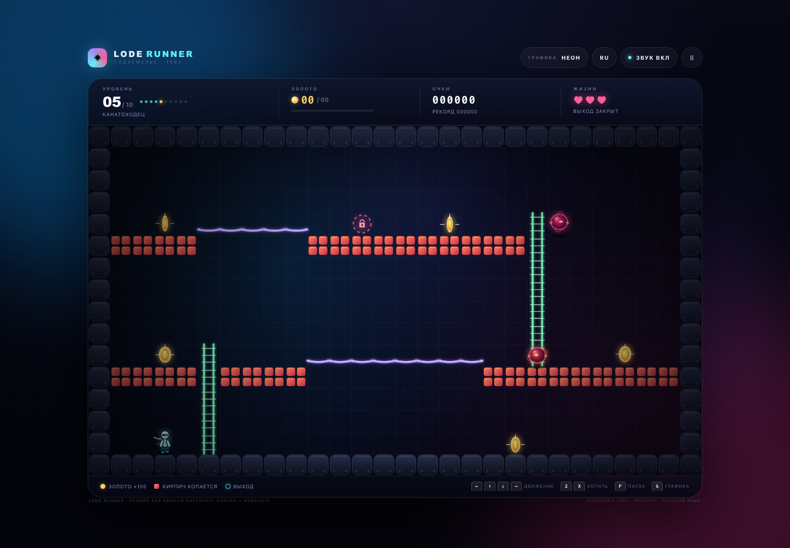
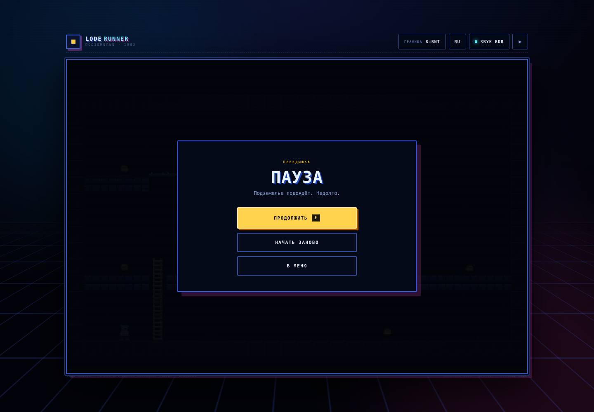
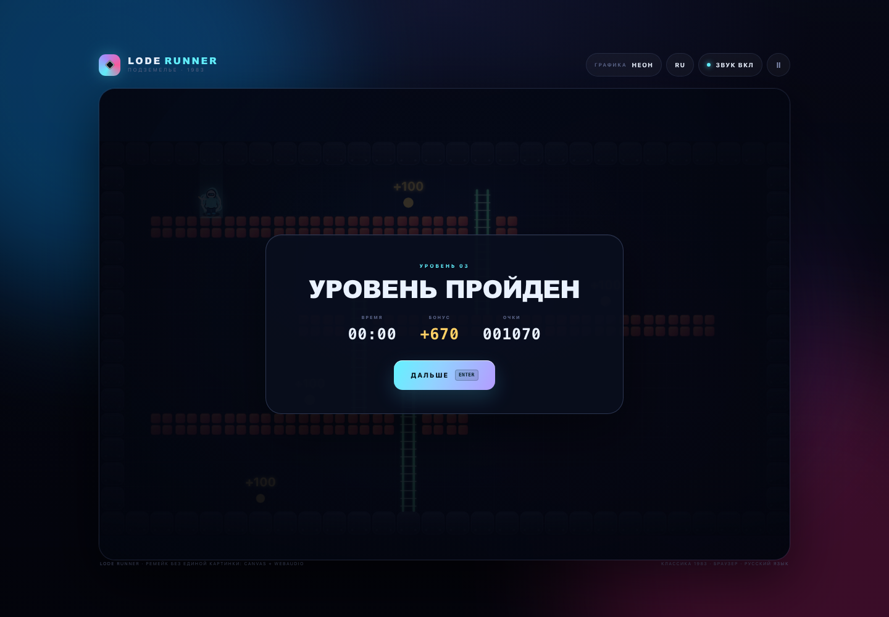
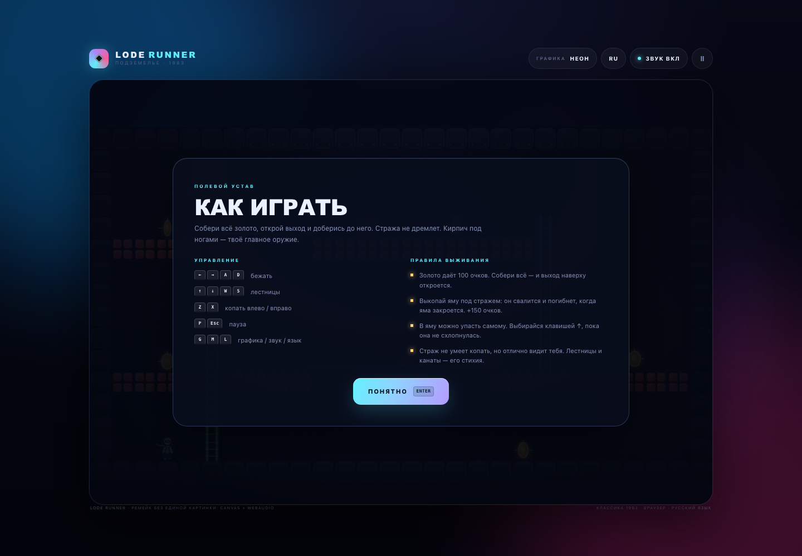
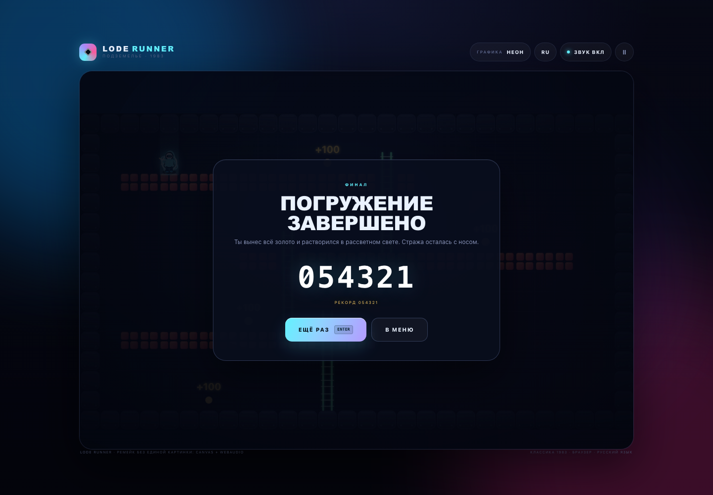
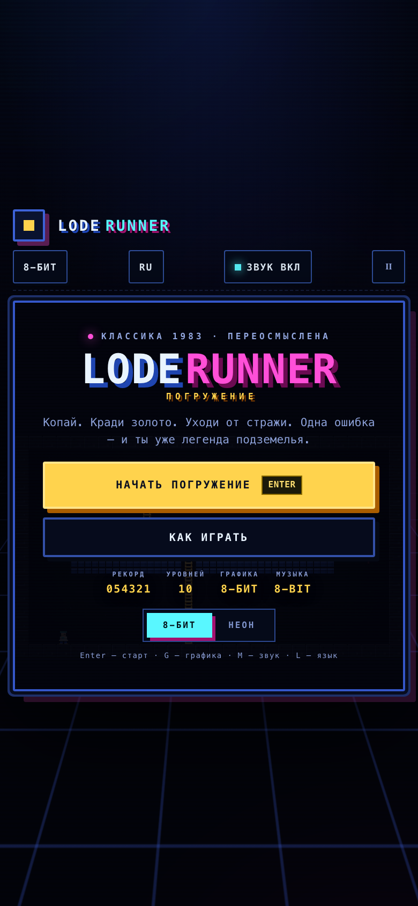

# СТАРАТЕЛЬ · Погружение

> **v2 (фреймворк Гефест Arcade).** Публичная версия — «Обвал в шахте» (валуны, големы, норма золота, выход).
> `index.html` — оболочка на движке `engine.js` (копия `_shared/engine.js`): меню/пауза (P/Esc)/темы/RU-EN (L)/
> звук (M)/рекорд `arcade.best.staratel`, музыка — `js/music.js`. Правила — `js/mine.js` (перенесены 1:1 из
> прежней страницы, она сохранена как `legacy.html`), retro — прежний пиксель-арт (`js/mine-retro.js`,
> спрайты `js/mine-sprites.js`, CC0), modern — векторный рендер `js/mine-modern.js`. DOM-HUD сверху сохранён
> и переключается вместе с темой и языком. Тесты: `node staratel/tests/engine.test.mjs`.
> Ниже — описание прежней Lode Runner-версии (лестницы/ямы-ловушки): она живёт в `classic-loderunner.html` (+ `js/game.js` и др.).

Браузерный ремейк аркады **СТАРАТЕЛЬ** (студия «Гефест», 1983) — один HTML-файл
(или папка из нескольких файлов), без сборки, интернета и внешних библиотек.
Вся графика, анимация и музыка генерируются кодом: **canvas + WebAudio**.



## Запуск

- **Двойной клик по `index.html`** — основной вариант (папка с css/js).
- **Двойной клик по `lode-runner.html`** — автономная сборка: один файл, внутри
  уже встроены стили и все скрипты. Удобно переслать одним файлом.
- Либо локальный сервер: `python3 -m http.server` из этой папки.

Нужны только клавиатура и браузер (Chrome / Safari / Firefox). На телефоне —
экранные кнопки. Интернет и npm не требуются.

## Что это

Классическая механика СТАРАТЕЛЬ:

- **золото**, **лестницы**, **канаты**, копаемый **кирпич** и монолитные стены;
- **ямы-ловушки**: копайте кирпич под стражем — он падает, а закрывающаяся яма его убивает;
- стража преследует игрока, лазает по лестницам и канатам, но не умеет копать;
- соберите **всё золото** — откроется выход; доберитесь до него, чтобы пройти уровень;
- 3 жизни, очки за золото и обезвреженных врагов, бонус за скорость, рекорд в `localStorage`.

**10 уровней** ручной работы: от «Разминки» без канатов до многоярусного «Последнего забоя»
с тремя стражами. Все уровни проверены BFS-валидатором на достижимость золота и выхода.

## Управление

| Клавиши | Действие |
|---|---|
| `←` `→` / `A` `D` | бежать |
| `↑` `↓` / `W` `S` | лестницы |
| `Z` / `X` (или `,` / `.`) | копать влево / вправо |
| `P` / `Esc` | пауза |
| `Enter` | старт, продолжить, дальше |
| `G` | переключить графику **8-БИТ ↔ НЕОН** |
| `M` | звук вкл/выкл |
| `L` | язык **RU / EN** |
| `↑` в яме | выбраться из вырытой ямы, пока она не закрылась |

На телефоне появляются D-pad и кнопки копания.

## Две графики

Переключаются на лету кнопкой в шапке, на титульном экране или клавишей `G`.
По умолчанию включён **8-БИТ** — как дань оригиналу.

| 8-БИТ (по умолчанию) | НЕОН |
|---|---|
|  |  |

- **НЕОН** — тёмный неоновый интерфейс, стеклянные панели, живые градиенты, свечение,
  векторные персонажи, частицы, ауры, сетка подземелья.
- **8-БИТ** — аутентичный пиксельный рендер 448×256 с nearest-neighbour апскейлом,
  CRT-сканлайны, квадратные панели, моноширинная типографика, жёсткие тени и палитра
  «синий кирпич / янтарная лестница / мятный канат / золото».


## Музыка и звук

- Оригинальный **8-битный саундтрек** на WebAudio: атмосферная тема меню (Dm, 78 BPM),
  два разных игровых лупа (A-moll 132 BPM и E-moll 140 BPM) — трек меняется по уровням.
- Синтез на лету: pulse/square lead, triangle bass, шумовые барабаны, арпеджио, эхо.
- SFX: золото, копание, ловушка, смерть, победа, открытие выхода, клики.
- Звук включается после первого касания/клика (политика автоплея браузеров),
  переключается клавишей `M`, состояние запоминается.

## Язык и сохранения

- Русский интерфейс по умолчанию, английский — клавишей `L` (включая названия и
  подсказки уровней; в `js/levels.js` есть поля `nameEn` / `hintEn`).
- В `localStorage` сохраняются: рекорд, выбранная тема, язык, состояние звука.
- Рекорд обновляется после уровней, game over и финала.

## Правила выживания

1. Золото = 100 очков. Соберите всё — откроется выход.
2. Выкопайте яму под стражем: он упадёт и погибнет, когда яма закроется. +150 очков.
3. В яму можно упасть самому. Жмите `↑`, чтобы выбраться, пока она не схлопнулась.
4. Страж не умеет копать, но отлично видит вас. Лестницы и канаты — его стихия.
5. Кирпич под золотом или выходом копать нельзя: опора не исчезнет.

## Скриншоты

| | |
|---|---|
|  |  |
|  |  |
|  |  |

## Структура

```
staratel/
├── index.html            # основная страница
├── lode-runner.html      # автономная сборка (всё внутри)
├── css/style.css         # дизайн-система, неон + 8-бит тема, адаптив
├── js/
│   ├── levels.js         # 10 уровней 28×16 + RU/EN названия и подсказки
│   ├── audio.js          # WebAudio-синтез, секвенсор, музыка, SFX
│   ├── game.js           # движок: движение, гравитация, копание, ямы, AI стражей
│   ├── render.js         # два рендерера: неон (вектор) и 8-бит (448×256)
│   ├── ui.js             # HUD, меню, оверлеи, i18n, ввод, настройки
│   └── main.js           # запуск, requestAnimationFrame, обработка ошибок
├── tools/
│   ├── validate-levels.mjs  # BFS-валидатор уровней (без зависимостей)
│   ├── build-single.mjs     # сборка автономного lode-runner.html
│   ├── qa.mjs               # браузерные приёмочные тесты через CDP
│   └── shots.mjs            # генерация скриншотов
├── screenshots/
└── CONTRACT.md           # контракты модулей (внутренняя документация)
```

## Проверки

```bash
node tools/validate-levels.mjs   # формат + достижимость 51/51 золота, 10/10 уровней
node --check js/game.js          # синтаксис
node tools/build-single.mjs      # пересобрать автономный файл
node tools/shots.mjs             # обновить скриншоты (нужен Chrome)
```

Дополнительно в браузере доступен объект `window.__LODE` (`game`, `renderer`, `ui`, `levels`)
для отладки и автотестов. `tools/qa.mjs` прогоняет через headless Chrome загрузку,
экраны, темы, звук, HUD, оверлеи и мобильную вёрстку.

## Технические детали

- Сетка **28 × 16**, шаг 100–125 мс, плавная интерполяция; враги используют BFS по
  графу «опорных» клеток с падениями, лестницами и канатами.
- Физика: гравитация, падение в ямы, закрытие ям, respawn стражей, неуязвимость при спавне.
- Canvas: 1792×1024 backing store; «неон» рисуется векторно, «8-бит» — в offscreen 448×256
  и апскейлится без сглаживания.
- Музыка: lookahead-планировщик на 25 мс, кроссфейды, плавные fade, лимитер.
- Никаких внешних шрифтов, изображений, CDN и сборщиков.

## Лицензия и благодарности

Это неофициальный фан-ремейк в учебных целях. Оригинальная **СТАРАТЕЛЬ** создана
Дугласом Э. Смитом (1983); права принадлежат правообладателям. В проекте не используются
оригинальные спрайты, уровни или музыка — вся графика и звук написаны с нуля.

Приятной охоты за золотом. Берегите кирпич.
